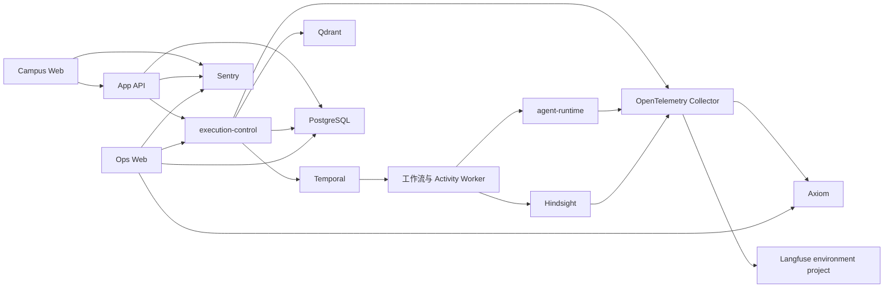

# 当前架构

## 文档边界

本文概述 `main` 已合并的系统拓扑和开放能力。字段、接口和实现以代码、schema、注册表、配置及
所有者测试为准；实际部署状态以环境仓选择和运行状态为准。

## 系统拓扑

- Campus Web 提供学生问答、账号、文档、地图、食堂和校园服务页面；
- App API 拥有浏览器认证、会话、产品 API、聊天接收和产品终态；
- execution-control 与 Temporal 拥有持久执行、内部查询、工具调用和有界运行投影；
- agent-runtime 在单个 Agent Activity 中运行 Primary Agent、Knowledge Agent 与工具循环；
- Ops Web 是独立受保护的运行排查和内容运营应用，不通过 App API 代理内部能力。

## 在线回答

浏览器提交的聊天请求由 App API 保存并创建持久运行。Temporal 以少量稳定阶段包裹一次完整
Agents SDK 运行；浏览器断线后仍读取同一个运行和产品终态。SDK 内部 handoff、函数工具与检索
不会展开成另一张 Temporal 工作流图。

当前工具开放注册表为 `configs/runtime/tools.v5.json`：

| 名称 | 暴露范围 | 用途 |
| --- | --- | --- |
| `transport_schedule_lookup` | 模型可见 | 查询已发布班车时刻表 |
| `knowledge_query` | 模型可见 | 从 Primary Agent 进入 Knowledge Agent |
| `knowledge_search` | 仅内部 | Knowledge Agent 查询一个已准入知识目标 |

当前查询目标注册表只开放：

- `student_rules`
- `institutional_rules`
- `curriculum`

通知和校历不在查询目标注册表中，在线回答也不执行实时网页搜索。配置、schema、采集产物或
页面存在不表示能力已经向模型开放。

## 产品与离线数据

文档阅读器、校园地图、Dining 和班车状态分别消费已经发布的产品读取模型。班车同时向状态页面
和模型工具提供同一发布版本的不同读取形态；Dining 当前不提供模型工具。

注册的离线任务由 ingestion-control、Temporal 和 Rust 内核执行。内部门户文件发布使用独立
workflow 调用 source-collector，通知则由 source-collector 本地命令直接写入来源对象；两者都
不是注册任务。PostgreSQL 只保存有界任务状态，通知同步边界保存在 source bucket；采集完成
不会自动创建索引、发布阅读器或开放查询目标。

## 观测与部署

PostgreSQL 保存产品和执行投影，Temporal 保存工作流历史，Hindsight 保存个人记忆，Qdrant 保存
机构知识索引。每个环境使用一个 Langfuse project 保存受信任模型调用与评测；Collector 通过
分权入口把通用信号发送到 Axiom，把 Agent、Hindsight 和受控编排 trace 发送到该 project；
Sentry 保存 browser/edge SDK 允许的错误和性能信号。这些系统通过稳定请求和运行标识关联，不
互相改写产品状态。

Campus Web 与 App API 运行在 Cloudflare Workers；自托管服务和依赖由 Kubernetes/GitOps 管理。
源码仓只产出候选版本和环境无关配置，不能据此断言某个环境已经部署。

## 所有者入口

- [跨系统流程](./flows.md)
- [产品运行时](./system/product-runtime.md)
- [持久执行](./system/durable-runtime.md)
- [Agent 框架](./system/agent-framework.md)
- [工具与检索](./system/tool-routing.md)
- [采集数据面](./system/data-plane.md)
- [可观测性](./system/ops-observability.md)
- [领域架构](./domains/README.md)
