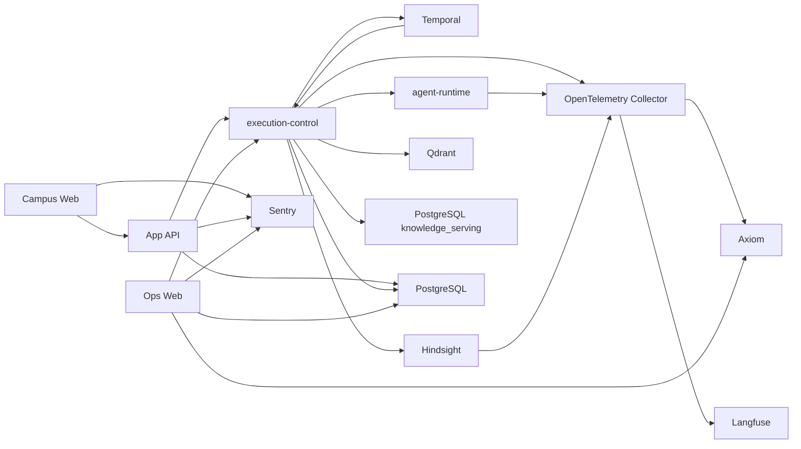

# 当前架构

## 文档边界

本文概述源码主干中的系统拓扑和开放能力。字段、接口和实现以代码、schema、注册表、配置及
所有者测试为准；实际部署状态以环境仓选择和运行状态为准。

## 系统拓扑



- Campus Web 提供学生问答和其他产品页面；
- App API 拥有浏览器认证、会话、聊天接收和产品终态；
- execution-control 拥有持久执行、知识准入、grounding、工具调用和安全投影；Temporal 只提供
  工作流历史、任务调度、定时器和 Activity 投递；
- agent-runtime 在一个 Primary Agent SDK run 中生成唯一最终答案；
- Ops Web 是独立受保护的运行排查和内容运营应用，不通过 App API 代理内部能力。

## 在线回答

浏览器提交请求后，App API 冻结执行输入并创建持久运行。`ToolExecutionWorkflow` 先按冻结的本地
grounding plan 选择路径：

```text
none: ExecutePrimaryAgentActivity
selected scopes: PrepareGroundingContextActivity
-> ExecutePrimaryAgentActivity
-> WriteFinalizationActivity
-> AppendConversationMemoryActivity
```

execution-control 仅在选中范围时读取本轮冻结的文档范围和检索 Provider Config，执行一次查询向量化，
并发查询选中范围的不可变 Qdrant collection，再使用 Qdrant RRF 分数合并、去重和裁剪。完整
`grounding_context.v2` 只写入受保护载荷；Temporal history、普通运行投影和产品响应只携带引用、
摘要、计数和 hash。`none` 路径建立 `not_required` context，不执行检索。Primary Agent 必须消费本轮
context，只能引用其中出现的 `evidence://` 标识，并只生成一次最终答案。

当前文档范围为 `student_rules`、`institutional_rules` 和 `curriculum`。培养方案、规章和普通正式
文档共用同一文档 RAG，不再作为课程事实、文档召回或章节读取模型工具。范围准入只接受
PostgreSQL `current_releases` 指向的 release 及其不可变 Qdrant collection；在线回答不查询历史
release，也不跟随 Qdrant alias。

当前工具注册表只包含：

| 名称 | 暴露范围 | 用途 |
| --- | --- | --- |
| `personal_memory_recall` | 按本轮授权开放 | 有界读取当前用户的个人记忆 |
| `transport_schedule_lookup` | 关闭 | 班车时刻表内部读取合同 |

未获个人记忆召回授权的运行没有模型可见工具；获授权的运行最多调用一次
`personal_memory_recall`。知识 grounding 不是模型工具，也不进入工具轨迹。

## 离线知识数据

离线采集由 ingestion-control、Temporal、source-collector 和 Rust 内核执行。规范文档单元通过
`build-retrieval-chunks-v2` 生成确定性的 `retrieval_chunk_set.v2`；分块不跨章节，使用本地
tokenizer 计算精确 token 数，并校验内容摘要。

源码保留 `knowledge-serving-release.v1`、查询范围注册表和 execution-control 的 release/Qdrant
消费接口，但当前没有正式索引生产者，也没有可供准入的发布数据。因此文档 grounding 当前不可用；
采集完成、schema 存在或 collection 已构建都不会单独开放在线范围。

通知和校历不在查询目标注册表中，在线回答也不执行实时网页搜索。配置、schema、采集产物或
页面存在不表示能力已经向模型开放。

## 产品与离线数据

文档阅读器、校园地图、Dining 和班车状态分别消费已经发布的产品读取模型。班车的内部工具读取
合同仍保留但未向模型开放；Dining 当前也不提供模型工具。

注册的离线任务由 ingestion-control、Temporal 和 Rust 内核执行。内部门户文件发布使用独立
workflow 调用 source-collector，通知则由 source-collector 本地命令直接写入来源对象；两者都
不是注册任务。PostgreSQL 只保存有界任务状态，通知同步边界保存在 source bucket；采集完成
不会自动创建索引、发布阅读器或开放查询目标。

## 观测与部署

单套 CNPG PostgreSQL 集群以独立 database、schema 和登录角色保存产品、执行投影、Temporal、
Hindsight、知识 release 和激活指针；App API 通过一个关闭 query cache 的 Hyperdrive binding 访问
其产品数据。Temporal 保存工作流历史，Hindsight
保存个人记忆，Qdrant 保存在线检索索引。每个环境使用自己的 Langfuse project 保存受信任模型
调用与评测；Collector 将通用信号发送到 Axiom，将 Agent、Hindsight 和受控编排 trace 发送到
Langfuse；Sentry 保存浏览器和边缘运行时允许的错误与性能信号。

Campus Web 与 App API 运行在 Cloudflare Workers；自托管服务和依赖由 Kubernetes/GitOps 管理。
execution-control 使用一个标准 Deployment 同时运行 HTTP 接口和三类 Temporal poller，agent-runtime
独立部署；采集 API 与两个 worker 分别部署。一个 OpenTelemetry Collector DaemonSet 完成节点采集、
受控入口和下游路由。源码仓只产出候选版本和环境无关配置，不能据此断言某个环境已经部署。

## 所有者入口

- [跨系统流程](./flows.md)
- [产品运行时](./system/product-runtime.md)
- [持久执行](./system/durable-runtime.md)
- [Agent 框架](./system/agent-framework.md)
- [Agent 知识读取](./system/agentic-retrieval.md)
- [检索服务](./system/retrieval-serving.md)
- [工具路由](./system/tool-routing.md)
- [采集数据面](./system/data-plane.md)
