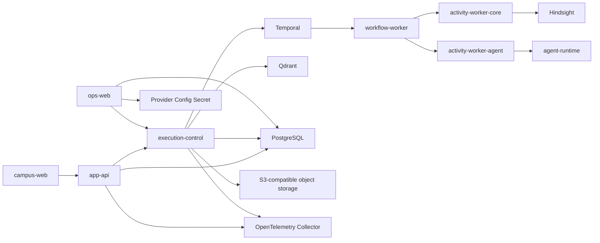

# 当前架构

## 文档边界

本文概述 `main` 已合并的系统拓扑和开放能力。具体字段、数据结构和实现细节以代码、schema、
注册表、配置及所有者测试为准；实际部署状态以环境仓 revision 和运行状态为准。

本文不保存：

- app、job 或 package 完整目录；
- 分支进度、待办、优先级或发布验收结果；
- HTTP 字段、数据库表或工具 schema；
- 目标架构和未来能力。

## 产品与执行拓扑



当前边界：

- `campus-web` 提供学生问答、账号、文档、地图、食堂和校园状态页面；
- `app-api` 拥有用户身份、会话、聊天持久化、产品 API 和请求终结；
- `ops-web` 是唯一自托管运维产品，不通过 app-api 代理数据库和 Temporal 状态；运行诊断默认
  只读，人员可以替换固定内部门户 TGC、管理食堂内容，并管理、验证和发布模型服务配置；
- `execution-control` 拥有内部执行准入、Temporal 命令、受控查询和执行投影；
- `agent-runtime` 在一个 Agent Activity 中完成 OpenAI Agents SDK agent/tool loop；
- 浏览器不直连 execution-control、Temporal、Hindsight、Qdrant 或 PostgreSQL。

## 在线问答

当前持久执行固定为四个阶段：

```text
Memory Recall
-> Agent Activity
-> Finalization
-> Memory Append
```

- Temporal 保存 workflow history、task queue、retry、timeout、heartbeat 和 cancellation；
- workflow worker 只运行确定性编排；
- core activity worker 执行 memory 和 finalization；
- agent activity worker 调用一次 `apps/agent-runtime`；
- SDK 内部的 function call、handoff 和检索不会展开成额外 Temporal activity；
- PostgreSQL `runtime.agent_*` 保存产品、运维和评测需要的受控投影，不是执行队列或
  Temporal history 副本；
- app-api 通过持久 run event 完成流式响应和断线续传，HTTP 连接不拥有执行生命周期。

完整语义见 `system/durable-runtime.md` 和 `../contracts/app-api/request-lifecycle.md`。

## 当前 Agent 与工具

`configs/runtime/tools.v5.json` 是当前工具开放注册表：

| 名称 | 暴露范围 | 当前用途 |
| --- | --- | --- |
| `transport_schedule_lookup` | model-visible | 查询班车时刻表共享读模型 |
| `knowledge_query` | model-visible handoff | 从 Primary Agent 进入 Knowledge Agent |
| `knowledge_search` | internal-only | Knowledge Agent 查询一个已准入知识目标 |

Primary Agent 可以直接回答、澄清、拒绝、调用班车工具或 handoff 到 Knowledge Agent。
execution-control 提供已准入工具集合，但不在 SDK 前建立文本分类器或平行 planner。

`configs/runtime/query-serving-targets.v1.json` 当前只开放：

- `student_rules`
- `institutional_rules`
- `curriculum`

`official_web` 不在注册表中，因此不是在线查询目标，也没有 live web-search fallback。
配置、schema 或来源文档存在不等于工具或知识目标已经开放。

## 数据与记忆

- app-api PostgreSQL schema 保存账号、会话、聊天、产品状态和产品级投影；
- execution-control PostgreSQL schema 保存 durable run/event/step/attempt/result 投影；
- Hindsight 保存个人记忆的提取、合并、检索和图结构，execution-control 只消费有界结果；
- Qdrant 只承载机构知识检索，不保存个人记忆；
- 对象存储保存 digest-pinned ingestion request、source artifact 和 result manifest；
- Langfuse 保存受信任的模型 trace、dataset、score 和评测工作流；
- OpenTelemetry Collector 接收受控 trace、log 和 metric，并按环境配置转发。

各系统通过 `request_id`、`run_id`、`trace_id` 和 `conversation_id` 关联，不维护第二套
operator request projector。

## 离线采集

```text
带摘要固定的请求
-> ingestion-control 准入
-> Temporal 采集 workflow
-> source-collector 或 Rust 内核 activity
-> 带摘要固定的结果 manifest
-> 有界 PostgreSQL 投影
```

在线问答不执行采集、OCR、chunk、index 或 publish。完成 ingestion task 也不会自动开放
query-serving target；知识发布仍需要 canonical document、chunk/index、release 和注册表准入。

详细边界见 `system/data-plane.md`。

## 校园服务

`campus_services.*` 是状态页面和确定性工具共享的 PostgreSQL 读模型。publisher 写入一次，
app-api 状态 API 与 execution-control 内部工具分别读取；状态页不调用工具，工具也不通过
app-api。

当前唯一 model-visible campus service 是班车时刻表。领域行为见 `../domains/transport.md`。

## 食堂

`jobs/dining-sync` 把飞书目录和评价写入独立 `dining.*` schema，`apps/ops-web` 使用专用角色完成
草稿校正、校验、发布、回滚和评价治理。app-api 只读取当前 publication、release 和公开评价；
Campus Web 使用代码版本内的 floorplan manifest 渲染地图，不从 API 接收 SVG URL、摘要或坐标。

领域所有权、地图发布和同步流程见 `domains/dining/architecture.md`。

## 部署边界

- campus-web 和 app-api 是 Cloudflare Worker 应用；
- execution-control、Temporal workers、ops-web 及自托管依赖由 Kubernetes/GitOps 管理；
- source repo 提供镜像、Worker 候选版本和 namespace-neutral base；
- 环境仓选择不可变版本、流量、Secret、namespace 和平台配置；
- Docker Compose 只用于本地诊断，不证明 staging 或 production 状态。

源码中存在部署清单不代表服务已经上线。判断实际环境必须查看环境仓 revision、Argo/Kubernetes
状态、Cloudflare version/traffic 和服务探针。

## 已退役边界

- Python `apps/supervisor-agent-worker` 和 `apps/ingestion-worker` 不属于当前运行路径；
- ChatKit 不再是问答入口依赖；
- 不存在 bootstrap mega-agent、隐藏 fallback router 或按 specialist 拆分的 worker graph；
- `runtime.request_execution`、projection outbox 和 operator request projector 已退役；
- 在线知识查询不回退到 provider web search 或现场采集。

## 所有者入口

- 产品运行时：`system/product-runtime.md`
- 持久执行：`system/durable-runtime.md`
- Agent SDK：`system/agent-framework.md`
- 工具路由：`system/tool-routing.md`
- 检索：`system/retrieval-serving.md`
- 个人记忆：`system/memory-plane.md`
- 采集数据面：`system/data-plane.md`
- 食堂：`domains/dining/architecture.md`
- 可观测性：`system/ops-observability.md`
- Kubernetes：`system/k8s-runtime.md`
- 代码组织：`system/code-organization.md`
