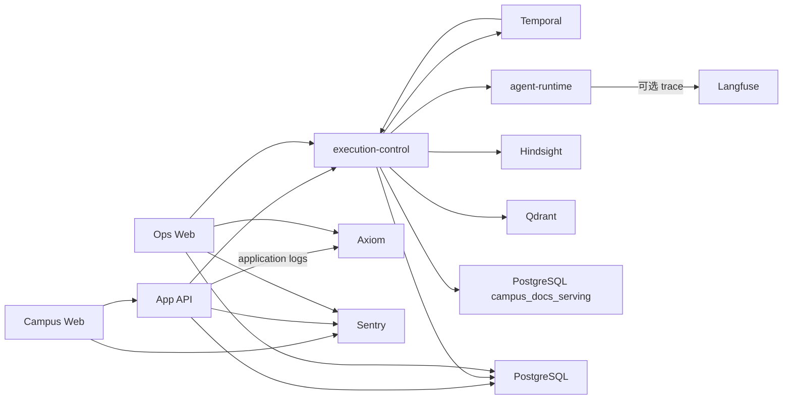

# 当前架构

## 文档边界

本文概述源码主干中的系统拓扑和开放能力。字段、接口和实现以代码、schema、注册表、配置及
所有者测试为准；实际部署状态以环境仓选择和运行状态为准。

## 系统拓扑



- Campus Web 提供学生问答和其他产品页面；
- App API 拥有浏览器认证、会话、聊天接收和产品终态；
- execution-control 拥有持久执行、Campus Docs 检索准入、工具调用和安全投影；Temporal 只提供
  工作流历史、任务调度、定时器和 Activity 投递；
- agent-runtime 在一个 Primary Agent SDK run 中生成唯一最终答案；
- Ops Web 是独立受保护的运行排查和内容运营应用，不通过 App API 代理内部能力。

## 在线回答

浏览器提交请求后，App API 冻结执行输入并创建持久运行。execution-control 为每个有效请求冻结
Campus Docs 当前索引、查询摘要和 Embedding 设置：

```text
RetrieveCampusDocsEvidenceActivity
-> ExecutePrimaryAgentActivity
-> WriteFinalizationActivity
-> AppendConversationMemoryActivity
```

execution-control 读取并冻结 PostgreSQL 当前索引和 embedding Provider Config，对当前问题生成一次
dense 与 sparse query vector，再查询唯一不可变 Qdrant collection，按 Qdrant 查询分数
排序、chunk 去重和 Unicode 字符预算单次裁剪。workflow 把最小 `campus_docs_evidence` 传给 Agent Runtime，
并把原检索结果独立传给 Finalization；Agent result 不回传检索副本。普通运行投影和产品响应只携带
引用、摘要、计数和 hash。空与非空 evidence 分别表示没有选出依据和存在可引用依据，不维护额外
mode/status。普通任务可以不引用文档直接回答；机构事实主张只能引用本轮 evidence 中的
`evidence://`。Primary Agent 只生成一次最终答案。

培养方案、规章和其他 Campus Web 当前文档共用同一个 `campus_docs` 索引，不再作为课程事实、文档
召回或章节读取模型工具，也不按文档范围拆 collection。准入只接受 PostgreSQL
`campus_docs_serving.current_index` 指向的不可变索引；在线回答不查询历史版本，也不跟随 Qdrant alias。

当前工具注册表只包含：

| 名称 | 暴露范围 | 用途 |
| --- | --- | --- |
| `personal_memory_recall` | 按本轮授权开放 | 有界读取当前用户的个人记忆 |

未获个人记忆召回授权的运行没有模型可见工具；获授权的运行最多调用一次
`personal_memory_recall`。Campus Docs 检索不是模型工具，也不进入工具轨迹。

## 离线知识数据

Campus Web 文档整理流程生成规范化 `campus-docs/source.json` 及其引用的
`campus_docs_reader.v3`。文档站与检索 publisher 共享这些已清洗输入，但各自生成静态站点产物和
不可变 Qdrant 索引。publisher 只选择每份文档的当前 reader，按代码内唯一索引定义生成
section/chunk 和 dense/sparse 向量，验证新 collection 后原子替换 PostgreSQL 当前索引绑定；它不
消费旧 canonical chunk 任务。`embedding_space_id`、provider、model 和 dimensions 全部兼容时，
publisher 按检索文本摘要复用当前 collection 的 dense vector，只对未命中的唯一检索文本调用
embedding provider；payload 和 sparse vector 始终完整重建。

源码提供可运行的 `jobs/campus-docs-index-publisher`，但源码、schema 或任务存在不表示任一环境已经
激活索引。Kubernetes 清单提供保持暂停的手动 Job 模板，不运行定时索引任务。通知和校历不进入该
publisher，在线回答也不执行实时网页搜索。

## 产品与离线数据

文档阅读器消费构建时固定的内容寻址静态 release；校园地图和 Dining 分别消费所属产品数据。
Dining 当前也不提供模型工具。

注册的离线任务由 ingestion-control、Temporal 和 Rust 内核执行。内部门户文件发布使用独立
workflow 调用 source-collector；通知则由本地 source-collector 命令采集，经人工确认领域后由
`notice-publisher` 显式物化。文件发布与通知采集都不是注册任务；通知没有自动分类、自动发布或集群
定时采集。App API 和 Campus Web 只读规范化通知，App API 不代理附件字节，Agent 结构化查询与通知
RAG 也未接入。采集或通知发布不会自动创建 reader、生成 Campus Docs 索引或替换当前绑定。完整边界见
`docs/architecture/domains/notices.md`，源码中的读取路径不表示任一环境已经完成通知写入或部署。

Ops Web 在所属 PostgreSQL schema 保存多条内部门户 TGC，提供真实 CAS 验证、轮换、按需明文读取
和定时检查。source-collector 不读取这些记录或自动选择运行凭据；本地采集由开发者显式传入从
Ops Web 取得的目标值。

## 观测与部署

单套 CNPG PostgreSQL 集群以独立 database、schema 和登录角色保存产品、执行投影、Temporal、
Hindsight 和 Campus Docs 当前索引绑定；App API 通过一个关闭 query cache 的 Hyperdrive binding 访问
其产品数据。Temporal 保存工作流历史，Hindsight 保存个人记忆，Qdrant 保存在线检索索引。local、
staging 和 production 共用 Langfuse Cloud Japan 区域中的 `campus-agent` project，并通过原生
`environment` 字段区分；Agent Runtime 可以按环境选择发送受控 trace，配额停收不影响产品执行。
Axiom 保存 Cloudflare destination 接收的有界 application logs；Sentry 保存浏览器和边缘运行时
允许的错误，以及生产 browser 的采样性能信号。execution-control 和 Hindsight 不发送仓库自有 OTel 信号。

Campus Web 与 App API 运行在 Cloudflare Workers；自托管服务和依赖由 Kubernetes/GitOps 管理。
execution-control 使用一个标准 Deployment 同时运行 HTTP 接口和三类 Temporal poller，agent-runtime
独立部署；采集 API 与两个 worker 分别部署。源码仓只提供本地单 receiver Agent trace Collector
配置；环境是否选择等价出口由环境仓决定。源码仓只产出候选版本和环境无关配置，不能据此断言
某个环境已经部署。

## 所有者入口

- [跨系统流程](./flows.md)
- [产品运行时](./system/product-runtime.md)
- [持久执行](./system/durable-runtime.md)
- [Agent 框架](./system/agent-framework.md)
- [Agent 知识读取](./system/agentic-retrieval.md)
- [检索服务](./system/retrieval-serving.md)
- [工具路由](./system/tool-routing.md)
- [采集数据面](./system/data-plane.md)
