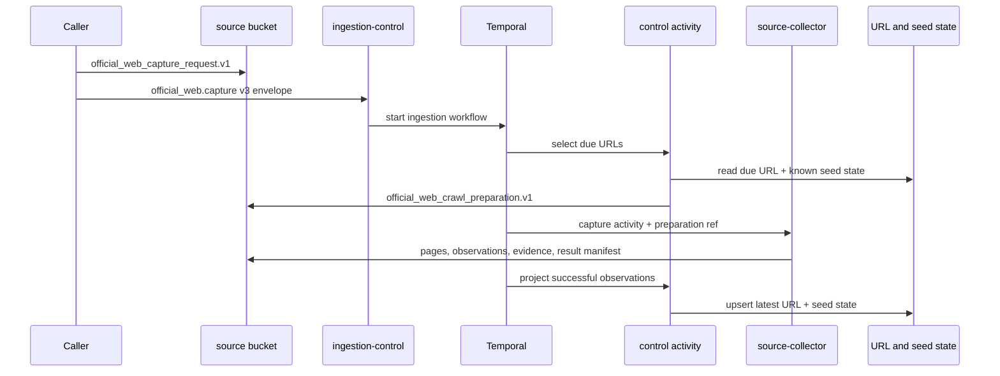

# Official Web

## Current Scope

Official web is an offline source-capture capability. It discovers and captures
allowlisted public university pages, preserves source evidence in object
storage, and projects latest URL freshness for later crawls.

It is not an online search provider, a notice service, a release system, or a
query-serving RAG target.

## Flow

Every run receives a bounded preparation manifest containing due URLs, prior
validators/hashes, cadence, priority, and configured seed URLs already
represented in seed state. The collector adds only configured seeds that have
never been observed. First runs and newly configured seeds therefore share one
bootstrap rule, while known seeds with no due canonical URL are not recrawled.
The manifest is digest-pinned; the collector cannot expand it into a separate
control-plane lifecycle.

## Ownership

- `configs/sources/official_web/<site>`: allowed hosts, seeds, crawl/extraction
  policy, and source metadata.
- `apps/source-collector/adapters/official-web`: Crawlee discovery, fetch,
  rendering, extraction, quality checks, and source artifact writes.
- `apps/ingestion-control`: admission, Temporal workflow, preparation,
  completion, and URL freshness projection.
- Temporal: retry, timeout, heartbeat, cancellation, and workflow history.
- object storage: request, preparation, source pages, observations, and result
  manifests.
- PostgreSQL: latest URL freshness and configured-seed identity only.

App-api owns none of this lifecycle. There are no app-api official-web routes,
tables, collector principals, release gates, target jobs, or run projections.

## Capture Rules

- Only configured hosts and policies are admitted.
- Robots and sitemap behavior are explicit site configuration.
- Listing/navigation pages may discover URLs; retained source evidence is based
  on extracted page content and policy.
- Conditional request validators and content hashes avoid unnecessary writes.
- HTTP failures, deleted pages, and not-modified results are observations, not
  implicit success or publication decisions.
- `official_web_page_manifest.v2` and canonical content blocks contain only
  stable page truth. Headers, redirect chain, fetch time, discovery path,
  policy evaluation and target/consumer planning remain run observations.
- `official_web_source_truth_bundle.v2` pins each page manifest, content block,
  provider extraction, discovered-link and response-HTML ref by digest and
  byte size.
- A retry may write only its own
  `runs/<run-id>/attempts/<activity-attempt>/...` observations; it must produce
  byte-identical canonical source truth for unchanged content.
- Activity progress is a Temporal heartbeat. Per-page evidence stays in object
  storage.
- Temporal cancellation stops Crawlee/provider work and prevents subsequent
  artifact or result-manifest writes.

## Freshness Projection

`ingestion_control.official_web_url_freshness` is keyed by site and normalized
canonical URL. It stores bounded fetch disposition, validators/hashes, title,
page family, discovery source, timestamps, cadence, priority, and next eligible
fetch time. `last_observed_run_id` is part of the ordering guard: upserts accept
only a lexicographically newer `(observed_at, run_id)` tuple.

`ingestion_control.official_web_seed_state` is keyed by site and configured
seed URL. It records the canonical URL most recently observed for that seed.
This preserves seed identity across redirects without duplicating canonical
freshness rows.

Neither projection stores page bodies, artifact lists, run history, release
decisions, or online index state.

## Serving Boundary

`official_web` is absent from
`configs/runtime/query-serving-targets.v1.json`. Capture completion does not
create canonical documents, chunks, vectors, aliases, or a model-visible tool.

Stable references and notices can become serving domains only after their own
normalization, publication, retrieval, and eval contracts are implemented
end-to-end. No live provider fallback is allowed in the knowledge path.

## Related Documents

- `docs/architecture/system/data-plane.md`
- `docs/data/official-web.md`
- `docs/policies/official-web-crawl-policy.md`
- `docs/decisions/adr-0077-ingestion.md`
