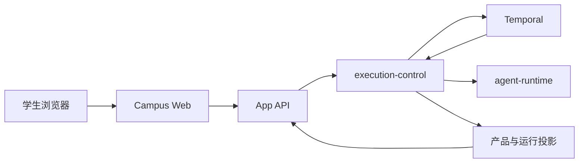
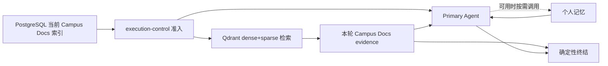
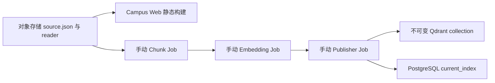
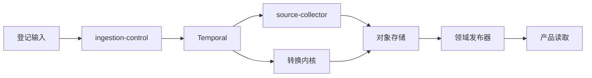
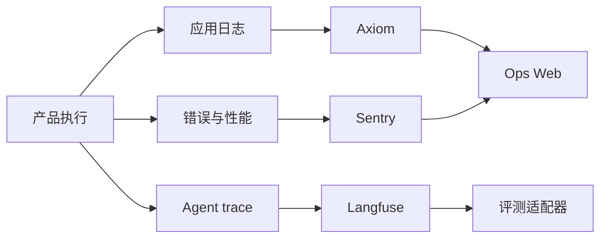

# 架构流程图

本文只展示跨多个所有者理解所需的稳定连接关系。字段、状态、版本、Activity 和操作步骤继续由所属
架构、合同、数据文档和 runbook 维护。

## 产品请求

所有者入口：`system/product-runtime.md`、`system/durable-runtime.md`、
`../contracts/app-api/request-lifecycle.md`。

## 在线回答上下文

当前索引与模型设置在 workflow 前冻结；没有获准能力时不形成隐藏 fallback。所有者入口：
`system/memory-plane.md`、`system/retrieval-serving.md`、`system/agent-framework.md`。

## Campus Docs 发布

三个索引阶段显式传递内容寻址制品，不自动串联；静态站候选和检索索引也不互相充当发布状态。
所有者入口：`system/document-site.md`、`system/retrieval-serving.md`、`../runbooks/campus-docs.md`。

## 离线数据

采集成功不表示领域数据已经发布，也不表示在线模型能力已经开放。所有者入口：
`system/data-plane.md`、`../runbooks/ingestion.md` 和所属领域文档。

## 运行观测与评测

观测和评分不能改写产品终态。所有者入口：`system/ops-observability.md`、
`../contracts/langfuse-runtime.md`、`../reference/eval.md`。
