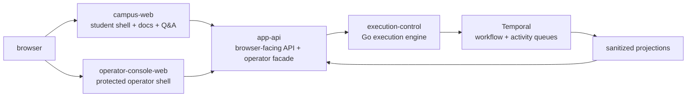
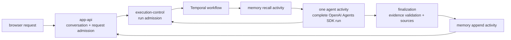
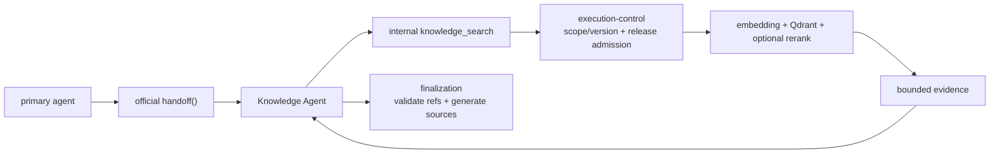
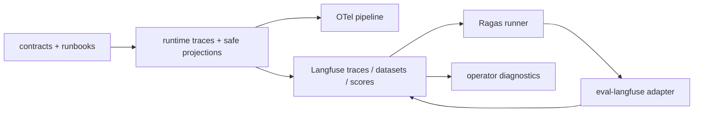

# Architecture Flows

This page is a compact visual index for stable cross-owner flows. It does not
own runtime, contract, schema, data or runbook truth. Owner documents remain the
source of truth; diagrams here only show how those owners connect.

Use this page when the question is "which owner boundaries does this chain
cross?" Use the linked owner document when the question is "what exactly is the
contract, schema, runtime rule or operational procedure?"

## Boundary

This document may contain only cross-owner flow diagrams that need more than one
owner class to be understood. Local diagrams belong in their owner documents:

- runtime or execution behavior: `docs/architecture/system/`
- domain/source-channel behavior: `docs/architecture/domains/`
- HTTP, tool and DTO shape: `docs/contracts/`
- schema, source truth and read-model ownership: `docs/data/`
- command procedures and closeout artifact rules: `docs/runbooks/`

This document must not become a full diagram catalogue. When a flow is already
clear inside one owner document, link to that owner instead of copying a diagram
here.

## Owner Map

| Flow | Primary Owner Docs |
| --- | --- |
| product runtime | `docs/architecture/system/product-runtime.md`, `docs/contracts/app-api/request-lifecycle.md` |
| online answer execution | `docs/architecture/system/execution-agent-layer.md`, `docs/architecture/system/tool-routing.md`, `docs/architecture/system/durable-runtime.md`, `docs/contracts/tool-execution.md` |
| ingestion data plane | `docs/architecture/system/data-plane.md`, `docs/architecture/domains/official-web/architecture.md`, `docs/architecture/domains/authenticated-notice/architecture.md`, `docs/runbooks/ingestion-control-clean-target.md` |
| Knowledge Agent retrieval serving | `docs/architecture/system/retrieval-serving.md`, `docs/architecture/system/agentic-retrieval.md`, `docs/contracts/tool-execution.md` |
| observability and eval loop | `docs/architecture/system/ops-observability.md`, `docs/architecture/system/langfuse.md`, `docs/architecture/system/learning-loop.md`, `docs/runbooks/eval-ragas.md` |

## Product Runtime

## Online Answer Execution

## Ingestion Data Plane

```mermaid
flowchart LR
  Collector["source-channel collector"]
  SourceBucket["source bucket\ncaptures + task input refs"]
  API["ingestion-control-api\nadmission + registry validation"]
  Temporal["Temporal workflow"]
  Worker["ingestion worker\nregistry-aware activities"]
  Kernel["TS handlers / Rust kernels"]
  Artifacts["source truth + projections"]
  Consumers["app-api / execution-control /\noperator-safe reads"]

  Collector --> SourceBucket
  SourceBucket --> API
  API --> Temporal
  Temporal --> Worker
  Worker --> Kernel
  Kernel --> Artifacts
  Artifacts --> Consumers
```

## Knowledge Agent Retrieval Serving

## Observability And Eval Loop

## Exclusions

The following document families intentionally do not get central diagrams here:

- pure index pages, because they only route readers to owner docs
- pure field dictionaries and executable schemas, because tooling verifies them
  better than a diagram
- owner-local runtime, source-channel, data or runbook flows, because those
  diagrams belong in the owner document
- archived or historical material recoverable through git history
