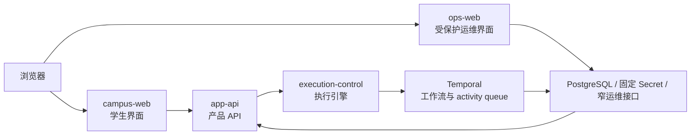
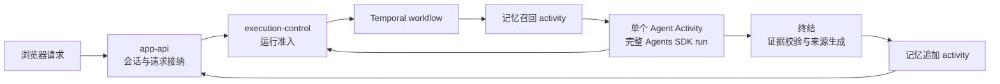
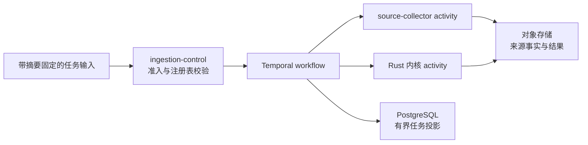
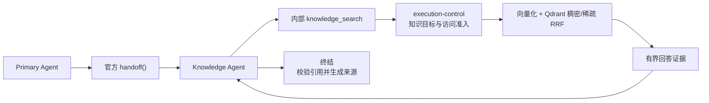
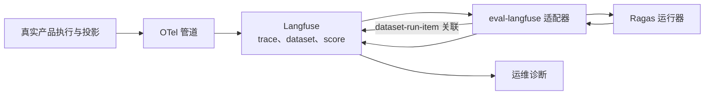

# 架构流程图

本文只索引需要跨多个所有者理解的稳定流程。runtime、contract、schema、data 和 runbook
事实仍由所属文档维护，图只展示连接关系。

本地流程图应留在所属文档：runtime 位于 `docs/architecture/system/`，领域和来源位于
`docs/architecture/domains/`，wire shape 位于 `docs/contracts/`，数据所有权位于
`docs/data/`，操作步骤位于 `docs/runbooks/`。

## 所有者入口

| 流程 | 主要所有者文档 |
| --- | --- |
| 产品运行 | `docs/architecture/system/product-runtime.md`、`docs/contracts/app-api/request-lifecycle.md` |
| 在线回答 | `docs/architecture/system/durable-runtime.md`、`docs/architecture/system/agent-framework.md` |
| 采集数据面 | `docs/architecture/system/data-plane.md`、领域 source 文档、`docs/runbooks/ingestion.md` |
| Knowledge Agent 检索 | `docs/architecture/system/retrieval-serving.md`、`docs/architecture/system/agentic-retrieval.md` |
| 可观测性与评测 | `docs/architecture/system/ops-observability.md`、`docs/architecture/system/langfuse.md` |

## 产品运行

## 在线回答

## 采集数据面

## Knowledge Agent 检索

## 可观测性与评测

纯字段字典、所属模块内部流程和可从 Git 历史恢复的材料不进入中央流程图。
