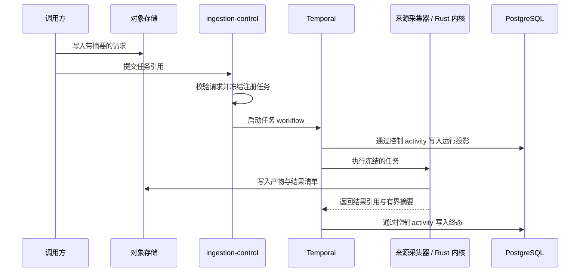

# 采集数据面

## 边界

采集数据面把已经写入对象存储的不可变请求交给 Temporal 执行，并产生带摘要的结果引用。它负责
离线采集、文件校验和分块，不负责在线检索、产品接口或知识目标发布。

```text
对象存储中的请求
-> ingestion-control 准入
-> Temporal workflow
-> source-collector 或 Rust 内核 activity
-> 对象存储中的结果清单
-> PostgreSQL 有界投影
```

## 组件职责

| 组件 | 负责 | 不负责 |
| --- | --- | --- |
| `apps/ingestion-control` API | 校验任务请求、冻结注册任务、启动和查询 workflow | 来源采集、文件处理、在线发布 |
| ingestion-control worker | workflow、控制 activity、TypeScript 物化、Rust 内核桥接、任务终态、离线发布与官网时效投影 | 供应商客户端、浏览器采集、在线查询 |
| `apps/source-collector` | Crawlee、Playwright 和供应商适配器，写入来源产物与结果清单 | 启动 workflow、维护任务状态、发布知识目标 |
| `packages/ingestion-contracts` | 跨运行时 JSON Schema 与校验器 | 运行时、存储和供应商实现 |
| `packages/ingest-core` | 与运行时无关的引用、摘要、解析和产物辅助能力 | Temporal、数据库和具体供应商客户端 |
| `packages/ingestion-kernels-rs` | 确定性文件校验与分块 | 网络、数据库、对象存储和工作流编排 |

任务字段、版本和执行器清单由 `packages/ingestion-contracts`、任务注册表及其测试维护，本文不
复制这些内容。

## 执行流程



Temporal 维护执行、重试、超时、心跳和取消。详细抓取观测与文件产物进入对象存储，不展开到
workflow history 或逐项写入 PostgreSQL。长 activity 通过心跳报告有界进度，取消信号必须传播
到正在进行的供应商请求、浏览器和文件写入。

## 状态分工

- Temporal 保存 workflow 执行状态和历史；
- 对象存储保存请求、准备数据、来源产物、内核产物和结果清单；
- PostgreSQL 保存任务查询所需的有界投影；
- Official Web 的 PostgreSQL 投影只保存下次抓取需要的最新网址和配置种子状态。
- 内部门户发布流在 PostgreSQL 保存当前发布指针、检查点和版本；完整发布清单仍在对象存储。

对象引用、写入一致性和具体对象路径由可执行合同与数据实现维护。PostgreSQL schema 由独立迁移
命令安装，运行进程只校验所需结构。

## 内部门户离线发布

通知父工作流依次执行采集、物化、文档单元校验和离线发布；文件发布父工作流执行采集、
物化和离线发布。父子工作流只传递不可变对象引用和有界结果，不在 Temporal history 中传递
正文。

固定通知计划跳过重叠执行。只有完整清单写入对象存储且发布流在版本锁下提交成功，当前发布
指针和通知检查点才同时前移。认证维护计划只验证门户会话；它不提交采集任务，验证成功仅恢复
因凭据问题自动暂停的通知计划。

## 在线边界

完成采集任务或离线发布不会创建在线索引、产品读模型或查询目标。知识发布必须通过独立的文档
规范化、分块、索引、release 和查询目标准入链路；在线回答不会现场执行采集。

部署资源由源码仓的 Kubernetes base 和环境仓共同决定，本文不记录副本数、镜像摘要或某次环境
状态。

## 相关文档

- `docs/decisions/adr-0077-ingestion.md`
- `docs/domains/official-web.md`
- `docs/runbooks/ingestion.md`
- `packages/ingestion-contracts/README.md`
