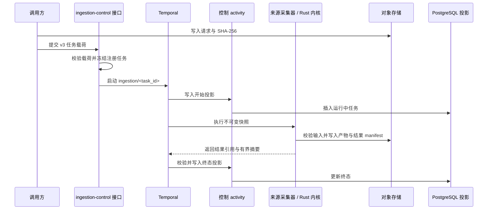

# 采集数据面

## 边界

本文描述当前 offline ingestion runtime，不定义 online retrieval、产品 route、来源特定浏览器
API 或未来 publication step。

```text
对象存储中的 digest-pinned request
-> ingestion-control HTTP admission
-> 一个 Temporal workflow
-> source-collector 或 Rust-kernel activity
-> 对象存储中的 digest-pinned result manifest
-> 有界 PostgreSQL projection
```

系统没有 parallel scheduler、task lease table、collector callback API、source-specific run
ledger 或 Python executor。

## 所有权

| 所有者 | 负责 | 不得负责 |
| --- | --- | --- |
| `apps/ingestion-control` API | v3 envelope 校验、registry snapshot、启动 Temporal、task query | provider capture、浏览器 route、在 API process 执行 activity |
| ingestion-control worker | workflow、control activity、Rust bridge、terminal projection、official-web freshness | source provider client、online publication |
| `apps/source-collector` | Crawlee/Playwright/provider capture、source artifact/result manifest | workflow start、PostgreSQL lifecycle truth、app-api command |
| `packages/ingestion-contracts` | canonical JSON Schema 和 validator | Temporal、database、object-store、provider client |
| `packages/ingest-core` | runtime-neutral ref、hash、parser、artifact writer、registry audit | 具体 runtime lifecycle 或 infrastructure client |
| `packages/ingestion-kernels-rs` | 确定性 file validation 和 chunk preparation | network、provider、database、object-store、workflow |

## 合同

`ingestion_task_envelope.v3` 只携带 `task_id`、`run_id`、`registry_task_id` 和包含
`s3://` URI、`sha256:` digest 的 `input_ref`。caller 不选择 executor、source/target identity
或 input/output contract；ingestion-control 从 registry 解析并冻结 execution snapshot。

`ingestion_task_registry.v3` 只接受 `source_collector` 与 `rust_kernel` executor。entry 必须
匹配 `packages/ingest-core` 中的 executable inventory；缺少 handler/kernel 或合同不一致时
验证失败。

executor 返回一个 `ingestion_task_result.v1`，包含 identity、declared output contract、一个
digest-pinned result-manifest ref 和有界 scalar summary。所有 object ref 都包含 digest 和
`byte_size`。page、notice、attachment、document、chunk 和详细 error artifact 留在 object
storage，不复制到 Temporal history 或 PostgreSQL。

## 对象 identity

所有 writer 使用 create-or-verify：新 key 通过 conditional create 写入；key 已存在时，保存
内容的 digest 和 byte size 必须一致，否则失败关闭。

execution-specific preparation、provider observation、raw response、kernel output 和 result
manifest 写入 `runs/<encoded-run-id>/attempts/<activity-attempt>/...`。canonical source truth
保持 content-addressed；timestamp、redirect、header 和 fetch error 属于 attempt observation。

## 工作流



retry、timeout、heartbeat、cancellation 和 terminal projection commit point 由 workflow/activity
代码及 runtime config 维护，不在架构文档固定数值。successful workflow 必须表示 completed
PostgreSQL projection 已写入；failed/canceled workflow 保留相同 Temporal outcome 和对应有界
projection。

长 activity 通过 heartbeat 报告粗粒度进度。大量 observation 和详细进度进入 object
storage，不使用大量 signal 或 per-item database row。

## Official Web 时效性

`official_web.capture` 是 offline source task。采集前 control activity 从 URL freshness 和
configured seed state 选择到期候选，写入 digest-pinned preparation manifest。成功后根据
result manifest 校验 page observation，并按 `(observed_at, run_id)` 确定性更新最新 URL
状态。

PostgreSQL 不保存 page body、artifact inventory、crawl-run history、target workset 或 release
gate。seed identity 单独投影，因为一个 seed 可以 redirect 到其他 canonical URL。

Official Web 不支持 query；source artifact 不代表 canonical document、chunk、index alias 或
serving target 已存在。

## 持久化

- Temporal：workflow state、attempt、retry、timeout、heartbeat 和 cancellation；
- object storage：request、preparation、source/kernel artifact 和 result manifest；
- PostgreSQL `ingestion_control.tasks`：有界 operator/query projection；
- PostgreSQL URL/seed table：下一次 official-web crawl 所需最新状态。

runtime 启动时断言 schema，不创建或放宽 table。独立 migration command 拥有 schema journal；
raw、未记录 SQL 不能作为部署事实。

## 部署与发布边界

源码仓提供 namespace-neutral ingestion runtime Kustomize base 和 image build。环境仓选择
immutable digest、namespace、Temporal/database/object-store/provider 配置和 network patch。
具体 Deployment、WorkerDeployment 和 image inventory 以 base 与环境仓为准，不在本文复制。

完成 ingestion task 不会自动发布 online target。query serving 需要独立完整链路，产生
canonical document、accepted chunk/index、release manifest 和 admitted serving target。

## 验证

```bash
pnpm ci:contracts
pnpm ci:ingest
pnpm ci:rust
kubectl kustomize infra/k8s/ingestion-runtime/base
```

## 相关文档

- `docs/decisions/adr-0077-ingestion.md`
- `docs/decisions/adr-0078-worker-versioning.md`
- `docs/domains/official-web.md`
- `docs/runbooks/ingestion.md`
