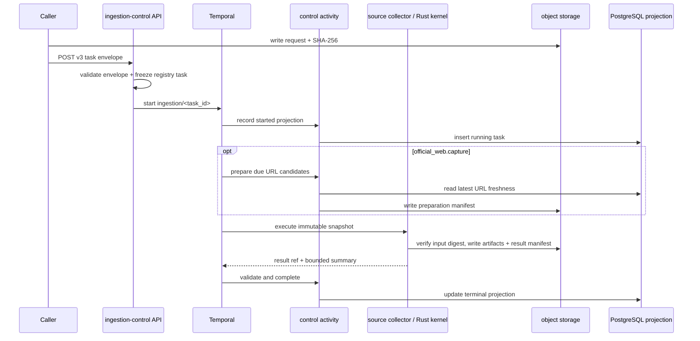

# Ingestion Data Plane

## Boundary

This document describes the current offline ingestion runtime. It does not
define online retrieval, product routes, source-specific browser APIs, or
future publication steps.

The accepted path is:

```text
digest-pinned request in object storage
-> ingestion-control HTTP admission
-> one Temporal workflow
-> source-collector or Rust-kernel activity
-> digest-pinned result manifest in object storage
-> bounded PostgreSQL projection
```

There is no parallel scheduler, task lease table, collector callback API,
source-specific run ledger, or Python executor.

## Ownership

| Owner | Responsibilities | Must not own |
| --- | --- | --- |
| `apps/ingestion-control` API | v3 envelope validation, registry snapshot, Temporal workflow start, task query, operator projection | provider capture, browser routes, activity execution in the API process |
| `apps/ingestion-control` worker | workflow, control activities, Rust process bridge, terminal projection, official-web freshness preparation/projection | source provider clients, online publication |
| `apps/source-collector` | Crawlee/Playwright/provider capture, source artifact writes, source result manifest | workflow start, PostgreSQL lifecycle truth, app-api commands |
| `packages/ingestion-contracts` | canonical JSON Schemas and validators | Temporal, database, object-store, or provider clients |
| `packages/ingest-core` | runtime-neutral refs, hashes, parsers, artifact writers, registry audit | concrete runtime lifecycle or infrastructure clients |
| `packages/ingestion-kernels-rs` | deterministic file-level validation and chunk preparation | network, provider, database, object-store, or workflow ownership |

## Contracts

### Task envelope

`ingestion_task_envelope.v3` contains:

- `task_id`
- `run_id`
- `registry_task_id`
- `input_ref` with `s3://` URI and `sha256:` digest

Callers cannot choose executor, source/target identity, input contract, or
output contract. Ingestion-control resolves those fields from the registry and
passes an immutable `ingestion_task_execution_snapshot.v1` to Temporal.

### Registry

`ingestion_task_registry.v3` supports two executor kinds:

- `source_collector`
- `rust_kernel`

Every entry must match the default executable inventory in
`packages/ingest-core`. A declaration without a concrete handler/kernel or
with mismatched contracts fails repository validation.

### Result

Every executor returns `ingestion_task_result.v1`:

- task/run/registry identity;
- declared output contract;
- one digest-pinned result-manifest ref;
- a bounded scalar summary.

Every object-store ref includes a `sha256:` digest and `byte_size`.
`ingestion_release_manifest.v2` applies the same requirement to every release
artifact.

Detailed page, notice, attachment, document, chunk, and error artifacts remain
in object storage. They are not copied into Temporal history or PostgreSQL.

### Object identity

All ingestion writers use create-or-verify semantics. A new object is written
with conditional create; if the key already exists, its stored digest and byte
size must match. Different bytes at the same key fail closed.

Execution-specific preparation, provider observations, raw responses, kernel
outputs and result manifests use
`runs/<encoded-run-id>/attempts/<activity-attempt>/...`. Canonical source-truth
keys remain content-addressed. The same Official Web page or WeChat article
captured by another run/attempt must therefore produce byte-identical
canonical manifests and rows; timestamps, redirects, headers and fetch errors
belong to attempt observations.

## Workflow



The workflow retries start/preparation projection activities up to five times
and executor activities up to three times. Terminal complete/fail/cancel
projection activities have no maximum-attempt cap: Temporal keeps retrying
transient projection failures so workflow history and PostgreSQL cannot settle
on contradictory terminal states. Once an executor returns a result, completion
projection runs in a non-cancellable scope; that is the terminal commit point.
Source capture has a 12-hour start-to-close timeout; Rust kernels have a 2-hour
timeout. Both heartbeat every 30 seconds or faster. Cancellation before the
commit point closes the bounded projection from a non-cancellable cleanup
scope.

After a source or kernel activity fails, the workflow writes the failed task
projection and rethrows the original failure, so Temporal remains `Failed`.
Cancellation follows the same rule: it writes the canceled projection and
preserves Temporal's `Canceled` outcome. A successful workflow therefore means
that its completed PostgreSQL projection was also written.

Activity progress uses heartbeats. Large observations and detailed progress
use object-store artifacts, not workflow signals or per-item database rows.

## Active Tasks

Source collector tasks:

| Registry task | Input | Output |
| --- | --- | --- |
| `official_web.capture` | `official_web_capture_request.v1` | `official_web_source_manifest.v1` |
| `internal_portal.notice.capture` | `internal_portal_notice_capture_request.v1` | `authenticated_notice_source_manifest.v1` |
| `internal_portal.file_release.capture` | `internal_portal_file_release_capture_request.v1` | `authenticated_file_release_source_manifest.v1` |
| `wechat_official_account.capture` | `wechat_official_account_capture_request.v1` | `wechat_official_account_source_manifest.v1` |

Rust tasks are declared only for the current curriculum and regulation
collections and use `validate-document-units` or `chunk-document-units`.
There are no placeholder release, alias-publish, vector-write, or source
materialization tasks.

## Official Web Freshness

`official_web.capture` is an offline source task. Before collection, the control
activity selects due URLs from
`ingestion_control.official_web_url_freshness` and reads configured seed
identity from `ingestion_control.official_web_seed_state`. The collector
combines due canonical URLs with configured seeds that have never been
observed. The preparation manifest is written to object storage and
digest-pinned before crossing the activity boundary.

On successful completion, ingestion-control finds the page-observation
artifact through the result manifest, verifies every digest, and upserts the
latest state per `(site_id, normalized_canonical_url)`. Observations are
ordered by `(observed_at, last_observed_run_id)` so equal timestamps converge
deterministically. PostgreSQL does not keep
page bodies, artifact inventories, crawl-run history, target worksets, or
release gates. Configured seed identity is projected separately by
`(site_id, configured_seed_url)` because a seed can redirect to another
canonical URL and multiple seeds can resolve to the same page.

Official web is not query-enabled. Its source artifacts do not imply canonical
documents, chunks, an index alias, or a serving target.

## Persistence

- Temporal: canonical workflow state, attempts, retry, timeout, heartbeat, and
  cancellation.
- Object storage: requests, preparations, source artifacts, kernel artifacts,
  and result manifests.
- Source collectors and official-web freshness use source-bucket credentials;
  Rust kernels use separate derived-bucket credentials for canonical inputs
  and deterministic outputs.
- PostgreSQL `ingestion_control.tasks`: bounded operator/query projection.
- PostgreSQL `ingestion_control.official_web_url_freshness`: latest URL state
  used for the next crawl decision.
- PostgreSQL `ingestion_control.official_web_seed_state`: configured seed to
  last-observed canonical URL mapping used to avoid redundant bootstrap fetches.

The runtime asserts the current schema at startup. It does not create or relax
tables at runtime and does not interpret retired lease/task-kind columns. The
separate migration command owns `ingestion_control.schema_migrations`; startup
also requires that journal so raw, untracked SQL application is not accepted as
deployment truth.

## Deployment

`infra/k8s/ingestion-runtime/base` defines:

- the replicated ingestion-control HTTP Deployment and Service;
- `ingestion-control-worker` WorkerDeployment;
- `source-collector-worker` WorkerDeployment;
- per-version KEDA ScaledObjects and PDBs through WorkerResourceTemplate;
- ServiceAccount, Connection, and NetworkPolicy resources.

The ingestion image workflows publish three production artifacts from the two
runtime packages: `ingestion-control` for the API and migrations,
`ingestion-control-worker` for workflow/control/Rust activities, and
`source-collector` for source activities. GitOps chooses immutable digests,
namespace, Temporal endpoint/namespace, database, object-store, provider
secrets, and environment-specific network patches.

## Publication Boundary

Completing an ingestion task does not publish an online target. Query serving
requires a separate, complete chain that produces canonical documents,
accepted chunks/index data, a release manifest, and an admitted serving target.
No task or config file may infer that chain exists.

## Verification

```bash
pnpm ci:contracts
pnpm ci:ingest
pnpm ci:rust
kubectl kustomize infra/k8s/ingestion-runtime/base
```

## Related Documents

- `docs/decisions/adr-0077-ingestion.md`
- `docs/decisions/adr-0078-worker-versioning.md`
- `docs/architecture/domains/official-web/architecture.md`
- `docs/runbooks/ingestion.md`
