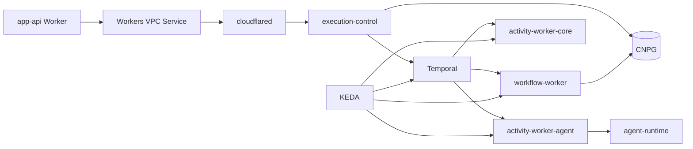

# Kubernetes Runtime

## 文档边界

本文定义 execution runtime 的 Kubernetes 资源、Temporal worker pool、KEDA、私网入口和
配置所有权。具体环境选择、镜像 digest、Secret 和部署状态由 GitOps repo 管理。

## 拓扑

PostgreSQL 的 Worker 私网路径复用同一 `cloudflared` 隧道，但使用独立 TCP VPC Service 和
5432 网络策略；数据库不暴露公网。

## First-party Workloads

`infra/k8s/execution-runtime/base` 只包含：

- `execution-control` Deployment/Service；
- `agent-runtime` Deployment/Service；
- `workflow-worker`；
- `activity-worker-core`；
- `activity-worker-agent`；
- 一组 `cloudflared` connector 副本；
- 每个 worker pool 一个 KEDA `ScaledObject`；
- namespace-neutral ServiceAccount、NetworkPolicy 和 probes。

Temporal、CNPG、Qdrant、Hindsight、OpenTelemetry Collector、OpenObserve、KEDA controller 和
Ingress controller 是平台/data applications，不复制进 execution-runtime base。Ops Web 有
独立的 `infra/k8s/ops-web/base`。

## Worker Pools

每个 Deployment 只 poll 一个固定队列：

| Deployment | Queue | 类型 |
| --- | --- | --- |
| `workflow-worker` | `campus-agent.workflow` | workflow |
| `activity-worker-core` | `campus-agent.activity.core` | activity |
| `activity-worker-agent` | `campus-agent.activity.agent` | activity |

worker image 可以复用 execution-control image，通过 command 选择角色；镜像拆分不是运行时
所有权边界。每个 pool 独立设置 resource、probe、rollout 和 KEDA policy。

## KEDA

KEDA Temporal scaler 直接读取 Temporal，不经过 app-api、PostgreSQL、sampler 或自研
autoscaler。当前 base 参数：

- `pollingInterval: 15`
- `cooldownPeriod: 180`
- `minReplicaCount: 1`
- `maxReplicaCount: 3`
- `targetQueueSize: "8"`
- `activationTargetQueueSize: "0"`
- HPA scale-down stabilization：300 秒

在线问答 worker 默认保留一个副本，使 Temporal poller readiness 和首个任务时延保持稳定。
scale-to-zero 只有在冷启动时延、KEDA activation、cooldown/HPA 和 release evidence 满足
ADR-0056 的条件后才能单独启用。调整这些值必须依据 schedule-to-start、backlog、poller、
activity latency 和用户时延，而不是恢复第二套控制器。

KEDA/HPA 是唯一 replica actuator。不得运行 Docker worker-autoscaler、写 decision/actuation
表或让 application code 调 Kubernetes API。

## 当前队列观测

execution-control 的 `GET /internal/ops/temporal/task-queues` 使用 Temporal SDK 即时读取三个
队列，Ops Web 缓存 15 秒。该接口只服务人工观测：

- 不写 PostgreSQL；
- 不参与 KEDA 决策；
- 不产生 sampler Deployment、posture collector 或 autoscaler artifacts。

合同见 `docs/contracts/operator-runtime.md`。

## 配置和 Secret

- source repo 保存 runtime JSON、schema、namespace-neutral Kustomize base 和策略。
- GitOps ConfigMap 保存环境非密配置；Secret 保存角色凭据和内部 token。
- provider active profile 仍由 app-api provider-config 拥有，并以受控 projection 交付 runtime。
- 每个数据库、内部 API、telemetry、memory、RAG 和 agent 调用面使用独立 Secret。
- 不从根 `.env` 生成 staging ConfigMap/Secret，不创建 monolithic runtime Secret。

## PostgreSQL

- CNPG 是独立 data application。
- execution-control 使用自己的 run projection 角色和 schema installer。
- app-api schema 与 campus-services schema 由 GitOps PreSync Job 安装。
- PreSync 先安装 execution-control run projection schema，再安装依赖其表授权的 app-api
  schema；campus-services schema 与 app-api schema 同波执行。
- campus-services Schema 安装不发布班车数据。缺少 current transport release
  不得阻塞其他服务的 rollout 或 readiness；正式数据发布等待 notice 链路重做后单独执行。
- 所有集群内连接挂载 CNPG CA 并使用 `verify-full`。
- app-api Worker 通过 Hyperdrive/Workers VPC 访问 `app_api` 角色。

数据库连接规则见 `docs/data/postgres-ownership.md`。

## 私网和 NetworkPolicy

- app-api 只通过 Workers VPC 到达 execution-control 和 CNPG。
- `cloudflared` 仅允许 DNS、Cloudflare tunnel egress、execution-control:8000 和 CNPG:5432。
- execution-control 不需要 public Ingress。
- Ops Web Ingress、Access 和内部上游由其 GitOps application 独立管理。

## Readiness

execution-control `/readyz` 至少检查：

- admission 未 draining/过载；
- OTel exporter 配置；
- open tool read model；
- run projection store；
- Temporal client 和三个队列的 poller；
- Hindsight personal memory；
- knowledge search/Qdrant；
- required provider-config roles。

Kubernetes 还必须检查 worker probes、KEDA controller/metrics server、ScaledObject/HPA 条件、
资源限制和网络策略。运行时 readiness 不替代 GitOps application health。

## GitOps

- source base 以完整 source commit SHA 固定；
- first-party image 以 multi-arch manifest digest 固定；
- Argo CD 管理 K8s desired state，不管理 Cloudflare Worker、Hyperdrive 或 VPC Service；
- source image workflow 可以创建 GitOps PR，但不能直接写 GitOps `main`。

## 禁止形态

- 不恢复 temporal-task-queue-sampler、keda-hpa-posture-collector 或 worker-autoscaler。
- 不为 KEDA 复制一套数据库 queue/current/posture 模型。
- 不把 app-api、campus-web 或 operator-console-web 部署进 Kubernetes。
- 不公开 execution-control 或 PostgreSQL 来绕过 Workers VPC。
- 不把 deployment closeout、临时验证或本地 Compose 描述成架构 truth。

## 相关文档

- `docs/contracts/operator-runtime.md`
- `docs/data/postgres-ownership.md`
- `docs/architecture/system/runtime-release.md`
- `docs/decisions/adr-0056-k8s-keda.md`
- `docs/decisions/adr-0065-gitops-argocd-helm-boundary.md`
- `docs/decisions/adr-0073-private-postgres.md`
