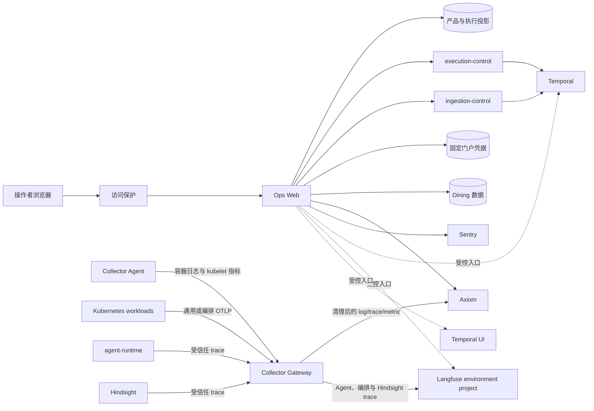

# Ops Web 与可观测性

## 文档边界

本文定义 Ops Web 在产品运行、可观测平台和少量管理操作之间的职责与数据流。页面体验见
`../../product/ops-web.md`，HTTP 语义见 `../../contracts/ops-web/README.md`，信号字段见
`../../reference/telemetry.md`。环境地址、Secret、网络目标和部署状态由可执行配置及环境仓维护。

## 核心边界

Ops Web 是独立的运维和内容运营应用，由浏览器页面和同源服务端组成：

- 浏览器只调用同源 `/api/ops/*`，不直连数据库、Kubernetes 或外部观测平台；
- 服务端关联有界产品投影、执行投影、Temporal 状态、Axiom 记录、Sentry Issue 和外部入口；
- Provider Config、固定门户凭据和 Dining 是三个独立管理边界；
- 外部平台继续拥有完整查询、工作流、模型观测和评测能力，Ops Web 不复制这些界面；
- 任何观测信号都不能改写产品请求或工作流的持久状态。

## 数据流

该图描述源码职责，不证明任一环境已经部署或收到可查询数据。

## 组件职责

| 组件 | 负责 | 不负责 |
| --- | --- | --- |
| Ops Web 页面 | 展示、筛选、复制关联标识和发起获准操作 | 保存凭据、构造任意查询或决定请求状态 |
| Ops Web 服务端 | 人员身份校验、固定查询、外部入口和受控管理调用 | 通用代理、产品执行或任意工作流控制 |
| 产品与执行投影 | 请求、运行和有界排查摘要 | 原始日志、模型 trace 或 Temporal history |
| Temporal | workflow history、任务队列、重试、timer 和取消 | 产品请求摘要或日志存储 |
| Collector Agent | 第一方容器日志和 kubelet 指标采集、Kubernetes 元数据补充 | 长期存储或采集 Collector/Hindsight stdout |
| Collector Gateway | 固定入口、字段清理、路由、采样、批处理、内存队列和有界下游重试 | 决定产品请求状态或查询历史数据 |
| Axiom | 清理后的日志、调用链和指标 | 模型正文、产品状态或工作流执行状态 |
| Sentry | 浏览器和边缘错误、性能摘要、release 与 Issue | 通用日志存储或模型 trace |
| Langfuse environment project | Agent、模型、工具、受控编排、记忆 trace、数据集、评分和人工评审 | 产品状态或 Temporal history |
| Dining 数据面 | 来源观测、草稿、发布版本和评价状态 | 运维身份或学生页面状态 |

PostgreSQL 角色和 schema 由 `../../data/postgres-ownership.md` 维护，Dining 数据语义由
`../../data/dining.md` 维护。

## 请求排查

请求状态和关联标识来自产品与执行链路写入的有界投影。Ops Web 可以使用请求标识关联外部记录，
但不能根据日志、健康检查、Sentry Issue 或 Langfuse trace 推断新的产品终态。

服务端按已保存请求生成固定查询范围和字段投影：

- Axiom 返回清理后的日志或调用链记录；
- Sentry 返回有限 Issue 摘要和官方详情入口；
- Temporal 与 Langfuse 只提供根据可信标识生成的受控入口；
- 外部正文不复制到产品数据库或 Ops Web 自有缓存。

所有接口使用同一 Cloudflare Access 人员准入；应用不复制人员、组或分操作白名单。失败、无记录、
部分响应和旧缓存分别保留自己的状态，不转换成产品请求成功或失败。

## 运行概况

运行概况并行聚合请求统计、服务健康、Temporal 队列和 Axiom 信号状态。每个来源独立失败，短时
缓存只用于保持页面可用，不能成为持久事实。精确状态、窗口和缓存语义由接口合同维护。

低流量窗口没有日志或调用链不自动表示故障；持续指标缺失可以表示采集链路降级。被观测服务
故障不应阻止操作者打开 Ops Web 查看其他来源。

## 管理操作

### Provider Config

Ops Web 通过 execution-control 的受控管理接口读取、验证和激活在线配置。Ops Web 不读取配置
数据库、不持有 keyring，也不能激活不完整或未验证的配置。

### 门户认证

Ops Web 只能读取和更新固定门户凭据资源，并通过 ingestion-control 查询或恢复固定认证维护
Schedule。它不能读取当前凭据、选择其他 Secret、在线执行门户登录或操作任意 Schedule。

### Dining

Ops Web 使用独立 Dining 数据权限管理草稿、不可变发布版本、回滚和评价状态。来源同步、内容
运营、学生读取和地图资产保持独立所有权，完整流程见 `../domains/dining.md`。

## 可观测平台

OpenTelemetry Collector 接收 Kubernetes 通用信号和受信任运行 trace，按入口执行字段清理、
采样、批处理与下游路由。Cloudflare Worker 和浏览器使用各自支持的日志或 Sentry 集成；这些
例外不能变成绕过字段治理的通用出口。

Gateway 使用四个固定 OTLP/HTTP receiver：`4318` 接收通用信号，`4319` 接收 execution-control
编排信号，`4320` 接收 Agent 受信任 trace，`4321` 接收 Hindsight 受信任 trace。入口由精确
NetworkPolicy 隔离，不使用集群内 bearer token。Axiom 的 log、trace 和 metric 共用一个 ingest
token、使用不同 dataset；所有 exporter 使用内存发送队列和最长 300 秒重试，不依赖持久队列。

受信任 Langfuse trace 可以包含排查模型行为所需的输入输出、记忆上下文和已授权检索内容。这些
正文不进入 Axiom、Sentry、产品投影或 Ops Web 响应。详细边界见 `langfuse.md` 和
`../../contracts/langfuse-runtime.md`。

Ops Web 使用服务端固定、最小权限的 Axiom 和 Sentry 读取能力。浏览器不能覆盖 endpoint、数据
集合、组织、项目、查询、时间范围或返回上限。供应商 SDK、环境变量和凭据交付由实现、环境文档
和部署配置维护，不在架构文档复制。

## 访问与故障边界

- Cloudflare Access policy 决定人员范围，服务端验证 JWT 并拒绝服务身份；
- 写操作继续执行同源、幂等、并发和所属领域校验；
- PostgreSQL 不可用时，请求读取返回错误而不是空列表；
- Axiom 或 Sentry 不可用时，只影响对应观测区域；
- Provider Config、Kubernetes API、认证维护或 Dining 依赖失败时，只影响对应页面；
- `/healthz` 只表示进程响应，`/readyz` 只检查 Ops Web 接受请求所需的核心依赖。

## 部署边界

源码仓拥有 Ops Web 代码、镜像、namespace-neutral Kubernetes base 和 Collector 模板。环境仓
拥有地址、Secret、网络目标、Ingress、保留策略和不可变版本选择。源码文件、manifest 或 Secret
键存在不表示某个环境已经部署成功。

网络出站按 workload 的实际依赖由 Kubernetes 配置声明；环境特定地址和供应商解析结果不得写入
HTTP 合同。新增下游依赖时必须同时更新实现、可执行网络配置和环境选择。

## 禁止形态

- 浏览器直连 PostgreSQL、Kubernetes、Axiom、Temporal、Langfuse、Sentry 或 Hindsight；
- 浏览器提交任意查询语言、外部 URL、数据集合、时间窗口或记录上限；
- Ops Web 查询 Temporal、Langfuse 或 Hindsight 的内部数据库；
- 把原始日志、event、模型 observation 或外部平台正文写入产品投影；
- 把 Ops Web 扩张为通用管理后台、工作流控制台、评测平台或外部平台复制品；
- 创建、列举、删除通用 Secret，或修改固定门户凭据以外的 Secret。

## 相关文档

- `../../product/ops-web.md`
- `../../contracts/ops-web/README.md`
- `../../data/postgres-ownership.md`
- `../../data/dining.md`
- `langfuse.md`
- `../../contracts/langfuse-runtime.md`
- `../../reference/telemetry.md`
- `../../runbooks/otel.md`
- `../../runbooks/worker-otel.md`
- `../../decisions/adr-0072-self-hosted-ops-web.md`
- `../../decisions/adr-0081-observability-planes.md`
