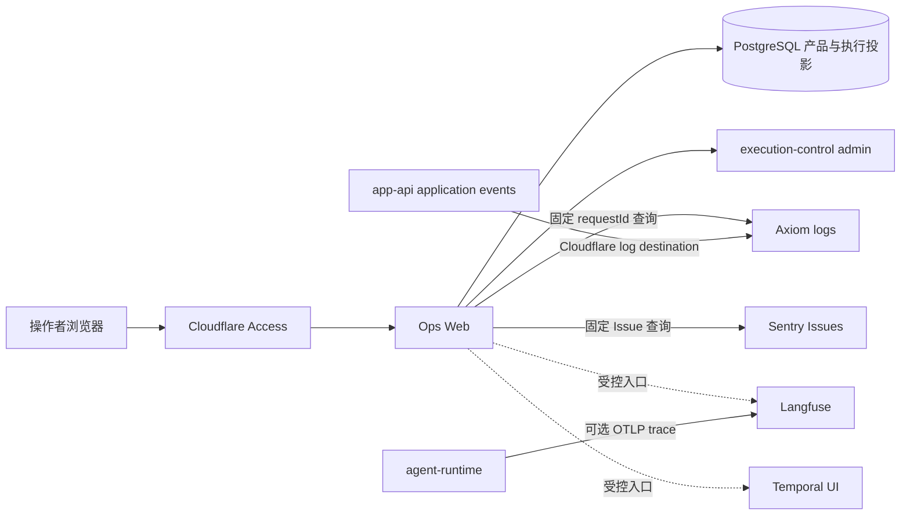

# Ops Web 与可观测性

## 文档边界

本文定义 Ops Web 在产品运行、外部观测平台和少量管理操作之间的职责。页面体验见
`../../product/ops-web.md`，HTTP 语义见 `../../contracts/ops-web/README.md`，信号字段见
`../../reference/telemetry.md`。环境地址、Secret、网络目标和部署状态由可执行配置及环境仓维护。

## 核心边界

Ops Web 是独立的运维和内容运营应用，由浏览器页面和同源服务端组成：

- 浏览器只调用同源 `/api/ops/*`，不直连数据库或外部平台；
- 服务端读取 PostgreSQL 产品与执行投影，按需查询 Axiom application logs 和 Sentry Issues；
- Langfuse、Temporal、Axiom 和 Sentry 继续拥有完整平台界面，Ops Web 只生成受控入口；
- 在线模型配置、内部门户凭据、账号管理、Dining 和同好群各自遵守所属合同；
- 内部门户 TGC 与自动化 token 由 Ops Web PostgreSQL 所有，开发者程序通过配置的机器 origin 和
  Bearer token 显式更新或删除；Source Collector 只消费开发者显式提供的本地 TGC；
- 任何观测信号都不能改写产品请求、个人记忆或 workflow 的持久状态。

## 数据流

该图描述源码职责，不证明任一环境已经部署或收到可查询数据。

## 运行概况

`/api/ops/overview` 只读取 Ops Web PostgreSQL 中的请求状态与趋势，并提供已配置外部平台入口。
它不轮询被观测服务、不查询 Temporal task queue、不计算 Axiom 覆盖，也不读取 Collector uptime。

请求摘要和趋势共享同一数据所有者，但分别保留 `FRESH`、`NO_DATA`、`STALE`、`PARTIAL` 或
`UNAVAILABLE`。缓存只保护这个 PostgreSQL 读取面；失败时可以在明确期限内返回最近成功结果，
不能用空数组或零值伪装成功。整体健康只由产品请求投影汇总。

低流量窗口没有日志、trace 或 metric 不参与产品健康判断。Ops Web readiness 也不依赖 Axiom、
Sentry、Langfuse、Temporal UI 或被观测服务。

## 运行记录

运行记录以持久 `requestId` 为主键，展示问题、产品状态、会话结果、有限 Agent usage、stage
timing 和可信关联标识。完整 Temporal history、Agent graph、model generation、评测和任意平台查询
仍在所属平台查看。

系统记录页提供两类按需查询：

- Axiom：只查询固定 logs dataset，返回允许的 application-log 摘要；
- Sentry：只查询固定项目和时间范围内的 Issue 摘要。

打开详情不会自动发起外部查询。服务端从已保存请求计算有界时间窗口、固定数据集、字段投影、排序
和返回上限，浏览器不能提交 APL、dataset、项目、时间范围或字段。

Axiom 查询只使用 durable `requestId` 过滤。产品 `traceId` 来自持久请求详情，只供页面展示和人工
关联；Axiom 和 Sentry 响应不携带 `traceId`、OTel correlation 或供应商 `searchQuery`。要求
requestId 与 traceId 同时匹配会丢失只拥有 durable request key 的合法 Worker application log，
因此不属于当前合同。

外部查询失败、部分响应、无记录和未配置分别保持自己的状态，不会改变运行记录的产品状态。Ops Web
不查询 Axiom metrics/traces dataset，不生成 trace tree，也不以 Langfuse trace 是否存在判断请求
是否成功。

## 平台分工

| 对象 | 所有者 | Ops Web 中的用途 |
| --- | --- | --- |
| 会话问题与产品结果 | app-api PostgreSQL | 展示本轮问题、已净化回答和用户可见来源 |
| 请求与执行投影 | app-api、execution-control PostgreSQL | 状态、时间、usage、版本和关联标识 |
| Workflow Execution | Temporal | 受控外部入口 |
| Agent Trace | Langfuse | 受控外部入口；环境可以因配额停收 |
| Application Log | Axiom | 按 requestId 加载有界摘要 |
| Issue | Sentry | 按 requestId 加载有限错误摘要 |

内部门户自动化接口是独立的机器入口，不是通用代理或凭据同步总线。它只暴露凭据 metadata、带 CAS
版本条件的 `ssoTgc` 更新和删除；TGC、Cookie、Bearer token 和门户响应正文不进入日志、观测数据或
部署配置。自动化入口是否可用由其接口返回局部错误表示，不改变 Ops Web 顶层 `/readyz`。

人员 `/api/ops/*` 接口使用同一 Cloudflare Access 准入，应用不复制人员、组或分操作白名单；自动化
`/api/automation/*` 只接受配置入口上的 Bearer token。失败、无记录、部分响应和旧缓存分别保留自己的
状态，不转换成产品请求成功或失败。

Axiom 不再承担本仓库自有 runtime metric 或分布式 trace 合同；Langfuse 不再接收
execution-control/Hindsight trace。Agent Runtime 是唯一可选 Langfuse runtime producer。

## 管理操作

Ops Web 通过 execution-control admin 的受控接口发现模型、读取、验证和写入在线配置。模型发现
只返回供应商模型 ID，不向浏览器返回 API key 或供应商响应。Dining、同好群、账号和内部门户凭据
由各自产品与数据合同维护，不与观测查询共享状态。

## 访问与故障边界

- Cloudflare Access policy 决定人员范围，服务端验证 JWT 并拒绝服务身份；
- 写操作继续执行同源、幂等、并发和所属领域校验；
- PostgreSQL 不可用时，请求读取返回错误而不是空列表；
- Axiom 或 Sentry 不可用时，只影响对应按需区域；
- Langfuse trace 因配额停收是允许状态，不影响在线执行或 Ops Web readiness；
- 自动化 origin 或 token 存储不可用时，只影响 token 管理和 `/api/automation/*`；
- `/healthz` 只表示进程响应；
- `/readyz` 检查公开来源地址和 PostgreSQL 轻量连接，并在非 local/development 环境检查 Access
  配置；它不重复执行 schema 查询，也不探测自动化 origin、业务依赖或供应商。

## 部署边界

源码仓拥有 Ops Web 代码、镜像、namespace-neutral Kubernetes base、Agent trace producer 合同和
本地 Collector 配置。环境仓拥有地址、Secret、外部平台设置、网络目标、Ingress、保留策略和
不可变版本选择。源码 manifest 或 Secret key 存在不表示某个环境已经部署成功。

不新增按 dataset、consumer 或 exporter 拆分的 Axiom/Sentry token。现有宽权限供应商身份及其
交付投影由环境合同维护，本次信号收缩只删除消费者，不改变权限。

## 禁止形态

- 浏览器直连 PostgreSQL、Axiom、Temporal、Langfuse、Sentry 或 Hindsight；
- 浏览器提交任意查询语言、外部 URL、数据集合、时间窗口或记录上限；
- 根据 Axiom、Sentry 或 Langfuse 数据推导新的产品终态；
- 恢复 Axiom metrics/traces、Collector coverage 或 Temporal queue 的 Ops Web 聚合面；
- 把原始日志、event、模型 observation 或外部平台正文写入产品投影；
- 创建、列举、读取或更新 Kubernetes Secret 和 workload。

## 相关文档

- `../../product/ops-web.md`
- `../../contracts/ops-web/README.md`
- `../../data/postgres-ownership.md`
- `langfuse.md`
- `../../contracts/langfuse-runtime.md`
- `../../reference/telemetry.md`
- `../../runbooks/otel.md`
- `../../runbooks/worker-otel.md`
- `../../decisions/adr-0072-self-hosted-ops-web.md`
- `../../decisions/adr-0081-observability-planes.md`
