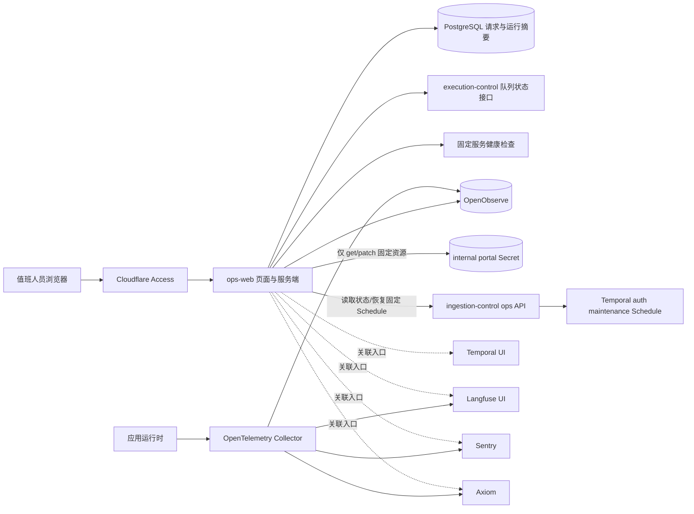

# Ops Web 可观测性架构

## 文档范围

本文定义 `ops-web`、PostgreSQL、OpenTelemetry、OpenObserve、Temporal、Langfuse、
Sentry 和 Axiom 在运行排查中的职责。页面要求见 `../../product/ops-web.md`，HTTP 字段见
`../../contracts/ops-web.md`，Worker Operator Console 见 `operator-console.md`。

本文不宣称 staging 已部署，也不记录环境地址、Secret 内容或资源规格；这些由环境 GitOps
仓库和实际运行证据负责。

## 核心结论

仓库保留两个用途不同的受控入口：

- `operator-console-web` 继续通过 `app-api` 承担供应商配置和业务操作。它仍受
  ADR-0055、ADR-0067 约束，不直连数据库或观测平台。
- `ops-web` 是独立、自托管、默认只读的运行排查应用。它在服务端读取严格授权的 PostgreSQL
  摘要并查询 OpenObserve，浏览器只访问 `ops-web` 自身接口。写操作只包括人员操作者替换
  固定内部门户 Secret 的 `sso_tgc`，以及恢复固定的门户认证维护 Schedule。

两者不互相代理，也不共享一个通用运维后端。`ops-web` 不是产品 API、数据库浏览器、
Temporal 控制台或通用日志平台。

## 数据流

图中的外部输出只表示对应环境配置了该输出；某个外部平台未启用时不影响请求状态读取。

## 组件职责

| 组件 | 负责 | 不负责 |
| --- | --- | --- |
| Ops Web 页面 | 展示、筛选、复制关联标识、打开入口、提交门户 TGC 替换或恢复固定维护 Schedule | 读取当前凭据或提交任意查询 |
| Ops Web 服务端 | Access 验证、固定查询、短缓存、读取审计、固定 Secret patch、调用固定维护接口 | 写请求状态、触发任意工作流、提供通用代理 |
| ingestion-control | 读取固定 Temporal Schedule 和最近 Workflow 摘要、幂等恢复该 Schedule | 接收任意 Schedule 或 Workflow 标识、保存凭据 |
| PostgreSQL | turn dispatch、用户问题、agent run、observability fact 和读取审计 | Temporal 队列、原始日志、原始调用链 |
| OpenTelemetry Collector | 接收、清理、批处理并发送观测数据 | 长期查询和请求状态判断 |
| OpenObserve | 保存并查询内网可用的日志、指标和调用链 | 决定产品请求成功或失败 |
| Temporal | 工作流历史、重试、超时、取消和任务队列真相 | Ops Web 请求状态或页面合同 |
| Langfuse | 受信任的模型调用 trace、评分、数据集和评测 | 产品请求状态数据库或工作流真相 |
| Sentry | 错误、异常和性能排查 | Ops Web 的内网原始记录来源 |
| Axiom | 外部日志、事件、查询、看板和告警 | Ops Web 的内网原始记录来源 |
| Hindsight | 由 execution-control Activities 调用的个人记忆服务 | Ops Web 浏览器或服务端查询接口 |

## 请求状态和关联

请求状态和排查摘要来自以下 PostgreSQL 来源：

- `chat.turn_dispatches`
- `chat.messages`
- `runtime.agent_runs`
- `runtime.request_observability_fact`

Ops Web 只获得这些来源中合同列出的列。OpenObserve、健康检查、Temporal、Langfuse、
Sentry 和 Axiom 只能补充排查信息，不能改写请求状态。

agent-runtime 通过 OpenInference、官方 Langfuse OTel processor 和标准 OTLP 输出 SDK
spans。受信任的 Langfuse trace 可以包含模型输入输出、授权的 retrieval facts 和 memory
context；这些正文不进入 PostgreSQL 摘要、OpenObserve、Sentry 或 Axiom。任何 sink 都不得
接收 credential、secret 或 Temporal history。

关联标识的用途：

- `requestId`：列表、详情和 OpenObserve 查询的主标识；
- `traceId`：同一次调用链的跨系统标识；
- `conversationId`：同一会话中的请求关联；
- `runId`：运行记录标识；
- `workflowId`：由 `runId` 按 `campus-agent.chat.<runId>` 生成的 Temporal 工作流标识。

缺少 `runId` 时不生成工作流标识，也不猜测其他 Temporal 字段。

## 运行概况

Ops Web 并行读取三类信息：

1. PostgreSQL 提供请求数量、状态、95% 耗时和趋势。
2. execution-control 通过 Temporal SDK 提供当前任务队列状态。
3. 固定健康检查提供五个服务的 HTTP 状态。
4. OpenObserve 提供日志、指标和调用链在所选时间窗口内的记录数与最近时间。

单个健康检查有独立超时。概况结果在每个进程内缓存 15 秒；PostgreSQL 和运行信号都失败时，
只允许使用五分钟内的最近成功结果并标为 `STALE`。该缓存不承担持久化或跨实例一致性。

## OpenTelemetry 和 OpenObserve

应用继续通过现有 OpenTelemetry 入口发送信号。环境中的 Collector 可以将同一批允许数据
同时发送到 OpenObserve 和已启用的外部平台。OpenObserve 不是从 Sentry 或 Axiom 回传数据，
因此外部平台不可访问时，内网仍可查询已写入 OpenObserve 的记录。

Collector 配置必须：

- 删除认证材料、Cookie、JWT、数据库地址、提示词和其他禁止字段；
- 为每个输出使用独立凭据；
- 批处理并进行有界重试；
- 暴露自身健康和发送失败信号；
- 不把调试输出重新采集回自身。

`diagnostics_json` 只能承载 compact operator summary：reason code、verdict、count、
latency/status、stable document id/title summary 与 `knowledge_search` target/history /
evidence shape。它不承载 query rewrite text、retrieval query text、raw filter payload、
source snippet 或 raw provider/tool diagnostics。

Ops Web 查询固定日志流、指标流和调用链流。浏览器只能选择日志或调用链；服务端从已保存
请求取得 `requestId` 和时间范围，应用 200/500 条上限，并在成功返回前写审计。

低流量窗口没有日志或调用链不自动表示故障。持续指标没有数据可视为采集链路降级。单个流
查询失败只影响该流；OpenObserve 整体不可用也不使 Ops Web Pod 退出就绪状态。

## Temporal、Langfuse 和外部平台

- Ops Web 调用 execution-control 的只读内部接口获取当前 Temporal 队列状态；该结果不落库。
- 完整工作流历史、重试、Signal、Update、Reset 和 Terminate 留在 Temporal UI。
- Ops Web 展示已保存的模型、提示词版本和安全关联标识，不查询 Langfuse 数据库。
- 模型 span、token、费用、评分、数据集和人工评审留在受信任的 Langfuse UI；产品数据库
  只保存 trace correlation，不复制 observation body 或 sink URL。
- Sentry 和 Axiom 只作为已配置的外部入口；Ops Web 不定时同步、不缓存其接口响应。
- 外部链接必须使用 HTTPS，并通过每个平台的服务端地址白名单校验。

## 权限和审计

### 浏览器访问

Cloudflare Access 负责登录和 JWT 签发，Ops Web 服务端再次验证签发方、受众、签名和
操作者白名单。原始日志和调用链使用更窄的独立白名单。

### 数据库权限

`ops_web` 账号拥有四个允许来源的列级读取权限，并只能向
`observability.ops_observability_read_audit` 插入。它不能读取、更新或删除审计记录，
不能访问其他业务表，也不能使用 owner 权限。

`ops_audit_maintenance` 账号只能执行固定的 180 天审计清理函数，不能直接访问审计表。
非本地 PostgreSQL 连接使用 CA 和 `verify-full` 验证证书链及主机名。

### 内部门户凭据

只有已通过基础人员白名单的 human operator 可以读取门户认证状态或替换 TGC。Ops Web
ServiceAccount 对 `source-collector-internal-portal-auth` 只有 `get`、`patch`，不能创建、
列举、删除或修改其他 Secret。凭据不进入 PostgreSQL、日志、Temporal 或响应正文；该
能力不可用不影响诊断页面和 `/readyz`。

Temporal 每 30 分钟以挂载的 TGC 强制建立一次新门户会话并探测通知接口。凭据确认过期或
不可用时 Workflow 失败且 Schedule 自动暂停；网络和供应商暂时故障只记录失败结果，不暂停。
Ops Web 展示最近结果和凭据更新时间到成功/首次过期之间的观测区间。替换凭据会恢复固定
Schedule，但不立即触发执行；完整执行历史继续留在 Temporal。

### OpenObserve 凭据

环境必须为以下用途分配不同凭据：

- OpenObserve 服务初始化；
- Collector 写入；
- Ops Web 读取；
- 保留期维护。

Ops Web 和 Collector 不得使用 root 凭据。若环境尚未创建可用的读取服务账号，Ops Web
保持 OpenObserve 查询不可用，但其 PostgreSQL 摘要、门户凭据维护和 readiness 继续工作；
不能提交占位用户名、占位令牌或 root 密码。

## 故障边界

- PostgreSQL 失败：请求列表和详情返回错误，不能显示为空列表。
- OpenObserve 失败：原始记录和观测状态不可用，请求摘要仍可读取。
- 单个健康检查失败：该服务显示故障，其他服务继续展示。
- 审计写入失败：拒绝返回原始记录。
- 外部入口未配置：显示未配置，不影响本地排查。
- 外部输出失败：由 Collector 自身状态反映，不改写请求状态。
- 门户维护暂时失败：Schedule 保持运行，下一周期重新验证。
- 门户凭据确认过期或不可用：Workflow 失败且 Schedule 暂停，等待人员替换凭据并恢复。

`/healthz` 只检查进程。`/readyz` 检查 Access 配置、PostgreSQL 读取和审计写入，不检查
OpenObserve 或被观测服务。

## 部署边界

源码仓库拥有 `apps/ops-web`、镜像发布和 `infra/k8s/ops-web/base`。该 base 不选择
namespace、Ingress、ConfigMap、Secret 内容、NetworkPolicy、数据库角色或保留期任务。

环境 GitOps 仓库拥有这些环境事实，并以完整源码提交 SHA 引用 base、以镜像 digest 选择
`ops-web` 镜像。应用、OpenObserve、OTel、PostgreSQL 和 Secret 全部渲染成功仍不是上线证明；
实际可访问性和数据写入需要环境验证。

## 禁止形态

- 不让浏览器直连 PostgreSQL、OpenObserve、Temporal、Langfuse 或 Hindsight。
- 不让 Ops Web 服务端查询 Temporal、Langfuse 或 Hindsight 数据库。
- 不让浏览器传入任意 SQL、数据流、`traceId`、时间范围或记录上限。
- 不把固定 TGC 替换能力扩展为 Kubernetes 或 Secret 通用管理接口。
- 不在 `app-api` 中保存 OpenObserve、Sentry、Axiom 或 Langfuse 查询结果。
- 不把 raw audit log、raw trace、raw event、raw LLM observation 或 SDK trace body 写入
  PostgreSQL read model。
- 不把 vendor-specific observability schema 写进 `packages/contracts`。
- 不恢复供应商正文同步任务或外部观测数据镜像表。
- 不把 Ops Web 做成通用管理后台、工作流控制台或外部平台复制品。
- 不为 Ops Web 单独拆分一个只有它消费的后端服务。

## 相关文档

- `../../product/ops-web.md`
- `../../contracts/ops-web.md`
- `operator-console.md`
- `k8s-runtime.md`
- `langfuse.md`
- `../../contracts/stage-timing.md`
- `../../reference/runtime-otel-telemetry-taxonomy.md`
- `../../decisions/adr-0067-ops-index-external-sinks.md`
- `../../decisions/adr-0074-source-and-environment-repository-boundary.md`
- `../../decisions/adr-0072-self-hosted-ops-web.md`
