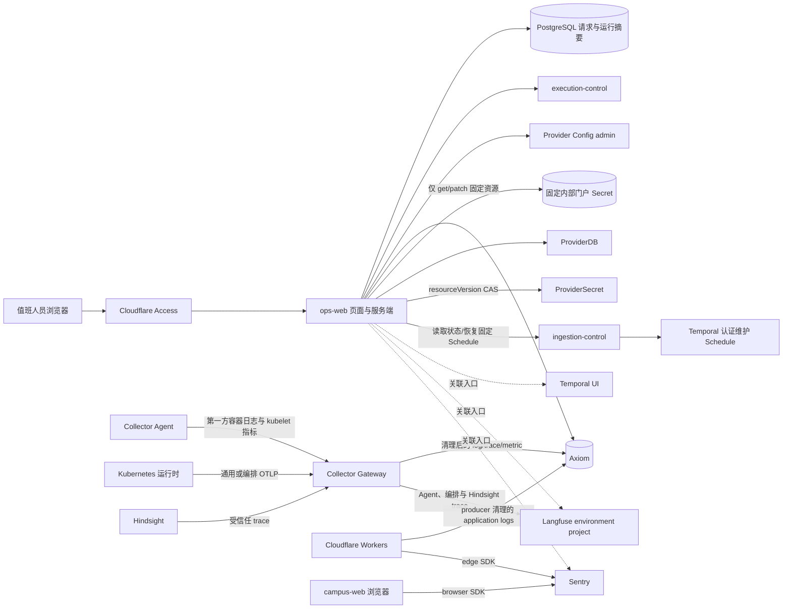

# Ops Web 可观测性架构

## 文档范围

本文定义 `ops-web`、PostgreSQL、OpenTelemetry Collector、Axiom、Temporal、Langfuse 和
Sentry 在运行排查中的职责。页面要求见 `../../product/ops-web.md`，HTTP 字段见
`../../contracts/ops-web.md`。

本文不宣称 staging 已部署或已通过 canary，也不记录环境地址、Secret 值或资源规格；这些由
环境 GitOps 仓库和实际运行证据负责。

## 核心结论

仓库只保留一个受控运维浏览器入口：

- `ops-web` 是独立、自托管、默认只读的运行排查应用。它在服务端读取严格授权的 PostgreSQL
  摘要、调用 execution-control 的受控接口并用固定 APL 查询 Axiom；浏览器只访问
  `ops-web` 自身接口。
- 唯一非诊断操作是受权限保护的在线 Provider Config、固定内部门户 TGC 替换和固定认证维护
  Schedule 恢复。
- Temporal UI、Langfuse UI、Sentry 和 Axiom 保留各自完整能力。Ops Web 只提供跨系统关联、
  固定摘要和经过地址白名单的入口。

Provider Config 通过同源 BFF 调用 execution-control admin；该后端不可用不影响排查 readiness。
`ops-web` 不是产品 API、数据库浏览器、Temporal 控制台或通用 Axiom 查询代理。

## 数据流

图只表示源码合同和环境可选输出，不证明任一环境已经收到可查询数据。

## 数据面分工

| 组件 | 负责 | 不负责 |
| --- | --- | --- |
| Ops Web 页面 | 展示、筛选、复制关联标识、打开入口、维护在线配置和替换门户 TGC | 获取凭据或提交任意查询 |
| Ops Web 服务端 | Access 验证、固定 Axiom 查询、短缓存、读取审计、Provider Config BFF 和固定 Secret patch | 写请求状态、触发任意工作流或提供通用代理 |
| PostgreSQL | turn dispatch、用户问题、agent run、observability fact 和读取审计 | Temporal 队列、原始日志、原始调用链 |
| Temporal | workflow history、重试、超时、timer、取消和 task queue 真相 | 产品请求状态或日志存储 |
| Collector Agent | 第一方容器日志和 kubelet 指标采集、Kubernetes 元数据补充 | 采集 Hindsight/Collector stdout 或长期存储 |
| Collector Gateway | 固定入口、字段清理、路由、采样、批处理、内存队列和有界下游重试 | 决定产品请求状态或查询历史数据 |
| Axiom | 脱敏运行日志、调用链、指标、固定查询、看板和告警 | 模型正文、产品状态或工作流真相 |
| Sentry | browser/edge SDK 错误、异常、受控性能、release 和 source map | 通用 OTLP sink、产品状态或模型 trace |
| Langfuse environment project | Agent、模型、工具、受控 execution-control、`memory.call` 与 Hindsight trace、dataset 和 score | 通用日志、产品记忆状态或 workflow history |
| Hindsight | 个人记忆提取、observation、consolidation、recall 和来源删除 | Ops Web 查询接口或产品状态 |

OpenObserve 已从目标运行和查询路径退役。它不得作为 Axiom 故障时的 fallback；环境残留资源只
能按 `../../decisions/adr-0081-observability-planes.md` 的独立破坏性门禁删除。

## 请求状态和关联

请求状态和排查摘要来自以下 PostgreSQL 来源：

- `chat.turn_dispatches`
- `chat.messages`
- `runtime.agent_runs`
- `runtime.request_observability_fact`

Ops Web 只获得这些来源中合同列出的列。Axiom、健康检查、Temporal、Langfuse 和 Sentry 只能
补充排查信息，不能改写请求状态。

受信任 Langfuse trace 可以包含模型输入输出、授权 retrieval facts 和 memory context；这些
正文不进入 PostgreSQL 摘要、Axiom 或 Sentry。任何观测面都不得接收 credential、secret 或
Temporal history。

关联标识的用途：

- `requestId`：列表、详情和 Axiom 固定查询的主标识；
- `traceId`：同一次调用链的跨系统标识；
- `conversationId`：同一会话中的请求关联；
- `runId`：运行记录标识；
- `workflowId`：由 `runId` 按 `campus-agent.chat.<runId>` 生成的 Temporal 工作流标识。

缺少 `runId` 时不生成工作流标识，也不猜测其他 Temporal 字段。

## 运行概况

Ops Web 并行读取四类信息：

1. PostgreSQL 提供请求数量、状态、95% 耗时和趋势。
2. execution-control 通过 Temporal SDK 提供当前 task queue 状态。
3. 固定健康检查提供五个服务的 HTTP 状态。
4. Axiom 分别查询 log、metric 和 trace dataset 的记录数与最近时间。

Axiom 三个 dataset 独立查询；单个查询失败只将该信号标为 `UNAVAILABLE`，不会把其他成功结果
丢弃。低流量窗口没有日志或调用链不自动表示故障；持续指标没有数据标为采集链路降级。

单个健康检查有独立超时。概况结果在每个进程内缓存 15 秒；PostgreSQL 和运行信号都失败时，
只允许使用五分钟内的最近完整结果并标为 `STALE`。缓存不承担持久化或跨实例一致性。

## Collector 入口和路由

staging 模板定义四个固定端口的 OTLP/HTTP receiver：

| 端口 | 生产者 | 允许输出 |
| ---: | --- | --- |
| `4318` | Collector Agent 和通用第一方运行信号 | Axiom log、trace、metric |
| `4319` | execution-control 编排信号 | Axiom 脱敏 trace/metric、Langfuse 受控编排 trace、Hindsight `memory.call` 父 span |
| `4320` | Agent runtime 受信任 trace | Langfuse environment project，按 service/tag 区分 |
| `4321` | Hindsight 受信任 trace | Langfuse environment project，按 service/tag 区分 |

四个入口使用精确 NetworkPolicy 隔离生产者，不增加集群内 bearer token。Gateway 对 Axiom
使用字段白名单、固定 span/log 归一化、采样、内存发送队列和 300 秒重试上限；对 Langfuse 受信任 trace 删除
credential 类属性，并按入口限制允许的 trace 类型。

Collector Agent 只读取第一方 namespace 容器日志，明确排除 Collector 和 Hindsight stdout；
kubeletstats 使用 ServiceAccount 和挂载 CA 验证 kubelet。Agent 从 Pod 的 canonical label 生成
`service.name`，只把单行 JSON 中准入的事件与关联字段提升为 attributes，并在发送前清空原始正文。
Gateway 另行抓取 Hindsight `/metrics`
和 Collector 自身指标，且指标 label 不得包含 user、bank、request、conversation、document 或
trace ID。

## Ops Web 的 Axiom 查询

Ops Web 使用 Axiom Edge APL endpoint 和 query-only token。浏览器只能选择 `logs` 或 `trace`；
服务端从已保存请求取得 `requestId` 和时间范围，并固定 dataset、过滤条件、字段投影、排序与
上限。

请求窗口从开始前五分钟到完成后五分钟，未完成请求以当前时间为上限，并最多查询 30 分钟。
日志最多返回 200 条，调用链最多返回 500 条；额外读取一条用于判断截断。Axiom 返回 partial
结果、无效 tabular JSON、重复字段、错位列、超时或非成功 HTTP 时都失败关闭，不返回部分正文。

日志投影仅包含时间、服务、severity、body、trace/span 和 request 关联字段；调用链投影仅包含
时间、服务、span 名称/类型/耗时/状态、error 和 trace/span/request 关联字段。每次成功返回原始
记录前必须写读取审计，审计失败时拒绝返回。

Worker application log 可以携带 producer 已准入的 `request_id`/`trace_id` 关联字段，但不是调用
链。请求级 trace 证据来自 W3C context 进入 execution-control 后由 Collector 写入 Axiom 的
runtime trace；Ops Web 不查询 Cloudflare native trace。

## Sentry 与 Cloudflare application logs

app-api 和 campus-web edge 使用 `@sentry/cloudflare`；campus-web browser 使用
`@sentry/react`、React error hooks、ErrorBoundary 和 TanStack Router tracing。运行配置使用独立
browser/edge DSN，并绑定 environment 与不可变 release；发布构建必须成功上传 browser source
map。

Sentry 配置关闭默认 PII、Cookie、header、query、正文、用户信息、GenAI 输入输出和 replay，
并在 `beforeSend`/span/transaction 钩子再次清理 route、identifier、breadcrumb 和异常上下文。
Collector 不向 Sentry 导出 trace。

app-api 与 campus-web edge 只把 producer 清理后的 application console logs 通过环境 log
destination 直接写入 Axiom，且 `persist=false`。`invocation_logs=false`，
`observability.traces.enabled=false`。application log 路径绕过 Collector 白名单，因此 staging
必须用哨兵请求检查 Axiom 中没有 query、header、正文、用户标识或 credential；出现 Cloudflare
invocation log/native trace 则属于配置漂移。检查失败时先禁用 log destination 或对应 producer
输出，不能继续平台退役门禁。

## Langfuse 与 Hindsight

execution-control、Agent runtime 和 Hindsight 传播 W3C `traceparent` 与 `baggage`。Hindsight
HTTP client 为每次 provider 请求建立 `memory.call` client span，只记录
`memory.provider=hindsight` 和 HTTP method，不记录 URL、bank、document 或正文。

Agent trace 与 Hindsight trace 进入不同 Langfuse project。runtime trace 使用产品 user identity
支持同一用户的隐私删除；Hindsight trace 的
`langfuse.user.id` 使用 execution-control 已按 owner salt、tenant、user 和 generation 派生的 bank
标识；Collector 不再二次哈希，映射后删除原 bank 属性。owner erase 因而可以按稳定产品 user
identity 与 `command.source_updated_at` 上界删除 runtime trace，同时精确清空已退役 generation
bank 的 Hindsight trace；命令之后的新 runtime trace 不会被误删。详细合同见 `langfuse.md` 和
`../../contracts/langfuse-runtime.md`。

## 权限和凭据

Cloudflare Access 负责登录和 JWT 签发，Ops Web 服务端再次验证签发方、受众、签名和操作者
白名单。原始日志和调用链使用更窄的独立白名单。

Ops Web 的 Axiom 配置必须完整提供 Edge URL、三个 dataset、query token 和有界 timeout。
query token 只能读取指定 dataset，不得使用 personal token、ingest token 或 Terraform 管理
token。Ops Web 与 Collector 使用不同凭据。

`ops_web` 数据库账号拥有四个允许来源的列级读取权限，并只能向
`observability.ops_observability_read_audit` 插入。`ops_audit_maintenance` 账号只能执行固定的
180 天审计清理函数。非本地 PostgreSQL 连接使用 CA 和 `verify-full`。

Provider Config、门户 Secret 和固定 Schedule 的权限边界保持独立；观测平台 credential 不得
复用为这些控制面 credential。

## 故障边界

- PostgreSQL 失败：请求列表和详情返回错误，不能显示为空列表。
- Provider Config admin 失败：配置页面返回明确错误，请求排查继续工作。
- Axiom 失败：原始记录或对应 telemetry signal 标为不可用，请求摘要仍可读取。
- 单个健康检查失败：该服务显示故障，其他服务继续展示。
- 原始记录查询或读取审计失败：拒绝返回记录，不返回部分数据。
- Kubernetes API、固定 Secret 或认证维护接口不可用：只影响门户认证页面。
- Sentry、Langfuse 或外部入口未配置：显示未配置，不影响本地排查。
- Collector 或 application-log destination 导出失败：由各自运行状态反映，不改写请求状态。

`/healthz` 只检查进程。`/readyz` 检查 Access 配置、PostgreSQL 读取和审计写入，不检查 Axiom、
Provider Config admin、门户认证依赖或被观测服务。

## 部署边界

源码仓库拥有 `apps/ops-web`、镜像发布、namespace-neutral base、集群内依赖 NetworkPolicy，
以及 `infra/otel/` 中 Collector 模板。环境 GitOps 仓库拥有 endpoint、dataset、Secret、API
Service IP 与外部 HTTPS 网络补丁、Ingress、保留期和不可变部署选择。Cloudflare
application-log destination 由环境 Terraform 管理，不由 Argo CD 管理。

源码、manifest、Terraform plan 或 Secret key 名全部存在仍不是上线证明；真实写入、查询、
权限拒绝和哨兵清理必须在目标环境验证。OpenObserve 的 `ensure: absent` 等破坏性状态不得与
首次 Axiom/Sentry/Langfuse rollout 放在同一环境变更。

## 禁止形态

- 不让浏览器直连 PostgreSQL、Axiom、Temporal、Langfuse 或 Hindsight。
- 不让浏览器传入任意 APL、dataset、`traceId`、时间范围或记录上限。
- 不让 Ops Web 查询 Temporal、Langfuse 或 Hindsight 数据库。
- 不在 `app-api` 中保存 Axiom、Sentry 或 Langfuse 查询结果。
- 不把 raw log、trace、event、LLM observation 或 SDK trace body 写入 PostgreSQL read model。
- 不把供应商 schema 写进 `packages/contracts`。
- 不恢复 OpenObserve、供应商正文同步任务或外部观测数据镜像表。
- 不让 Collector 向 Sentry 通用扇出，或让通用入口接收受信任模型/记忆正文。
- 不把 Ops Web 做成通用管理后台、工作流控制台或外部平台复制品。
- 不允许 Ops Web 创建、列举、删除 Secret，或修改固定门户 Secret 以外的 Secret。

## 相关文档

- `../../product/ops-web.md`
- `../../contracts/ops-web.md`
- `langfuse.md`
- `../../contracts/langfuse-runtime.md`
- `../../runbooks/otel.md`
- `../../reference/telemetry.md`
- `../../decisions/adr-0081-observability-planes.md`
- `../../decisions/adr-0067-ops-index-external-sinks.md`
- `../../decisions/adr-0072-self-hosted-ops-web.md`
