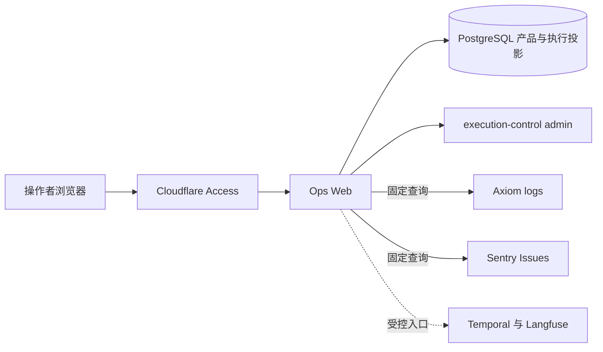

# Ops Web 与运行观测

## 边界

本文定义 Ops Web、产品投影和外部观测平台的所有权与数据流。操作者体验见
`../../product/ops-web.md`，HTTP 语义见 `../../contracts/ops-web/`，信号生产者索引见
`../../reference/telemetry.md`。

Ops Web 只关联现有事实，不生成第二套产品状态、工作流历史或模型 trace。

## 所有权

| 对象 | 所有者 | Ops Web 用途 |
| --- | --- | --- |
| 会话问题与产品结果 | App API PostgreSQL | 展示本轮问题、结果和公开来源 |
| 请求与执行投影 | App API、execution-control PostgreSQL | 状态、时间、用量、版本和关联标识 |
| Workflow Execution | Temporal | 受控外部入口 |
| Agent trace、dataset 和 score | Langfuse | 受控外部入口；运行 trace 可以停止接收 |
| Application log | Axiom | 按持久请求标识加载固定摘要 |
| Issue | Sentry | 按持久请求标识加载有限 Issue 摘要 |
| 在线模型配置 | execution-control | 发现、验证和写入受控配置 |
| 账号与会话 | App API | 固定账号管理操作 |
| Dining、同好群、门户凭据 | 各自领域数据所有者 | 内容与凭据管理 |

## 数据流

该图描述源码职责，不证明任一环境已经部署或外部平台已有数据。

## 概览与运行记录

概览只从持久产品请求投影汇总产品状态和趋势。外部平台、服务探针、Temporal queue 和 Collector
状态不参与产品健康，也不参与 Ops Web readiness。

运行记录以持久 `requestId` 为业务键，关联会话结果、执行投影和安全诊断标识。完整 Temporal
history、模型 generation、工具 observation、评测和任意平台查询仍在所属平台查看。

应用日志与 Sentry Issue 是两条独立按需查询：

- 服务端根据持久请求计算固定时间范围、来源、字段投影、排序和返回上限；
- 浏览器不能提交 APL、dataset、项目、任意 URL、时间窗口或字段；
- 打开详情不会自动读取外部平台；
- 失败、无记录、部分响应和未配置保持独立状态，不改变产品请求。

## 管理能力

Ops Web 通过 execution-control 的受控管理接口发现模型、验证候选连接并写入在线配置。模型发现不向
浏览器返回供应商密钥或原始响应。

账号管理通过 App API 固定接口完成。Dining、同好群和内部门户凭据使用各自数据与合同，不与运行
观测共享状态。自动化门户入口只处理具名凭据 metadata、带版本条件的更新和删除，不成为通用代理。

## 访问与故障

- Cloudflare Access policy 决定人员范围，服务端验证人员身份；机器入口使用独立 origin 和 Bearer
  token。
- 浏览器只调用同源接口，不持有数据库、供应商或下游服务凭据。
- PostgreSQL 不可用时返回明确错误，不转换为空列表或无数据。
- Axiom、Sentry、Langfuse、Temporal UI、模型配置或领域能力故障只影响所属区域。
- Langfuse 因配额停收是允许状态，不影响在线执行或 Ops Web readiness。
- 观测信号不能改写产品请求、个人记忆、账号或 workflow 状态。

## 部署边界

源码仓拥有 Ops Web 代码、镜像、环境无关 base、受控查询和信号消费合同。环境仓拥有地址、Secret、
外部平台设置、网络、Ingress、保留策略和不可变版本选择。配置或 manifest 存在不表示环境已经部署。

## 禁止形态

- 浏览器直连 PostgreSQL、Axiom、Temporal、Langfuse、Sentry 或 Hindsight；
- 浏览器控制任意供应商查询、项目、字段或记录上限；
- 根据日志、Issue 或 trace 推导新的产品终态；
- 把原始日志、模型 observation 或外部正文写入产品投影；
- 创建、列举、读取或更新 Kubernetes Secret 和 workload；
- 恢复已经删除的 Axiom metrics/traces 或通用平台聚合面。

## 相关文档

- `../../product/ops-web.md`
- `../../contracts/ops-web/README.md`
- `../../contracts/langfuse-runtime.md`
- `../../reference/telemetry.md`
- `../../decisions/adr-0072-self-hosted-ops-web.md`
- `../../decisions/adr-0081-observability-planes.md`
