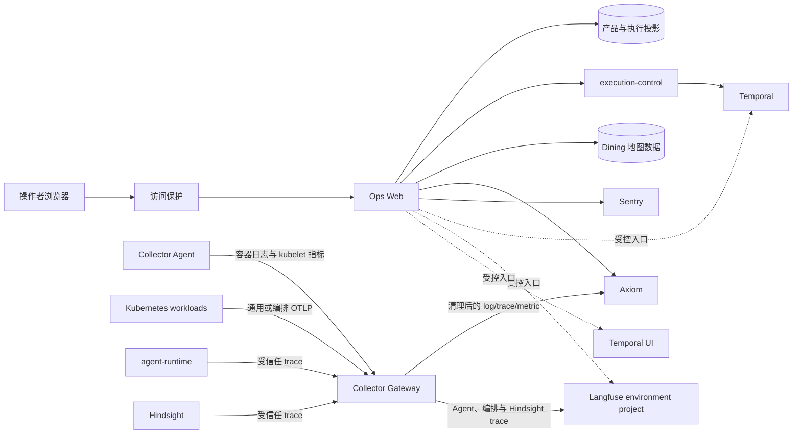

# Ops Web 与可观测性

## 文档边界

本文定义 Ops Web 在产品运行、可观测平台和少量管理操作之间的职责与数据流。页面体验见
`../../product/ops-web.md`，HTTP 语义见 `../../contracts/ops-web/README.md`，信号字段见
`../../reference/telemetry.md`。环境地址、Secret、网络目标和部署状态由可执行配置及环境仓维护。

## 核心边界

Ops Web 是独立的运维和内容运营应用，由浏览器页面和同源服务端组成：

- 浏览器只调用同源 `/api/ops/*`，不直连数据库、Kubernetes 或外部观测平台；
- 服务端关联有界产品投影、执行投影、Temporal 状态、Axiom 记录、Sentry Issue 和外部入口；
- 在线模型配置、Dining 和同好群是彼此独立的管理边界；
- 外部平台继续拥有完整查询、工作流、模型观测和评测能力，Ops Web 不复制这些界面；
- 任何观测信号都不能改写产品请求或工作流的持久状态。

## 数据流

该图描述源码职责，不证明任一环境已经部署或收到可查询数据。

## 组件职责

| 组件 | 负责 | 不负责 |
| --- | --- | --- |
| Ops Web 页面 | 展示、筛选、复制关联标识和发起获准操作 | 保存凭据、构造任意查询或决定请求状态 |
| Ops Web 服务端 | 人员身份校验、固定查询、外部入口和受控管理调用 | 通用代理、产品执行或任意工作流控制 |
| 产品与执行投影 | 请求、运行和有界结果摘要 | 原始日志、模型 trace 或 Temporal history |
| Temporal | workflow history、任务队列、重试、timer 和取消 | 产品请求摘要或日志存储 |
| Collector Agent | 第一方容器日志和 kubelet 指标采集、Kubernetes 元数据补充 | 长期存储或采集 Collector/Hindsight stdout |
| Collector Gateway | 固定入口、字段清理、路由、采样、批处理、内存队列和有界下游重试 | 决定产品请求状态或查询历史数据 |
| Axiom | 清理后的日志、调用链和指标 | 模型正文、产品状态或工作流执行状态 |
| Sentry | 浏览器和边缘错误、性能摘要、release 与 Issue | 通用日志存储或模型 trace |
| Langfuse environment project | Agent、模型、工具、受控编排、记忆 trace、数据集、评分和人工评审 | 产品状态或 Temporal history |
| Dining 数据 | 地图草稿与发布版本、菜单、评价、举报和评价修改记录 | 采集、来源同步或人员准入 |

PostgreSQL 角色和 schema 由 `../../data/postgres-ownership.md` 维护，食堂完整边界由
`../../product/dining.md` 维护。

## 运行记录与平台分工

Ops Web 以运行记录作为跨系统入口。默认页面回答本轮用户问了什么、从哪个产品入口进入、Agent 使用
了哪些用户可理解的业务能力、什么结果已经写入会话、耗时与主 Agent token 多少，以及是否需要人员
关注。它不是观测平台数据的副本，也不表示系统已经完成根因诊断。

各平台继续使用自己的稳定对象，不在 Ops Web 中压平成一套“诊断证据”：

| 对象 | 所有者 | Ops Web 中的用途 |
| --- | --- | --- |
| 用户问题与会话结果 | `chat.messages` | 本轮完整问题、app-api 净化后的回答和用户可见来源 |
| 产品请求 | `chat.turn_dispatches` | 入口、轮次、产品状态和请求与消息关联 |
| Agent 业务动作与用量 | `runtime.agent_*` | 人类可读能力路径、一次总耗时和主 Agent token |
| Session、Trace、Observation | Langfuse | 会话、单轮 Agent 运行、模型与工具步骤的完整分析和评测 |
| Workflow Execution | Temporal | 持久执行状态、重试、等待和事件历史 |
| Issue | Sentry | 跨事件聚合的应用错误或性能问题 |
| 日志与分布式调用链 | Axiom | 清理后的应用日志摘要、跨服务路径和完整查询入口 |

普通时间序和异常处置是两种读取任务，查询与界面必须显式区分，不能用隐藏排序混合。运行中的
记录不是天然故障，等待用户也不等于工作流仍在后台执行。具体页面视图和排序体验由产品需求
维护。

Ops Web 可以使用可信请求标识关联外部记录，但不能根据日志、健康检查、Sentry Issue 或 Langfuse
Trace 推断新的产品终态。Sentry Issue 可能聚合多个运行，单个运行也可能没有 Issue；Axiom 记录和
Langfuse Trace 可能因采样、延迟或保留策略暂时不可用。

服务端按已保存请求生成固定查询范围和字段投影：

- Axiom 返回清理后的应用日志或调用链记录；
- Sentry 返回有限错误摘要和官方 Issue 入口；
- Temporal 与 Langfuse 提供根据可信标识生成的受控入口；
- 外部正文不复制到产品数据库或 Ops Web 自有缓存。

所有接口使用同一 Cloudflare Access 人员准入；应用不复制人员、组或分操作白名单。失败、无记录、
部分响应和旧缓存分别保留自己的状态，不转换成产品请求成功或失败。

请求主体、列表主体和时间窗口汇总是运行记录接口的主投影。业务动作、Agent usage 和趋势是独立的
次要投影，必须在主体读取成功后分别结算；任一查询失败不能抹掉已取得的请求或汇总。业务动作通过
`actionsDataState` 区分无记录与不可用，usage 使用自身 `state`，趋势使用包含 `dataState`、`reason`
和 `data` 的有状态容器。次要投影失败显式返回 `UNAVAILABLE`，已有但不完整的 usage 返回
`PARTIAL`，不得用空数组或零值冒充成功查询结果。服务端不为这些投影增加缓存或重试。

Ops Web 只展示本轮产品结果和有界业务动作，并按需关联外部记录。它不从
`runtime.request_observability_fact.supporting_sources_json` 推断用户结果，也不把 memory、attempt、
重试或原始工具 ID 投影成产品旅途。完整模型输入输出和评测进入
Langfuse，完整工作流历史进入 Temporal，错误聚合进入 Sentry，日志和分布式调用链搜索进入 Axiom。
Ops Web 不实现统一查询语言、根因推断、Trace tree、Workflow history 或 Issue 管理。
用户可见结果中的内部来源链接必须属于已配置的 Campus Web origin；外部来源只接受无凭据的
绝对 HTTPS URL。Ops Web 只向浏览器提供跳转，不从服务端抓取该 URL。

## 运行概况

运行概况分成三个相互独立的状态面：

- 产品运行面读取请求投影和 Temporal 队列，只描述已经保存的产品与执行事实；
- 服务探针面只检查已配置的 Campus Web、App API、execution-control 和 agent-runtime 地址，
  未配置探针不生成虚构故障；
- 观测覆盖面读取 Axiom 的固定日志、调用链和指标查询，只描述观测数据是否持续写入。

三个状态面并行刷新，各自拥有超时、短期缓存、旧数据期限和并发合并。一个状态面失败时只能回退
该状态面的最近成功结果，不能抹除或降级其他状态面的最新结果。产品整体健康只汇总产品运行面和
服务探针面，Axiom 覆盖故障不等同于产品故障。页面以 `issues[]` 作为唯一根因摘要，不在整体状态、
服务表和问题列表重复同一说明。精确状态、窗口和缓存语义由接口合同维护。

低流量窗口没有日志或调用链不自动表示故障；持续指标缺失可以表示采集链路降级。被观测服务
故障不应阻止操作者打开 Ops Web 查看其他来源。

## 管理操作

### 在线模型配置

Ops Web 通过 execution-control 的受控管理接口读取、验证和写入在线配置。配置写入本身就是
当前设置的替换，不存在独立的 revision、bundle 或 activation 动作。Ops Web 不读取配置数据库、
不持有 keyring，也不能写入不完整或未验证的配置。

### Dining

Ops Web 使用统一 `ops_web` 角色管理地图、菜单、评价和举报。App API 读取当前发布地图和菜单，
并以受限权限创建、读取或删除学生评价及创建举报。完整规则见 `../../product/dining.md`。

## 可观测平台

OpenTelemetry Collector 接收 Kubernetes 通用信号和受信任运行 trace，按入口执行字段清理、
采样、批处理与下游路由。Cloudflare Worker 和浏览器使用各自支持的日志或 Sentry 集成；这些
例外不能变成绕过字段治理的通用出口。

Gateway 使用四个固定 OTLP/HTTP receiver：`4318` 接收通用信号，`4319` 接收 execution-control
编排信号，`4320` 接收 Agent 受信任 trace，`4321` 接收 Hindsight 受信任 trace。入口由精确
NetworkPolicy 隔离，不使用集群内 bearer token。Axiom 的 log、trace 和 metric 共用一个 ingest
token、使用不同 dataset；所有 exporter 使用内存发送队列和最长 300 秒重试，不依赖持久队列。

受信任 Langfuse trace 可以包含分析模型行为所需的输入输出、记忆上下文和已授权检索内容。这些
正文不进入 Axiom、Sentry、产品投影或 Ops Web 响应。详细边界见 `langfuse.md` 和
`../../contracts/langfuse-runtime.md`。

Ops Web 使用服务端固定、最小权限的 Axiom 和 Sentry 读取能力。浏览器不能覆盖 endpoint、数据
集合、组织、项目、查询、时间范围或返回上限。供应商 SDK、环境变量和凭据交付由实现、环境文档
和部署配置维护，不在架构文档复制。

## 访问与故障边界

- Cloudflare Access policy 决定人员范围，服务端验证 JWT 并拒绝服务身份；
- 写操作继续执行同源、幂等、并发和所属领域校验；
- PostgreSQL 不可用时，请求读取返回错误而不是空列表；
- Axiom 或 Sentry 不可用时，只影响对应观测区域；
- 在线模型配置或 Dining 依赖失败时，只影响对应页面；
- Dining 和 Sentry 未配置时不阻止 Ops Web 启动或就绪，所属接口返回明确的不可用状态；
- `/healthz` 只表示进程响应，`/readyz` 检查 Cloudflare Access 配置、公开来源地址和请求状态
  PostgreSQL；不探测 Dining、供应商或被观测服务。

## 部署边界

源码仓拥有 Ops Web 代码、镜像、namespace-neutral Kubernetes base、遥测字段策略和本地 Collector
配置。环境仓拥有 staging Collector Helm values、地址、Secret、网络目标、Ingress、保留策略和
不可变版本选择。源码文件、manifest 或 Secret 键存在不表示某个环境已经部署成功。

网络出站按 workload 的实际依赖由 Kubernetes 配置声明；环境特定地址和供应商解析结果不得写入
HTTP 合同。新增下游依赖时必须同时更新实现、可执行网络配置和环境选择。

## 禁止形态

- 浏览器直连 PostgreSQL、Kubernetes、Axiom、Temporal、Langfuse、Sentry 或 Hindsight；
- 浏览器提交任意查询语言、外部 URL、数据集合、时间窗口或记录上限；
- Ops Web 查询 Temporal、Langfuse 或 Hindsight 的内部数据库；
- 把原始日志、event、模型 observation 或外部平台正文写入产品投影；
- 把 Ops Web 扩张为通用管理后台、工作流控制台、评测平台或外部平台复制品；
- 创建、列举、读取或更新 Kubernetes Secret 和 Deployment。

## 外部设计依据

- Langfuse 对象模型：<https://langfuse.com/docs/observability/data-model>
- Langfuse Trace 结构：<https://langfuse.com/docs/observability/best-practices>
- LangSmith Trace 视图：<https://docs.langchain.com/langsmith/view-traces>
- Dify Conversation Logs：<https://docs.dify.ai/en/guides/monitoring/logs>
- Temporal Web UI：<https://docs.temporal.io/web-ui>
- Sentry Issues：<https://docs.sentry.io/product/issues/>
- Arize Phoenix Trace：<https://arize.com/docs/phoenix/tracing/concepts-tracing/what-are-traces>

## 相关文档

- `../../product/ops-web.md`
- `../../contracts/ops-web/README.md`
- `../../data/postgres-ownership.md`
- `../../product/dining.md`
- `langfuse.md`
- `../../contracts/langfuse-runtime.md`
- `../../reference/telemetry.md`
- `../../runbooks/otel.md`
- `../../runbooks/worker-otel.md`
- `../../decisions/adr-0072-self-hosted-ops-web.md`
- `../../decisions/adr-0081-observability-planes.md`
