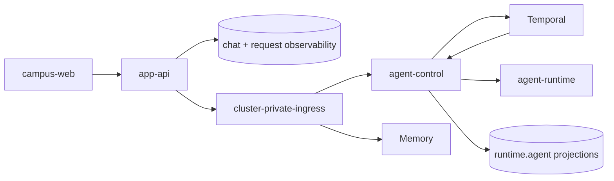

# 产品运行时

## 文档边界

本文定义浏览器产品、受控配置面、自托管运行查看面和执行运行时的所有权。HTTP 字段由合同定义，
数据库表由数据文档定义，部署状态由 GitOps 和实际运行状态定义。

## 组件

| 组件 | 负责 | 不负责 |
| --- | --- | --- |
| `campus-web` | 学生问答、账号、文档、地图、食堂和校园业务状态页面 | 产品可用性状态页、运维运行记录、数据库或内部运行时访问 |
| `app-api` | 浏览器认证、聊天接收与终结、公开问答可用性信号和产品 API | 产品可用性状态快照、Temporal worker、内部检索、在线模型配置、通用运维数据 API |
| `status-web` | 独立的产品可用性状态页、公共状态快照和第一方入口黑盒探测 | 校园业务状态、用户账号、聊天、内部运行时和观测平台原始数据 |
| `ops-web` | 自托管运行记录、运行概况、在线模型配置、Dining 内容运营和固定通知维护工作流操作入口 | 学生账号、聊天和请求写入，任意工作流控制或通用 Kubernetes 资源管理 |
| `agent-control` | 持久运行准入、启动取消、内部查询、receipt 和执行投影 | 浏览器认证、页面合同和模型凭据所有权 |
| `campus-search-service` | 共享 Campus Docs/Notice 检索、当前索引读取和 MCP 客户端 HTTP 合同 | Agent run 生命周期、个人记忆、通知采集和 Bot 写操作 |
| `model-config` | 具名在线模型配置、Provider 凭据、验证和内部读取合同 | 模型流量代理、执行编排和产品页面 |
| `agent-runtime` | 当前模型 operation 及其内部模型与获准工具循环 | 持久编排和产品数据持久化 |

## 浏览器路径

- `campus-web` 通过 Service Binding 或已配置的 app-api origin 调用 `app-api`。
- `status-web` 通过独立的 `status.*` origin 提供公开页面和只读状态快照；它不经由
  `campus-web` 或 `app-api` 代理状态数据。
- `status-web` Cron 通过 App API 的匿名 `GET /api/chat/availability` 探测问答，通过 Campus
  公开入口的 `/` 探测问答之外的整体站点；文档和地图等静态页面不单独探测。
- 浏览器不直连 agent-control、Temporal、Hindsight、Qdrant、PostgreSQL 或外部观测平台。
- `ops-web` 是独立受保护的自托管站点；其浏览器只调用同一进程的 `/api/ops/*`。

## 聊天路径

app-api 保存用户轮次并创建持久 request；agent-runtime 的 Temporal Workflow 推进执行，经 agent-control 写入
`execution_control.agent_*`；app-api 消费有界事件并保存产品终态。事务与幂等规则只在
[聊天请求生命周期](../../contracts/app-api/request-lifecycle.md) 维护。

## 数据边界

- 会话、消息和轮次派发：`apps/app-api`；
- 工作流 run、event、step、tool 和 memory 投影：`apps/agent-control`；
- 完整 Temporal history：Temporal；
- Agent 模型和工具调用 trace：Langfuse；
- 离线评测输入与结果：调用方和所属评分器；需要关联运行时再把 score 发布到 Langfuse；
- Worker release 和 source map：Worker 发布流程与 Cloudflare 平台；
- 个人记忆内容：Hindsight，由独立 memory-service 拥有；Agent Runtime 通过 Memory API 召回，Control/Memory Workflows 负责命令和追加；
- 产品可用性快照和有限时间线：`status-web` 所属的 Cloudflare KV namespace；不写入原始探测
  响应、Langfuse trace 或数据库记录。

产品和跨服务诊断统一通过 `request_id` 关联，`conversation_id` 只用于产品会话。workflow、Temporal
run、step、attempt、result 和 provider response ID 仅属于 agent-control 内部；OTel 和 Langfuse
的原生 trace ID 只在各自技术系统内存在，不进入产品 API 或持久业务投影。

## 配置与运行记录

- `ops-web -> model-config` 通过同源 BFF 管理在线模型配置；浏览器不获得 Provider API Key。
- agent-control 读取 `primary_agent` target 并冻结服务返回的 hash；Agent Runtime 按该 hash 读取完整
  配置。普通 Job 直接读取所属具名配置。内部 consumer 位于共同受信任边界，不使用 Model Config
  consumer token 或注册表。Campus Search service 在检索时读取 Embedding 与 Reranker 连接，具体查询与
  失败语义见[检索服务](./retrieval-serving.md#在线消费边界)。
- `ops-web -> PostgreSQL/agent-control` 提供有界运行摘要和执行诊断事实。
- `ops-web -> dining.*` 使用统一 `ops_web` 角色维护食堂草稿、不可变发布版本、菜单、评价和举报；
  app-api 读取公开菜单并以受限权限处理学生评价和举报；校园地图由 campus-web 的静态资产直接提供。
- Dining 投稿由 App API 提供学生入口、媒体编排与生命周期清理，Ops Web 提供治理入口，Campus Web
  提供公开及本人页面；源码实现与外部能力验收边界集中在[Dining PRD](../../product/dining.md)。
- `ops-web -> Temporal` 管理通知流水线的固定 Schedule、手动运行与有界运行状态；阶段由通知 Worker
  执行。通知维护不再通过 Kubernetes API 创建 Job，见[通知维护合同](../../contracts/ops-web/notices.md)。
- 在线模型配置不可用不阻断 Ops Web 的运行记录读取 readiness。
- Temporal UI 和 Langfuse UI 保留各自完整能力；Ops Web 只提供跨系统关联和常用摘要。

## 部署边界

浏览器产品与自托管运行时由不同平台承载；候选物、环境选择和实际发布的所有权见
[运行时发布架构](./runtime-release.md)。源码仓的 base 和镜像不单独构成环境状态。

## 架构约束

- 不让 app-api 代理 Temporal、Langfuse 或数据库通用查询。
- 不让产品可用性状态页复用 `campus-web` 的校园业务状态语义，或把内部运行组件作为公共服务行。
- 不让观测平台改写产品请求状态。
- 不把离线采集职责混入在线回答路径。
- 不为单一页面拆出没有独立数据、扩缩容或安全边界的后端服务。

## 相关文档

- [App API HTTP 合同](../../contracts/app-api/README.md)
- [聊天请求生命周期](../../contracts/app-api/request-lifecycle.md)
- [Ops Web 接口](../../contracts/ops-web/README.md)
- [PostgreSQL 所有权](../../data/postgres-ownership.md)
- [产品可用性状态页](../../product/status-web.md)
- [运行时发布架构](./runtime-release.md)
- [App API Worker 运行时](../../../.agents/notes/implemented/architecture/2026-03-28-app-api-worker-runtime.md)
- [产品可用性状态页](../../../.agents/notes/implemented/feature/2026-08-11-product-availability-status.md)
