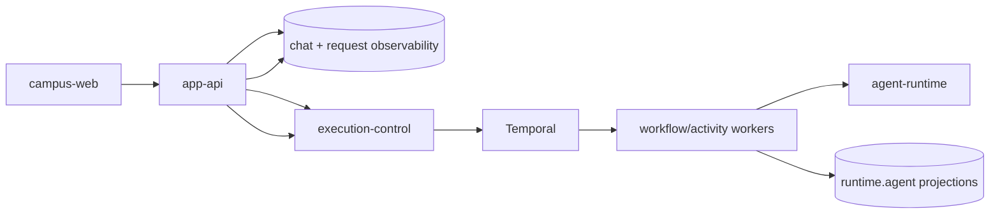

# 产品运行时

## 文档边界

本文定义 browser-facing 产品、受控配置面、自托管排查面和 execution runtime 的所有权。
HTTP 字段由 contracts 定义，数据库表由 data 文档定义，部署状态由 GitOps 和运行证据定义。

## 组件

| 组件 | 负责 | 不负责 |
| --- | --- | --- |
| `campus-web` | 学生问答、账号、文档、地图、食堂和 campus status 页面 | 运行排查、数据库或内部 runtime 访问 |
| `app-api` | browser auth、chat admission/finalization、产品 API 和状态 API | Temporal worker、RAG 内部、Provider Config、通用运维数据 API |
| `ops-web` | 自托管请求排查、运行概况、在线 Provider Config 和固定门户凭据替换 | 产品写操作、任意工作流控制或通用 Secret 管理 |
| `execution-control` | durable run admission、Temporal workflow、memory/RAG activities、run projection 和在线 Provider Config | browser auth 和页面合同 |
| `agent-runtime` | primary agent execution | durable orchestration 和产品数据持久化 |

## Browser 路径

- `campus-web` 通过 Service Binding 或已配置的 app-api origin 调用 `app-api`。
- 浏览器不直连 execution-control、Temporal、Hindsight、Qdrant、PostgreSQL 或
  Axiom。
- `ops-web` 是独立受保护的自托管站点；其浏览器只调用同一进程的 `/api/ops/*`。

## Chat 路径

app-api 在接收 turn 时写 `chat.turn_dispatches` 和 accepted observability fact，随后创建
durable run。execution-control/Temporal 推进执行并写 `runtime.agent_*`。app-api 读取 run
events，最终以原子事务写 assistant message、terminal dispatch 和 observability fact。

完整规则见 `docs/contracts/app-api/request-lifecycle.md`。

## 数据边界

- 会话、消息和轮次派发：`apps/app-api`；
- 工作流 run、event、step、tool 和 memory 投影：`apps/execution-control`；
- 完整 Temporal history：Temporal；
- 模型调用链与评测：Langfuse；
- 脱敏运行日志、调用链和指标：Axiom；
- browser/edge 错误、受控性能、release 和 source map：Sentry；
- 模型、工具和记忆受信任 trace：分项目的 Langfuse；
- 个人记忆：Hindsight，仅由 execution-control Activity 调用。

这些数据通过 `request_id`、`run_id`、`trace_id` 和 `conversation_id` 关联，不复制成
operator request projection。

## 校园服务

`campus_services.*` 是班车状态页面和模型可见工具共享的读取模型。
publisher 写一次，app-api status API 与 execution-control tool 分别读取；状态页不调用 tool，
tool 也不通过 app-api。

当前 model-visible campus service 只有 `transport_schedule_lookup`。contract/schema 存在不
代表其他 campus tool 已开放。

## 配置与排查

- `ops-web -> execution-control` 通过同源 BFF 管理在线 Provider Config；浏览器不持有
  execution-control credential。
- `ops-web -> PostgreSQL/execution-control/Axiom` 提供受限排查；人员可以通过固定接口
  patch `source-collector-internal-portal-auth` 并恢复固定认证维护 Schedule。
- Provider Config 后端不可用不阻断 Ops Web 的请求诊断 readiness。
- Temporal UI、Langfuse UI、Sentry 和 Axiom 保留各自完整能力；Ops Web 只提供跨系统关联、
  固定 Axiom 查询和常用摘要。

## 部署

- browser-facing Worker 应用由源码 workflow 上传不可变版本，环境仓 Terraform 管理
  custom domain、cron 与流量版本。
- execution-control、workers、ops-web、PostgreSQL 和依赖平台由 Kubernetes/GitOps 管理。
- app-api Worker 通过 Hyperdrive/Workers VPC 访问私有 CNPG，不公开 PostgreSQL。
- source repo 的 base 和镜像不是部署完成证明；环境 repo revision 和运行验证才是部署事实。

## 禁止形态

- 不恢复 supervisor、bootstrap mega-agent 或 flat retrieval tool。
- 不恢复 `runtime.request_execution`、projection outbox 或 operator request projector。
- 不恢复 Operator Console 或 app-api operator/provider 路由。
- 不让 app-api 代理 Temporal、Langfuse、Axiom、Sentry 或数据库通用查询。
- 不恢复 OpenObserve 或让观测平台改写产品请求状态。
- 不把 ingestion/data-plane ownership 混入在线回答路径。
- 不为单一页面消费面拆出无独立 owner 的后端服务。

## 相关文档

- `docs/contracts/app-api/README.md`
- `docs/contracts/app-api/request-lifecycle.md`
- `docs/architecture/system/ops-observability.md`
- `docs/contracts/ops-web.md`
- `docs/data/postgres-ownership.md`
- `docs/domains/transport.md`
