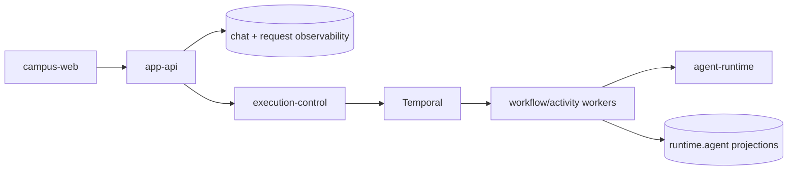

# 产品运行时

## 文档边界

本文定义浏览器产品、受控配置面、自托管运行查看面和执行运行时的所有权。HTTP 字段由合同定义，
数据库表由数据文档定义，部署状态由 GitOps 和实际运行状态定义。

## 组件

| 组件 | 负责 | 不负责 |
| --- | --- | --- |
| `campus-web` | 学生问答、账号、文档、地图、食堂和校园状态页面 | 运维运行记录、数据库或内部运行时访问 |
| `app-api` | 浏览器认证、聊天接收与终结、产品 API 和状态 API | Temporal worker、内部检索、在线模型配置、通用运维数据 API |
| `ops-web` | 自托管运行记录、运行概况、在线模型配置、固定门户凭据和 Dining 内容运营 | 学生账号、聊天和请求写入，任意工作流控制或通用 Secret 管理 |
| `execution-control` | 持久运行准入、Temporal workflow、内部查询、终态投影和在线模型配置 | 浏览器认证和页面合同 |
| `agent-runtime` | Primary/Knowledge Agent 与工具循环 | 持久编排和产品数据持久化 |

## 浏览器路径

- `campus-web` 通过 Service Binding 或已配置的 app-api origin 调用 `app-api`。
- 浏览器不直连 execution-control、Temporal、Hindsight、Qdrant、PostgreSQL 或
  Axiom。
- `ops-web` 是独立受保护的自托管站点；其浏览器只调用同一进程的 `/api/ops/*`。

## 聊天路径

app-api 保存用户轮次并创建持久 run；execution-control 和 Temporal 推进执行并写入
`runtime.agent_*`；app-api 消费有界事件并保存产品终态。事务与幂等规则只在
`docs/contracts/app-api/request-lifecycle.md` 维护。

## 数据边界

- 会话、消息和轮次派发：`apps/app-api`；
- 工作流 run、event、step、tool 和 memory 投影：`apps/execution-control`；
- 完整 Temporal history：Temporal；
- 模型调用链与评测：Langfuse；
- 脱敏运行日志、调用链和指标：Axiom；
- browser/edge 错误、受控性能、release 和 source map：Sentry；
- 模型、工具和记忆受信任 trace：单一 Langfuse project；
- 个人记忆：Hindsight，仅由 execution-control Activity 调用。

这些数据通过 `request_id`、`run_id`、`trace_id` 和 `conversation_id` 关联，不建立第二套请求
关联投影。

## 校园服务

`campus_services.*` 是班车状态页面和模型可见工具共享的读取模型。
publisher 写一次，app-api status API 与 execution-control tool 分别读取；状态页不调用 tool，
tool 也不通过 app-api。

当前 model-visible campus service 只有 `transport_schedule_lookup`。contract/schema 存在不
代表其他 campus tool 已开放。

## 配置与运行记录

- `ops-web -> execution-control` 通过同源 BFF 管理在线模型配置；浏览器不持有
  execution-control credential。
- `ops-web -> PostgreSQL/execution-control/Axiom/Sentry` 提供有界运行摘要和关联记录；人员可以
  通过固定接口更新内部门户认证并恢复固定维护 Schedule。
- `ops-web -> dining.*` 使用独立角色维护草稿、不可变发布版本和评价状态；app-api 只读取公开
  投影。
- `ops-web -> ingestion-control` 只查询和恢复固定门户认证维护 Schedule，不提交采集任务或选择
  其他工作流。
- 在线模型配置后端不可用不阻断 Ops Web 的运行记录读取 readiness。
- Temporal UI、Langfuse UI、Sentry 和 Axiom 保留各自完整能力；Ops Web 只提供跨系统关联、
  固定 Axiom 查询和常用摘要。

## 部署

- browser-facing Worker 应用由源码 workflow 上传不可变版本，环境仓 Terraform 管理
  custom domain、cron 与流量版本。
- execution-control、workers、ops-web、PostgreSQL 和依赖平台由 Kubernetes/GitOps 管理。
- app-api Worker 通过 Hyperdrive/Workers VPC 访问私有 CNPG，不公开 PostgreSQL。
- 源码仓的 base 和镜像不表示已经部署；实际环境状态由环境仓 revision 和运行检查确定。

## 架构约束

- 不让 app-api 代理 Temporal、Langfuse、Axiom、Sentry 或数据库通用查询。
- 不让观测平台改写产品请求状态。
- 不把离线采集职责混入在线回答路径。
- 不为单一页面拆出没有独立数据、扩缩容或安全边界的后端服务。

## 相关文档

- `docs/contracts/app-api/README.md`
- `docs/contracts/app-api/request-lifecycle.md`
- `docs/architecture/system/ops-observability.md`
- `docs/contracts/ops-web/README.md`
- `docs/data/postgres-ownership.md`
- `docs/domains/transport.md`
