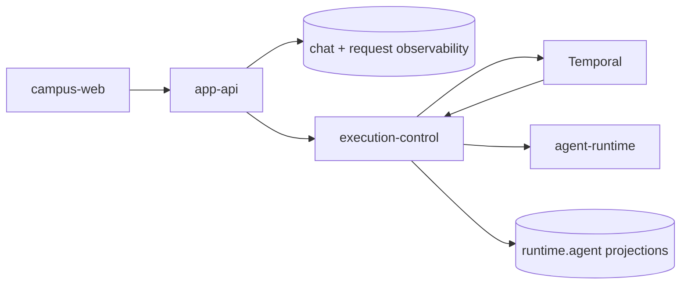

# 产品运行时

## 文档边界

本文定义浏览器产品、受控配置面、自托管运行查看面和执行运行时的所有权。HTTP 字段由合同定义，
数据库表由数据文档定义，部署状态由 GitOps 和实际运行状态定义。

## 组件

| 组件 | 负责 | 不负责 |
| --- | --- | --- |
| `campus-web` | 学生问答、账号、文档、地图、食堂和校园业务状态页面 | 产品可用性状态页、运维运行记录、数据库或内部运行时访问 |
| `app-api` | 浏览器认证、聊天接收与终结、公开问答可用性信号和产品 API | 产品可用性状态快照、Temporal worker、内部检索、在线模型配置、通用运维数据 API |
| `status-web` | 独立的产品可用性状态页、公共状态快照和第一方入口黑盒探测 | 校园业务状态、用户账号、聊天、内部运行时和观测平台原始数据 |
| `ops-web` | 自托管运行记录、运行概况、在线模型配置和 Dining 内容运营 | 学生账号、聊天和请求写入，任意工作流控制或 Kubernetes 资源管理 |
| `execution-control` | 持久运行准入、工作流业务逻辑、内部查询、执行投影和在线模型配置 | 浏览器认证和页面合同 |
| `agent-runtime` | 单次 Primary Agent SDK run 与获准工具调用 | 持久编排和产品数据持久化 |

## 浏览器路径

- `campus-web` 通过 Service Binding 或已配置的 app-api origin 调用 `app-api`。
- `status-web` 通过独立的 `status.*` origin 提供公开页面和只读状态快照；它不经由
  `campus-web` 或 `app-api` 代理状态数据。
- `status-web` Cron 通过 App API 的匿名 `GET /api/chat/availability` 探测问答，通过 Campus
  公开入口的 `/` 探测问答之外的整体站点；文档和地图等静态页面不单独探测。
- 浏览器不直连 execution-control、Temporal、Hindsight、Qdrant、PostgreSQL 或
  Axiom。
- `ops-web` 是独立受保护的自托管站点；其浏览器只调用同一进程的 `/api/ops/*`。

## 聊天路径

app-api 保存用户轮次并创建持久 run；execution-control 和 Temporal 推进执行并写入
`runtime.agent_*`；app-api 消费有界事件并保存产品终态。事务与幂等规则只在
`docs/contracts/app-api/request-lifecycle.md` 维护。

## 数据边界

- 会话、消息和轮次派发：`apps/app-api`；
- 工作流 run、event、step、tool 和 memory 投影：`apps/execution-control`；
- 完整 Temporal history：Temporal；
- Agent 模型调用链与评测：Langfuse；
- 有界 application logs：Axiom；
- browser/edge 错误、生产 browser 采样性能、release 和 source map：Sentry；
- Agent 模型和工具受信任 trace：单一 Langfuse project；
- 个人记忆：Hindsight，仅由 execution-control Activity 调用；
- 产品可用性快照和有限时间线：`status-web` 所属的 Cloudflare KV namespace；不写入原始探测
  响应、Langfuse trace 或数据库记录。

这些数据通过 `request_id`、`run_id`、`trace_id` 和 `conversation_id` 关联，不建立第二套请求
关联投影。

## 配置与运行记录

- `ops-web -> execution-control` 通过同源 BFF 管理在线模型配置；浏览器不持有
  execution-control credential。
- `ops-web -> PostgreSQL/execution-control/Axiom/Sentry` 提供有界运行摘要、application logs 和
  Sentry Issue。
- `ops-web -> dining.*` 使用统一 `ops_web` 角色维护食堂草稿、不可变发布版本、菜单、评价和举报；
  app-api 读取公开菜单并以受限权限处理学生评价和举报；校园地图由 campus-web 的静态资产直接提供。
- 在线模型配置不可用不阻断 Ops Web 的运行记录读取 readiness。
- Temporal UI、Langfuse UI、Sentry 和 Axiom 保留各自完整能力；Ops Web 只提供跨系统关联、
  固定 Axiom logs 查询和常用摘要。

## 部署

- browser-facing Worker 应用（包括 `campus-web`、`app-api` 和 `status-web`）由源码 workflow
  上传不可变版本，环境仓 Terraform 管理 custom domain、KV、cron 与流量版本。
- execution-control、agent-runtime、ops-web、PostgreSQL 和依赖平台由 Kubernetes/GitOps 管理。
- app-api Worker 通过 Hyperdrive/Workers VPC 访问私有 CNPG，不公开 PostgreSQL。
- 源码仓的 base 和镜像不表示已经部署；实际环境状态由环境仓 revision 和运行检查确定。

## 架构约束

- 不让 app-api 代理 Temporal、Langfuse、Axiom、Sentry 或数据库通用查询。
- 不让产品可用性状态页复用 `campus-web` 的校园业务状态语义，或把内部运行组件作为公共服务行。
- 不让观测平台改写产品请求状态。
- 不把离线采集职责混入在线回答路径。
- 不为单一页面拆出没有独立数据、扩缩容或安全边界的后端服务。

## 相关文档

- `docs/contracts/app-api/README.md`
- `docs/contracts/app-api/request-lifecycle.md`
- `docs/architecture/system/ops-observability.md`
- `docs/contracts/ops-web/README.md`
- `docs/data/postgres-ownership.md`
