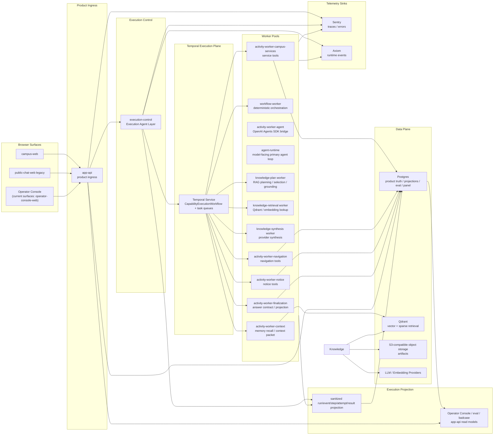

# 目标架构

## 文档边界

本文只负责描述 `campus-agent` 的 target architecture。

它回答的是：

- 长期要稳定成什么系统形态
- 哪些边界是长期不能退回的
- 当前架构向目标架构演进时，哪些原则必须保持不变

它不负责：

- 当前已开放 serving surface 的快照
- 某一轮 phase 的执行顺序
- 某个 app/package 的一次性实施细节

## 目标系统形态

`campus-agent` 的目标形态是：

- Campus Assistant product agent experience
- execution-control-owned Execution Agent Layer
- governed tool-using campus assistant architecture
- deterministic governance + bounded semantic agent execution
- capability-neutral Execution Agent Layer routing
- tools-first domain capability boundary；semantic specialist 以 agent-as-tool
  参与 typed step
- shared app runtime 与 execution engine 分层
- Temporal-backed durable execution plane
- execution-control + workflow / activity worker pools + KEDA/HPA worker autoscaling
- Go-owned workflow worker 与 capability activity worker plane；Python 不作为长期
  online answer hot path
- 独立 ingestion / data plane
- 可替换 retrieval stack
- eval-governed quality lifecycle
- primary-agent-first typed tool / RAG orchestration，且仍保持 bounded campus
  scope
- OpenAI Agents SDK 承接 model-facing primary agent tool loop；repo-owned
  artifacts 继续拥有 tool contract、admission、source-trust、projection、eval
  与 durable lifecycle truth
- cross-step context 通过 typed artifact / projection 传递，而不是通过 prompt
  自由文本或 provider raw trace 传递
- repo-owned execution projection spine：`Run -> RunEvent -> RunStep ->
  StepAttempt -> StepResult -> Finalization` 是 panel、eval、badcase 与
  operator_diagnostic_evidence 的共同诊断主线

长期主链路固定为：

```text
client/channel
-> browser surface
-> app-api surface policy / account-session / minimal context projection
-> execution-control durable run admission / Temporal command
-> CapabilityExecutionWorkflow
-> optional context.memory_recall
-> agent.primary model-facing first decision
-> direct/no-tool terminal or admitted tool / workflow signal
-> typed tool / RAG graph when tools are needed
-> finalization.write
-> sanitized run event + step/attempt/result projection
-> app-api response / stream / operator read model
-> browser surface / Operator Console / eval / badcase
```

这里的 multi-capability / agent-as-tool orchestration 不是无中心 peer swarm。长期默认是
manager-style multi-capability / agent-as-tool：`execution-control` 与 Temporal
workflow 保持 workflow / policy / budget / finalization ownership，typed tools
与 agent-as-tool 作为受控 capability step 参与执行；只有当某个 specialist
需要拥有后续回复 ownership 时，才使用 explicit handoff。

### Agent / Workflow / Capability Terminology

- `Campus Assistant` 是用户看到的 product-level agent experience，不是一个独立 worker
  进程。
- `Execution Agent Layer` 是 `execution-control` 内的 durable execution
  governance 层，负责 admission、workflow command/query/cancel、visible tool
  裁剪、step admission、projection 与 finalization；首轮工具选择由 primary
  agent runtime 在已裁剪 tool set 内完成。
- `CapabilityExecutionWorkflow` 是 Temporal durable workflow；它编排 execution
  lifetime，但不是 agent 本身。
- `agent-runtime` 是 model-facing primary agent runtime；它承接 OpenAI Agents
  SDK instructions、function tool schema、tool loop、SDK trace 与 usage
  normalization，但不拥有 run truth、source truth、product auth、Temporal
  command/cancel 或 panel/eval projection。
- `Capability Worker` 是按 capability / resource profile 拆分的 Temporal activity
  worker pool，例如 context / memory、knowledge、campus_services、notice、navigation
  与 finalization。
- `Tool` 是 deterministic data access 或受控外部服务调用；没有稳定语义职责的
  deterministic capability 不得借用 `agent` 命名。
- `knowledge` 是 capability family；RAG graph 是 `knowledge` 内部的 durable
  execution shape，不是与 `knowledge` 并列的用户可见能力。
- `requested_capability` 是 explicit caller hint / compatibility field，不是
  普通 chat 的目标态默认语义路由字段；缺失时不得伪造成 `knowledge`。

目标拓扑图：



长期摄入链路固定为：

```text
collector/source admission
-> ingestion control plane
-> task registry / lease / retry / dead-letter
-> source-family executor
-> raw asset
-> provider output
-> canonical source truth
-> declared projections
-> canonical document artifacts
-> document-units
-> chunks
-> embedding / index
-> release manifest
-> alias / read-model publish
-> app-api operator projection
```

长期 ingestion / data-plane runtime 目标不是 Python script collection，也不是把
`apps/app-api` 扩成 ingestion executor。目标分工固定为：

- `apps/app-api` 只承接 product/operator ingress、release gate command 与
  operator-safe read model；不拥有 ingestion task execution、source mutation、
  document/index materialization 或 Qdrant alias publish。
- ingestion control plane 拥有 task admission、task registry、claim / lease /
  retry / dead-letter、run shard state、registry-aware executor dispatch、telemetry
  closeout 与 operator projection snapshot。
- `apps/ingestion-control` 的 executor shell 按 registry 分派 `ts_control` /
  `rust_kernel` 任务，并把 redacted closeout 投影回 operator surface；缺失 handler /
  kernel 时 fail closed。
- `apps/ingestion-worker` 只保留 Python adapter island；Python extraction 只能由显式
  TS task handler 调用，不作为 collection lifecycle 或 fallback executor。
- `packages/ingestion-core` 继续拥有 canonical data-plane contract、shared file asset
  loader、source-truth / materialization strategy 与 collection strategy；release
  lifecycle 由 ingestion-control task registry/executor 承接。
- Rust 只作为 proof-gated deterministic kernel lane，用于 profiling 已证明的高吞吐
  CPU / memory 热点，例如 JSONL streaming、document-units validation、chunk packing、
  hash / dedup / diff、release manifest validation 与 embedding batch input preparation。
- Python 只作为 offline ingestion / eval / tooling runtime，或 MinerU / OCR / ML /
  domain extraction adapter；不得重新进入 online answer serving、top-level
  orchestration、provider cancellation ownership 或 product projection ownership。

## 长期硬约束

- 不退回扁平 retrieval tool-adapter 顶层路径
- Execution Agent Layer 保持唯一顶层协调入口，不演化成无中心 peer mesh
- Execution Agent Layer 不得退化成只负责 HTTP 转发的被动 proxy；它必须继续拥有 deterministic
  governance、workflow admission、budget 与 finalization
- HTTP request 不得成为 agent execution lifetime 的 canonical truth；一次回答的长期
  execution object 是 Temporal workflow execution + repo-owned product run
  projection，streaming 只是订阅 sanitized events / projection
- production 并发预算不得只存在于单个 `execution-control` 进程内存；Temporal Task Queue、
  workflow / activity worker pool、repo-owned admission policy 与 downstream
  budget projection 必须共同定义全局 execution capacity
- process-local limiter 只能作为单进程 runtime protection，不得被多实例叠加解释为
  production scheduler
- deterministic data access 默认必须建模为 typed tool 或 projection-backed internal query
  service；semantic specialist 只有在需要语义消歧、摘要、规划、tool/result consumption、
  clarification 或 answer shaping 时才作为 agent-as-tool
- agent-as-tool 不得退化成只有名称的 thin function wrapper；没有稳定语义职责的能力应保留为
  typed tool
- `admission / guardrails` 与 `capability routing` 必须分层，不得重新混成一个模糊 knowledge gate
- runtime / transport 逻辑留在 `apps/*`
- stable capability boundary 留在 `packages/*`
- `packages/contracts` 不泄漏具体 runtime、vendor、infra 类型
- online query path 与 offline data plane 不混层
- serving surface 由 runtime profile / explicit policy 控制，而不是硬编码在 entry shell
- canonical document 的 reader publish 与 RAG query-serving 是两条独立 release
  lane；文档站可见不等于 retrieval alias 已切换或 RAG 已可服务
- surface capability allowlist 由 shared `app-api` / product runtime policy
  拥有，而不是由 agent 或 browser surface 自行推断
- 普通 chat entry 缺失 `requested_capability` 时，目标态必须进入 primary
  agent decision，而不是由 `app-api` 或 `execution-control` 默认改写成
  `knowledge`
- target architecture 不默认接纳开放域 generalist / web capability 进入主 campus path
- `requested_scope` 只属于 knowledge-family path，不再作为所有 capability 共用的顶层默认字段
- retrieval plan 必须是 typed / observable artifact，而不是 prompt 内隐式黑盒
- planner 不能绕过 runtime profile、source-trust、freshness gate 或 capability
  opening gate
- admitted live retrieval 只能命中 repo-owned source channel，不得退化为 general web
  answer path
- provider-native function calling、remote MCP、built-in web tool 或其他外部 tool
  substrate 不得替代 repo-owned admission、source-trust、ToolSpec、eval 与
  observability truth
- Redis 不得作为 canonical execution queue；只允许作为 cache、invalidation、非权威 wakeup 或
  live fanout adjunct
- K8s 只作为 pod/resource/rollout substrate；不得拥有 workflow history、task queue truth、
  product run projection、event projection 或 terminal truth
- production worker autoscaling 目标态由 KEDA Temporal scaler + Kubernetes HPA
  承接；autoscaler 只能调整 workflow / activity worker replica count，不得写
  workflow state、product run projection、step projection、event projection 或 terminal
  state。Docker Compose `worker-autoscaler` 只保留 local / transitional staging 语义。
- capability 不得只因为 typed tool / worker 函数可执行就进入 production-open；normal、
  fail-close、cancel、timeout、late-completion 与 replan outcome 必须能写入
  step/attempt/result projection，并能被 app-api operator read model 消费
- tool output 不得以 provider 原始 trace、raw function response 或未裁剪正文形式进入
  app-api、panel、eval canonical asset 或 downstream prompt context
- cross-capability handoff / context projection 必须使用 bounded typed artifact；不得把上一步
  agent 的完整自然语言解释、raw evidence dump 或 provider trace 直接塞进下一步 prompt
- notice-family 用户可见 surface 默认采用 source-link / card-first posture：title、
  official URL、source family、发布时间与短摘要/匹配原因可以进入用户面；canonical body、
  OCR owner text、inline image text 与附件正文只能作为 source-truth、内部 context、
  下游 materialization 或 bounded summary/fact extraction 输入，不得作为默认全文输出。
- 主问答产品不按学生 / 教职工 / 院系身份拆分普通 capability。account / session、
  rate / quota、operator surface access 与 user-scoped memory binding 是产品层边界，不是普通校园问答能力差异来源。
- restricted documents、内部受限材料、approval / HITL、预约 / 提交 / 支付 / 工单等状态变更能力不属于主问答产品目标；
  不得把这些非目标反写成 capability opening gate 的默认复杂度。

## 长期产品/runtime 形态

- public 与 protected browser surface 可以是独立 Worker web surface
- shared `apps/app-api` 持续承接产品层 auth/session/principal、conversation、chat
  ingress、request projection 与 operator read surfaces
- `campus-web` 是长期学生侧统一入口，承载 Q&A、account、docs、map、dining 与
  feedback；`/docs/*` 使用 Rspress-powered canonical reader，而不是独立
  `public-docs` product surface
- shared `apps/app-api` 长期同时拥有 surface capability policy 与最小 typed context
  projection
- `execution-control` 持续只是 internal execution ingress，不是 product backend
- `apps/app-api` 长期以 Worker product ingress 承接产品层 runtime boundary
- `execution-control` 是长期 internal execution ingress 概念名；具体 app /
  deployment label 的当前状态以 `current-architecture.md` 为准
- execution-control / worker 的部署 substrate 不反推 browser-facing exposure model
- `apps/app-api` 长期拥有 conversation 与 run creation / stream proxy 的 product
  surface；`execution-control` 负责 workflow start / signal / cancel / query，
  Temporal 负责 workflow history、task queue、retry、timeout 与 heartbeat
- worker runtime 拆成 workflow worker 与 activity worker pools；deterministic
  workflow code 负责 orchestration，package-owned specialists 继续负责 bounded
  semantic reasoning
- production worker runtime 目标部署在 Kubernetes 中以独立 Deployment 表达，并通过
  KEDA Temporal scaler + Kubernetes HPA 按 Temporal task queue backlog 调整 replica；
  K8s/HPA/KEDA 不拥有 workflow history、product projection 或 terminal truth。
- worker plane 拆分优先于语言重写：先把 workflow worker、context / memory
  activity worker、knowledge activity worker、finalization / projection worker
  与 notice / navigation / campus_services worker 拆成可独立扩容、可观测、
  可取消的能力池；
  Rust 只用于 profiling 已证明的 CPU hotspot，例如 rerank / normalization /
  graph scoring，不作为 capability worker 重构的默认假设

## 长期 execution / agent 形态

- active target terminology 不再使用 `supervisor` 作为主语；历史 ADR、legacy
  contract 文件名、旧 schema / symbol 中的 `supervisor` 在目标态映射为
  `Execution Agent Layer`
- product-level agent 是 `Campus Assistant`；runtime-level agentic logic 位于
  `Execution Agent Layer` 和明确的 semantic specialist / agent-as-tool step。
- `CapabilityExecutionWorkflow` 是 durable execution substrate；它承载 run lifecycle、
  retry、timeout、cancel、step ordering 与 projection ordering，但不承担语义主体身份。
- repo-wide execution capability family 采用三层术语：
  - invariant role name
  - current-truth runtime / package / contract label
  - forward family label
- current-truth runtime / package / contract label 的实际状态只由
  `current-architecture.md` 维护，本文只定义长期命名分层。
- long-term forward family label 必须表达稳定 semantic specialist family，不得用
  transient worker、prompt delegate 或 source-channel implementation label 替代。
- 当新增稳定 domain capability 时，默认先冻结 typed tool / internal query service；只有需要
  semantic specialist 时，才新增 explicit agent-as-tool family，不得把 deterministic tool
  命名成 `*-agent`
- 不维护与 current-truth label 脱节的 synthetic alias；不得继续无规则地新增混合命名
- Execution Agent Layer 负责 admission / guardrails、visible tool/capability 裁剪、
  workflow command/query/cancel、step admission、handoff shaping 与 response
  finalization
- Execution Agent Layer 长期必须是 neutral capability router，而不是默认把所有请求先压成 `knowledge`
- Execution Agent Layer 长期拥有 durable workflow ownership：它决定本次 run 是否可创建 /
  推进，并显式限制 allowed capabilities、allowed tools、step budget、timeout 与
  fail-close terminal policy；本轮是否 direct no-tool 或调用哪个 model-visible
  tool，由 primary agent runtime 在该 allowlist 内决策
- first Execution Agent decision 是 provider/model-facing 的第一语义决策：它在
  repo-global invariants、typed task packet、allowed tool/capability set 与 strict
  output contract 下判断是否需要工具。产品自我说明、普通寒暄、澄清、拒绝、
  out-of-scope 与 fail-close outcome 不新增 `assistant_intro`、`product_meta`、
  `surface prompt profile` 或 `product persona` 分支。
- 长期必须有 repo-owned `CapabilitySpec` registry 作为 capability-level
  canonical artifact；新增稳定 domain capability 或 explicit agent-as-tool
  不得只在 planner / prompt / runtime delegate map 中添加字符串 target
- run projection 的 canonical lifecycle 固定为
  `Turn -> Run -> RunStep -> StepAttempt -> StepResult -> RunEvent -> Finalization`；
  multi-capability / agent-as-tool projection 可以在 step result 中表达
  `CapabilityInvocation` / `ToolCall` graph；
  provider-native trace、SDK run state 或框架 agent graph 只能作为内部
  debug input，不能替代 repo-owned sanitized projection
- production run lifecycle 的 canonical durable object 固定为 `Run`，最小状态为
  `created -> queued -> admitted -> running -> streaming -> completed / failed /
  canceled / expired`；`WorkflowRun` 是 multi-step / agent invocation graph 的内部
  workflow projection，不替代 product-visible run truth
- execution-control 长期承接 deterministic machine ingress、workflow command/query、
  cancel/signal/update admission、runtime metrics、audit command 与 fail-close envelope
- deterministic orchestration 长期由 Temporal workflow code 承接；online answer hot path
  的 capability activity worker 长期由 Go-owned runtime envelope 承接，
  package-owned specialists 只以 repo-owned DTO 和 bounded result projection 参与。
  Python 只允许作为 offline ingestion / eval / tooling runtime，或在迁移期间作为
  临时 semantic bridge；不得作为长期在线回答热路径、top-level orchestration、
  provider cancellation owner 或 product projection owner
- typed tool 负责 deterministic data access；agent-as-tool 负责明确语义边界内的 planning /
  evidence consumption / answer shaping
- agent-as-tool 可以作为 manager-style workflow 中的 bounded specialist；其输出必须先收敛为
  `StepOutputProjection` 或同等 bounded result projection，才能供后续 agent 或 finalizer 消费
- context inheritance 必须按 agent role 最小化；Execution Agent Layer 不得把完整 conversation、
  完整上游 answer、raw evidence dump、raw OCR、raw provider trace 或未裁剪 source body
  广播给后续 agent
- first model-facing execution decision 应由 primary agent runtime 承接，而不是由
  deterministic planner 先把空 capability 默认路由到 `knowledge`。成熟 agent runtime
  形态是：repo 先提供 system instructions、tool catalog 与 deterministic gates，模型
  在 SDK loop 内决定是否使用已暴露工具；repo durable workflow 只接收 sanitized
  final output、selected tool summary 与 result refs。
- campus services 的只读结构化查询默认由 typed tools / projection-backed internal query
  service 承接，包括 transport schedule、service status、service guide、temporary override
  与 contact directory。`campus_services` 只在需要语义消歧、跨工具编排、说明生成或
  agent-owned clarification 时作为 agent-as-tool；它不拥有服务 source truth。
  其中 `service_guide_lookup` 只回答办理指南、材料、入口说明、服务时间、
  联系方式与来源引用，不执行申请、预约、提交、代办、支付、工单创建或任何状态变更
- notice discovery、selected notice ref resolution 与 official source card
  rendering 默认由 typed tools / projection-backed internal query service 承接。
  `notice` 只在需要候选消歧、historical posture、短摘要/事实抽取或向
  campus-services / RAG / regulation 等下游提供
  source-linked bounded notice context 时作为 agent-as-tool。它不是默认正文阅读器，不负责把官方通知全文复制到用户面。
- `navigation` 长期可消费 transport point refs / service point refs，但不拥有
  timetable truth 或 service-status truth。
- `knowledge` 长期拆成 scope resolution、retrieval planning、answer
  synthesis、grounding validation 等内部角色；当前 runtime owner 为 Go-owned
  `apps/execution-control` RAG Temporal graph
- `context.memory_recall` 是 capability-neutral bounded context step，不属于
  RAG worker 的私有前置逻辑；`plan.route` 只能作为 retained deterministic
  support path / historical planning artifact，不再是普通 chat 的 first
  model decision owner。进入 `knowledge` branch 后，RAG 在线目标不是单个
  `semantic.rag` 黑盒 step，而是 durable typed step graph：
  `knowledge.rag.plan -> knowledge.retrieval.indexed_lookup ->
  knowledge.retrieval.expand_or_rescue -> knowledge.evidence.selection ->
  knowledge.synthesis -> knowledge.grounding.verify`。每个 step 必须产生
  sanitized result projection，供 Operator Console / eval / badcase 诊断消费。
- provider adapter 是 execution cost / cancellation 的明确边界：必须记录 provider
  request ref、latency、input / output / cached token、estimated cost 与 terminal
  outcome；cancel / timeout 必须传递到 activity 与 provider adapter，并在可能时
  abort in-flight request，不能只把 Temporal cancel 记录成产品终态后继续消耗 token
- LLM 服务可用性不作为目标架构的主要风险假设；目标关注的是 latency、token、
  estimated cost、budget enforcement、cancel / timeout 下游停止能力与 sanitized
  projection
- `knowledge` 不再作为所有 campus 请求的默认 fallback；它是 knowledge / retrieval /
  grounding specialist，可以消费 notice、service、navigation step 产生的 bounded context，
  但不能代持这些 domain capability 的 source truth
- repo-owned retrieval runtime seam 长期负责 retrieval execution、rerank / merge / dedupe、query
  activity 与 candidate-set shaping
- retrieval backend、vector infra、framework 选择隐藏在 agent / retrieval boundary 之后
- 非 RAG deterministic capability 只要是稳定能力边界，默认应作为 typed tool / internal query
  service 落地，而不是回退成 Execution Agent Layer inline ad hoc function
- `routing clarification` 与 `agent clarification` 必须显式分层；前者由 Execution Agent Layer
  拥有，后者由对应 agent 拥有
- 对 `service_status_lookup`、`transport_schedule_lookup`、`service_guide_lookup`、
  `campus_notice_discover` 与 selected notice card/context resolution 这类结构化 runtime
  capability，目标实现形态固定为
  `projection-backed internal query service + typed tool + optional agent-as-tool`，而不是
  query-time raw source scan、browser/public API 直连，或 execution path 回调
  `app-api` loopback HTTP
- projection-backed internal query service 可优先采用 Go 实现，以降低 Docker-side runtime
  latency / memory cost；这不改变 typed tool / agent-as-tool 的边界
- 对 structured projection capability，长期 online consumption 固定为 PostgreSQL
  release catalog / current pointer / typed read model；对象存储保存 immutable release
  artifacts，Redis 只能作为 cache / invalidation adjunct，不拥有 current truth

典型 multi-capability / agent-as-tool campus workflow 的长期形态包括：

- transport / schedule answer
  - campus services typed tool 读取 current schedule baseline
  - notice typed tool 或 `notice` agent-as-tool 提供近期 override /
    change notice 的 source-linked bounded context
  - navigation typed tool 或 `navigation` agent-as-tool 补充 stop /
    pickup point context
  - `knowledge` retrieval step 或 grounding validator 校验证据是否足以回答
- service handling answer
  - campus services typed tool 读取 guide / contact / status projection
  - navigation typed tool 补充办理地点
  - `knowledge` typed retrieval step 补充稳定制度依据
- notice explanation answer
  - notice typed tool 或 `notice` agent-as-tool 解析 selected notice ref，提供 official
    source card 与 bounded context
  - `knowledge` typed retrieval step 读取相关制度 / reference evidence
  - Execution Agent Layer 统一 finalization 与 fail-close semantics

如果未来产品明确接受开放域能力，也必须以独立 capability boundary 或独立 agent 接入，并拥有单独的
routing、policy、eval 与 observability 约束；它不是当前 campus path 的隐式 fallback。

## 长期 tool / function-calling 形态

长期 tool 架构固定为：

`app-api surface admission -> execution-control durable run / visible tool
裁剪 -> Temporal workflow -> primary agent SDK tool catalog -> direct no-tool
answer or SDK function tool call -> repo-owned internal query service / RAG
graph / typed activity -> sanitized StepResult projection`

其中：

- `execution-control` 与 workflow policy 拥有 deterministic admission、opening gate、
  capability / lane / scope / version guard、visible capability allowlist、workflow
  policy、Temporal timeout/cancel 与 fail-close terminal semantics
- OpenAI Agents SDK 是 model-facing primary agent loop substrate：它拥有本轮工具选择、
  function-tool 调用循环、direct/no-tool final output 与 SDK trace；它不拥有
  source truth、capability opening posture、surface admission、Temporal lifecycle、
  sanitized projection 或 panel/eval canonical evidence
- agent-as-tool 可以在自己的能力边界内使用 provider/SDK mediated tool loop，但只能消费
  durable workflow step 允许的 tool 子集
- provider/SDK tool loop 不是跨 family permission expansion owner；它只能在
  repo 预先暴露的 model-visible read-only tool catalog 内选择工具
- tool 必须优先建模为 read-only typed capability；state-changing tool 不属于当前
  campus 主问答产品目标
- tool 后端必须是 repo-owned internal query service、retrieval runtime seam 或已 admission
  的 source-channel adjunct，不得直接暴露 browser-facing API、raw SQL、raw object-store
  bytes、collector runtime 或 ingestion/index build path
- tool result 必须先变成 bounded result projection 或 `StepOutputProjection`，再进入
  answer synthesis、workflow trace、operator projection 或下一步 handoff
- remote MCP / provider built-in web search 只能作为显式 admitted source-channel
  adjunct；未 admission 前不得作为 campus answer-bearing fallback

目标态 canonical routing examples：

- `hi，你是谁？`：primary agent direct/no-tool terminal answer；
  finalization 写入 `agent.primary` result ref，不调用 RAG 或 synthetic
  `assistant_intro` capability。
- `最近有什么通知？帮我总结一下。`：primary agent 选择 notice capability 的
  `campus_notice_discover`；必要时再消费 selected notice bounded context，默认不复制通知全文。
- `今晚六点还有丰台去海淀的班车吗？`：primary agent 选择
  `transport_schedule_lookup`；如存在近期变更，需要 consumption notice change-set
  作为 bounded override 输入。
- `信工有什么专业？`：primary agent 选择 `knowledge_query` workflow signal，
  进入 Go-owned RAG graph；primary agent 不直接接收 `retrieval.query`、collection
  或 top-k slot。

tool 与 deterministic query function 的边界必须保持清晰：

- capability-facing tool 应表达用户意图级能力，例如找通知、查班次、查服务状态或查办理指南。
- deterministic query function 应表达内部读模型函数，例如按 notice id 取 source card、
  按 selected notice ref 取 bounded context、读取附件 refs 或读取 OCR owner text。
- query function 不应因为实现上有 JSON schema 就自动进入 ToolSpec 顶层 tool surface。
- SDK internal function 是 deterministic query function 的受控子类：可以由
  repo-owned tool catalog / `ToolSpec` 注册 strict function schema，但必须通过
  runtime posture 显式 admission；例如 RAG 的 `retrieve_evidence` 只读取 admitted
  query slot 与 bounded evidence anchors，不进入 public model-visible tool catalog。
- notice family 默认只暴露 `campus_notice_discover` 这类 card discovery tool；
  selected notice card/context resolution 应优先作为 notice 或 Go internal query
  service 的 deterministic function。若未来确需 capability-facing resolve tool，也必须只返回
  `ResolvedNoticeRef` / `NoticeCard` / display policy，不返回 full body。
- canonical notice body、OCR owner text、inline image text 与附件正文不得作为 provider
  function tool output 直接进入 public answer；只允许进入 bounded summary、fact extraction、
  downstream materialization 或 source-linked context projection。

长期 capability、tool 与 explicit agent-as-tool registry 的边界必须保持清晰：

- `CapabilitySpec` 定义 deterministic domain capability 的能力边界、
  input/output projection、allowed tools、context filter、opening gate、
  timeout/budget、trace projection 与 eval denominator
- `ToolSpec` / `tool-catalog.v1` 定义 capability / agent-as-tool / primary agent
  内部可调用的 read-only capability 或受控 function surface；model-facing SDK
  catalog、deterministic structured planner 与 typed branch support path 必须由
  repo-owned artifacts 生成或校验
- Go `WorkflowPlan` 只能选择已注册且 gate-ready 的 capabilities / tools /
  admitted agent-as-tool steps；primary agent SDK loop 只能接收 workflow 已裁剪的
  visible capability set
- provider/SDK function schema 必须从 repo-owned artifacts 派生或被 drift test
  校验；Python worker delegate map 只属于 offline / eval / historical bridge reference
- 新增 explicit agent-as-tool、打开 explicit handoff 或打开 parallel fanout，都必须先补
  contract、eval denominator 与 trace
  projection，不得只靠 prompt 约束

长期需要一个 repo-owned `ToolSpec` registry 作为 canonical artifact。该 registry 至少固定：

- `tool_name`
- owner capability / capability family
- payload schema / result schema
- read-only posture
- opening gate 与 allowed surface
- source-truth owner / internal query service owner
- timeout budget、max result size 与 parallel-call policy
- temporal semantics、freshness policy 与 version behavior
- argument summary 与 result projection policy
- fail-close reason、business outcome 与 observability labels
- eval denominator 与 provider function schema generation policy

`ToolSpec` registry 应生成或校验：

- Go runtime policy 的 target/tool allowlist
- Go structured planner 的 payload kind 与 planning outcome
- provider-native function schema
- OpenAI Agents SDK function tool schema / model-visible catalog
- workflow trace / execution audit 的 sanitized projection
- `packages/evals` tool selection、argument precision 与 fail-close denominator

## 长期 routing intent governance 形态

顶层 routing intent 长期必须是可版本化、可观测、可评测的 typed governance artifact，而不是
prompt 内部的隐式判断。

固定职责如下：

- `apps/app-api` 拥有 surface capability policy、conversation / session truth、
  operator review truth 与观测驱动治理 read model
- `apps/execution-control` 只拥有 deterministic execution admission、lane /
  opening gate、timeout / cancel / audit event 与 runtime metrics
- `apps/execution-control` 拥有 Execution Agent Layer routing intent framing、routing
  clarification 与 handoff semantics
- domain agent 只拥有已选定 capability family 内部的 agent clarification 与执行语义
- `packages/evals` 拥有 intent truth dataset、runner、regression gate 与 observed-case
  promotion 协议

长期 intent policy / classifier 规则必须由 repo-owned artifact 治理，而不是散落在 runtime
源码中的匿名 signal list。该 artifact 至少固定 policy artifact schema version、runtime
policy version、classifier behavior version、intent schema version、case-set version、reason
code registry 与 signal group taxonomy。runtime 可以把 artifact 编译进部署镜像或按受控路径加载，
但缺失、版本漂移或结构不合法时必须 fail closed，不能静默回退到另一套未版本化规则。

长期 intent frame 至少应显式表达：

- admitted / inferred capability family
- task kind
- next action
- launch state
- risk level
- scope class / scope reason / policy reason
- missing slots
- routing confidence 或 ambiguity signal
- context resolution state
- classifier version
- intent schema version

其中 `intent_schema_version` 与 `intent_classifier_version` 必须分离：

- `intent_schema_version` 约束字段、枚举、reason code 与下游兼容性
- `intent_classifier_version` 约束 deterministic rule / model / resolver 的行为版本
- schema 的破坏性变更必须显式升 major，并同步 app-api、panel、eval 与 telemetry consumer
- classifier 的行为修复可以在兼容 schema 下独立迭代，但必须进入 eval regression 与
  observability rollup

上下文 follow-up 长期不作为 prompt side effect 处理，而由 Execution Agent Layer-owned
routing context resolver 显式产出：

- `context_resolution_state`，例如 `not_follow_up`、`resolved`、`ambiguous`、
  `missing_context`
- `context_reference_type`，例如 previous goal、selected notice、curriculum slot、
  service temporal reference
- resolved slots
- missing slots
- ambiguity reason

resolver 只能消费 `apps/app-api` 投影出的最小 typed context，例如 session slot、selected notice
ref、recent goal summary 与 actor / profile projection；它不得反向读取 raw transcript、raw
session store 或 browser-local state。

长期 eval 必须把 routing intent 作为独立 workflow gate，而不是用最终回答质量间接覆盖。最小
suite family 固定为：

- `release_gate`：稳定 deterministic routing / guardrail baseline
- `context_follow_up`：多轮引用、slot 继承、缺上下文澄清与歧义处理
- `observed_regression`：从线上观测、人工复核、incident backfill 晋升的真实样本
- `version_compat`：schema / classifier version 与下游消费兼容性

长期 operator observability 必须能区分：

- routing 错误
- routing clarification 正确但 agent 证据不足
- capability family 正确但 handoff / tool / source 执行失败
- schema / classifier version 变化导致的行为漂移

观测驱动治理链路固定为：

`request observability fact -> operator review / sampled grade -> intent case mining
-> packages/evals observed_regression -> release gate / version compat report`

该链路只能回流 sanitized routing / outcome / review summary，不得把 raw prompt、raw answer、
raw transcript、auth material 或 provider raw response 作为 Operator Console truth
或 eval canonical asset。

## 长期 eval / quality governance 形态

长期 eval 不是一次性 release checklist，而是围绕 production feedback 持续运行的质量治理
lifecycle。它必须和 runtime observability、operator review、golden truth 与 release gate
保持分层，但形成闭环。

固定 owner 如下：

- `packages/evals` 拥有 eval truth、case schema、runner、artifact、grader adapter、
  release gate 与 golden / regression admission lifecycle
- `apps/app-api` 拥有 internal eval ingress、request correlation、quality grade /
  trace backlink ingest 与 operator-facing projection，不拥有 golden truth
- Operator Console 只承担 operator review / triage UX；它可以发起受控 review
  action，但不决定 golden set truth、不生成 benchmark artifact。当前实现 surface 可以是
  `operator-console-web` 或后续统一后的 operator console package。
- `apps/execution-control` 与 domain agent 只产出 execution / trace / outcome
  facts，不写 eval truth
- OpenAI Evals / graders / tracing、RAGAS、Sentry、Axiom 等外部工具只能作为 grader、
  trace/debug sink 或 analysis input，不成为 repo canonical eval truth

长期 eval lifecycle 固定为：

`production request / incident / operator badcase ->
app-api operator candidate projection ->
eval-owned review / dedupe / admission ->
golden or observed regression case ->
deterministic + supplemental gate ->
accepted artifact ->
optional app-api grade / backlink publish ->
operator observability rollup`

其中：

- production aggregate、sampled grades、release-gate verdict 与 golden truth 不得混成一张表
- candidate review 必须记录 accept / reject / duplicate / deprecated / needs-info 等
  lifecycle decision，以及 reviewer、reason、source request 与 target suite
- accepted case 必须写入 repo-owned case fixture / artifact truth，而不是只留在 panel、
  sink dashboard 或临时 JSON
- release-gate artifact 必须保留 request correlation、runtime versions、case-set version、
  deterministic verdict、supplemental verdict 与 publish summary
- failed release gate 只能通过修复 runtime、修复 truth、或有审计记录的 case
  governance decision 关闭，不能在 Operator Console 上直接 override

长期 suite family 固定分层：

- `smoke`
  - 小样本、快速、本地开发可跑，覆盖入口 contract 与高风险 happy path
- `release_gate`
  - 发布前 canonical denominator，覆盖已开放 serving surface 的核心成功 / fail-close /
    clarification / policy path
- `regression_locked`
  - 高风险历史回归，优先锁定 doc/version/source truth 与已修复 incident
- `observed_regression`
  - 从生产 badcase、operator review、incident backfill 与 sampled grade 晋升的真实样本
- `context_follow_up`
  - session slot、selected notice、recent goal、profile projection 与缺上下文澄清
- `version_compat`
  - intent schema、classifier、prompt、model、index、case-set 与 downstream consumer 兼容性
- `workflow_trace`
  - planner、handoff、tool call、guardrail、fail-close 与 structured runtime branch
    的 trace correctness

`workflow_trace` 是 orchestration 的一等 release gate，不是回答质量 gate 的附属字段。它至少需要覆盖：

- `first_decision_branch_correctness`
  - 应 direct/no-tool terminal 的 product identity、普通寒暄、clarification /
    rejection / fail-close case 不得误入 `knowledge` 或其他 capability
  - 应进入 capability/tool 的 semantic case 必须携带完整 typed routing /
    workflow planning projection
- `handoff_correctness`
  - capability family、target、allowed tools、missing slots、context resolution 与 policy
    reason 必须和 expected truth 对齐
- `tool_argument_precision`
  - structured tool / retrieval plan 的 corpus、collection、doc/version、service subtype、
    temporal scope 与 source-channel 参数必须可比对
- `fail_close_correctness`
  - policy unavailable、capability closed、query scope disabled、missing context、source
    truth unavailable 与 evidence insufficient 必须进入可审计 terminal outcome
- `trace_projection_completeness`
  - request correlation、runtime versions、policy artifact versions、planning outcome、
    selected capability / tool 与 source summary 必须进入 sanitized artifact

外部 agent / trace 工具可以降低 trace capture 与 grader adapter 的实现成本，但不能成为
`workflow_trace` 的 canonical truth；repo-owned case fixture、expected truth、artifact
projection 与 release verdict 仍由 `packages/evals` 拥有。

长期评分分层固定为：

- deterministic gate 是 canonical release verdict 的第一层，覆盖 status、routing、retrieval、
  citation、required facts、forbidden claims、policy / opening posture 与 fail-close
- supplemental graders 只能补充 grounding、relevance、tool / handoff semantics、
  workflow quality 与 human-calibrated rubric；它们是否 gating 由 repo-owned policy 决定
- human review 必须持续校准 automated grader，避免把 grader drift 反向写成 truth
- 对未开放 capability family，只允许评估 closed / candidate-only / clarification
  behavior；不能提前要求 answer quality gate

长期 eval artifact 与 observability 回流必须坚持 data minimization：

- eval artifact 可以保存 sanitized prompt summary、expected truth、observability summary、
  request / trace correlation、grader rationale summary 与 safe links
- eval artifact 不得保存 raw JWT、raw cookies、raw auth envelope、raw transcript、
  provider raw response、retrieval backend dump 或未经裁剪的 source body payload
- trace / grader tooling 的原始结果必须先经过 eval-owned projection，再进入
  `apps/app-api` 的 operator-facing grade / backlink ingest

## 长期 account / memory 形态

长期主问答真相层固定拆成：

- `institutional knowledge`
- `account / session`
- `user-scoped memory`

长期 owner 固定为：

- `apps/app-api` 拥有 account / session、operator access、rate / quota 与 user-scoped
  memory binding 的 product truth；online memory recall 由 execution-control /
  Temporal / Hindsight self-host Personal Memory Plane 承接
- execution path 只消费最小 typed projection
- memory 可以影响 follow-up、preference、query framing、disambiguation、planning /
  wording，但不能决定 capability opening、tool admission、source trust、fail-close、
  operator access 或 account/session truth

Memory Plane 的 Hindsight runtime、online recall、写入链路与 Temporal 参与点，统一看
`system/memory-plane-architecture.md`。本文只保留目标 repo 级 owner 与 advisory-context
约束。

## 长期 retrieval / serving 形态

- retrieval 长期是 registry-backed、filter-first、evidence-oriented path
- retrieval 只在 capability routing 已进入 knowledge-family path 后成立
- retrieval 长期目标是 planner-first、multi-step、bounded agentic retrieval path
- current / historical / as-of / compare query 必须显式区分
- 版本选择发生在 retrieval 之前，不让回答层事后补救
- 多来源等价内容归并为逻辑 document version，而不是并列候选
- candidate set 与最终 answer-bearing evidence 必须继续分层
- canonical document admission 只能生成 RAG release candidate，不能直接改变
  query-serving alias；RAG release candidate 必须经过 chunk/index、acceptance 与
  serving alias publish 后才进入可检索状态
- query-enabled regulation scope 的 RAG release candidate 必须先通过
  `regulation_rag_release_admission.v1` scope-level manifest；该 manifest 绑定当前
  document identity/version/hash、document-units hash、cleaning/chunk/runtime profile
  identity、reader current version 与 qrels/admission 检查结果。缺失或不匹配时只能进入
  `release_admission_blocked`，不得 embedding、index 或切 alias
- RAG release lane 必须支持增量更新：用 document identity、version/hash 与 runtime
  profile identity 判断 unchanged / changed / deleted / withdrawn，不靠定时全量重建或
  文档站发布状态反推 RAG 状态
- historical / search-only regulation candidate 如果不是 withdrawn / deleted，不得误触
  current alias cleanup；它必须进入 non-serving terminal status，例如 `held_search_only`
- serving alias 只能由通过 retrieval acceptance 的 release 切换；失败 release 必须保留旧
  current pointer，并产出可观测 repair backlog
- 对已发布但缺少 admission proof 的 regulation release，目标态处理是 fail-closed
  containment：只有当 alias 仍指向指定 suspect physical collection 时才允许解除或回滚，
  然后重新生成 canonical/reader/chunk/qrels/admission 证据后再发布
- freshness-sensitive / live-assisted query 必须显式进入 planner
  branch，不得继续压扁成普通当前版本查询
- query activity、step outcome 与 supporting evidence summary 必须成为长期 observability
  truth

## 长期 data-plane 形态

- raw asset、source truth、declared projection、document truth、chunk/index 持续分层
- source truth 是 canonical shared upstream
- 一份 source truth 可以 fan-out 到多份 collection / corpus
- canonical document artifacts 可以 fan-out 到 reader asset lane 与 RAG release lane；
  reader asset、document-units、chunks、index release 与 serving alias 继续各自持有
  独立 truth
- 后续 replay / rebuild 从 source truth 继续，而不是返回 raw 重消费
- 对象存储始终被视为独立 `S3-compatible object storage` 边界

## 与当前架构的关系

当前架构是目标架构的受控子集，不是另一套方向。目标架构包含以下能力边界；是否已经合入
merged truth 只看 `docs/architecture/current-architecture.md`，不由本文反推：

- richer execution capability families
- governed routing intent schema / classifier versioning
- context follow-up resolver and routing clarification eval
- eval-owned candidate admission / observed regression lifecycle
- observability-driven intent review / production badcase backflow
- campus navigation / wayfinding
- planner-first agentic retrieval
- explicit historical / as-of / compare query
- freshness-sensitive / live-assisted retrieval
- regulation 之外更多 document family 的增量 RAG release lane rollout、scheduled
  reconciliation、rollback/current-pointer automation 与 operator-safe status projection
  扩面
- 更完整的 user-scoped memory productization
- operator observability / audit control plane
- deploy-side observability hardening

这些能力的实现状态以 `current-architecture.md`、对应 supporting architecture 与
`.planning/` work map 为准。

与 capability-neutral routing、surface capability policy 与 clarification 分层相关的长期
supporting truth，统一看
`docs/architecture/system/capability-routing-and-admission-architecture.md`。

与 campus services structured runtime、projection-backed internal query service 与
opening gate 相关的长期 supporting truth，统一看
`docs/architecture/domains/campus-services/architecture.md`。
