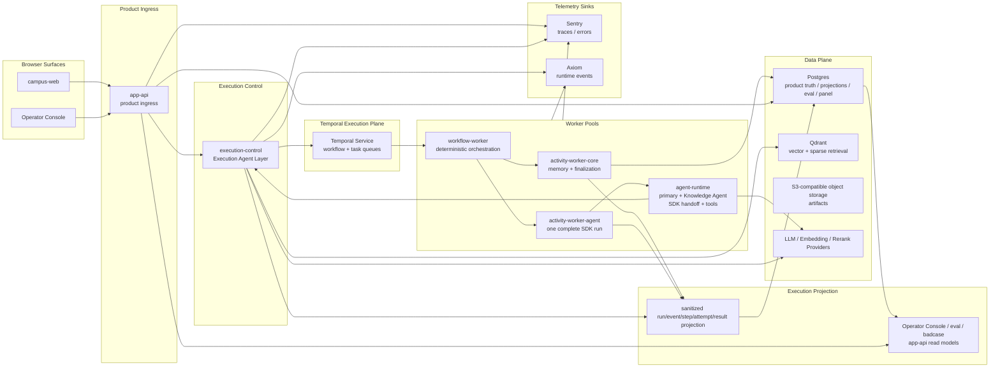

# 目标架构

## 文档边界

本文只负责描述 `campus-agent` 的 target architecture。

它回答的是：

- 长期要稳定成什么系统形态
- 哪些边界是长期不能退回的
- accepted architecture 向目标架构演进时，哪些原则必须保持不变

它不负责：

- accepted serving surface 的快照
- 某一轮 phase 的执行顺序
- 某个 app/package 的一次性实施细节

## 目标系统形态

`campus-agent` 的目标形态是：

- Campus Assistant product agent experience
- OpenAI Agents SDK owned primary/Knowledge Agent and function-tool loop
- primary-agent-first routing with official SDK handoff
- execution-control-owned durable admission, evidence and projection boundary
- shared app runtime 与 execution engine 分层
- Temporal-backed four-phase execution plane
- workflow / core / agent worker pools with KEDA/HPA autoscaling
- Go-owned workflow envelope and finalization validation；Python 不作为长期 online
  answer hot path
- 独立 ingestion / data plane
- internal-only `knowledge_search` retrieval boundary
- eval-governed quality lifecycle
- repo-owned artifacts 继续拥有 tool contract、admission、source-trust、projection、
  eval 与 durable lifecycle truth
- bounded evidence 通过 internal tool result 与 sanitized projection 传递，不通过
  provider raw trace 或第二套 planner state 传递
- repo-owned execution projection spine：`Run -> RunEvent -> RunStep ->
  StepAttempt -> StepResult -> Finalization` 是 panel、eval、badcase 与
  operator_diagnostic_evidence 的共同诊断主线

长期主链路固定为：

```text
client/channel
-> browser surface
-> app-api auth / account-session / conversation transport
-> execution-control durable run admission / Temporal command
-> ToolExecutionWorkflow (canonical Temporal workflow name)
-> Memory Recall
-> one Agent Activity containing the complete OpenAI Agents SDK run
   -> primary agent direct answer / SDK function tool
   -> official handoff() to Knowledge Agent when knowledge_query is selected
   -> Knowledge Agent may call only internal knowledge_search
-> Finalization validates terminal evidence and generates sources
-> Memory Append
-> sanitized run event + step/attempt/result projection
-> app-api response / stream / operator read model
-> browser surface / Operator Console / eval / badcase
```

整个 SDK run 是单个 Temporal Agent Activity。Temporal 不展开 SDK 内部的 function
tool call 或 handoff 为独立 Activity，也不维护平行的 routing、RAG、replan 或
specialist graph。

### Agent / Workflow / Tool Terminology

- `Campus Assistant` 是用户看到的 product-level agent experience，不是一个独立 worker
  进程。
- `Execution Agent Layer` 是 `execution-control` 内的 durable execution
  governance 层，负责 admission、workflow command/query/cancel、visible tool set、
  query-serving scope、projection 与 finalization validation；语义工具选择由 SDK
  primary agent 在已裁剪 tool set 内完成。
- `ToolExecutionWorkflow` 是 canonical Temporal durable workflow 名称；它编排 execution
  lifetime，只编排 Memory Recall、Agent Activity、Finalization 与 Memory Append。
- `agent-runtime` 是 model-facing runtime，也是唯一 agent/tool loop owner；它承接
  primary agent、Knowledge Agent、official handoff、function tools、SDK trace 与 usage
  normalization，但不拥有 run truth、source truth、product auth、Temporal
  command/cancel 或 canonical projection。
- `activity-worker-core` 承接 memory 与 finalization activities；
  `activity-worker-agent` 承接完整 SDK run。不存在 knowledge/tool/specialist worker。
- `Tool` 是 SDK function surface。Model-visible 与 internal-only exposure 由 repo
  registry 冻结，具体数据访问由 owning internal query service 执行。
- `knowledge_query` 是 official model-visible handoff 的 runtime/projection id。
  Primary agent 选择由 SDK `handoff()` 暴露的 handoff target 后进入 Knowledge
  Agent；它不是普通 function tool 或 agent-as-tool wrapper。
- `knowledge_search` 是 internal-only SDK tool，只对 Knowledge Agent 可见；
  execution-control 校验 scope/version、执行 embedding/Qdrant/rerank、返回 bounded
  evidence，并在 Finalization 校验 evidence refs 和生成 sources。
- `requested_tool` 是 optional explicit caller hint / internal forced route，不是
  普通 chat 的目标态默认语义路由字段；缺失时不得伪造成 `knowledge_query`。

目标拓扑图：



长期摄入链路固定为：

```text
collector/source admission
-> ingestion control plane
-> Temporal workflow start / task registry validation
-> registry-aware activity dispatch
-> source-family handler or deterministic kernel
-> raw asset
-> provider output
-> canonical source truth
-> declared projections
-> canonical document artifacts
-> document-units
-> chunks
-> embedding / index
-> release manifest
-> alias / read-model publish
-> app-api operator projection
```

长期 ingestion / data-plane runtime 目标不是 Python script collection，也不是把
`apps/app-api` 扩成 ingestion executor。目标分工固定为：

- `apps/app-api` 只承接 product/operator ingress、release gate command 与
  operator-safe read model；不拥有 ingestion task execution、source mutation、
  document/index materialization 或 Qdrant alias publish。
- ingestion control plane 拥有 task admission、task registry、claim / lease /
  retry / dead-letter、run shard state、Temporal workflow start、run-level
  orchestration、registry-aware executor dispatch、telemetry closeout 与 operator
  projection snapshot。
- `apps/ingestion-control` 的 executor shell / Temporal workflow activity worker 按
  registry 分派 `ts_control` / `rust_kernel` 任务，并把 redacted closeout 投影回
  operator surface；缺失 handler / kernel 时 fail closed。
- `apps/ingestion-worker` 已移除；Python extraction 只能作为 package library 或
  private service dependency 由显式 TS task handler 调用，不作为 collection
  lifecycle 或 fallback executor。
- `packages/ingest-core` 继续拥有 runtime-neutral TS ingestion helper：
  source-channel parser、canonical JSON/artifact helper、registry-aware dispatch
  helper、collection profile parser 与纯 materialization/projection helper。
  release lifecycle 由 ingestion-control Temporal workflow/activity worker 承接。
  旧 Python ingestion package 已删除；后续 shared file / OCR / Office 能力必须作为
  explicit adapter boundary 重新 admission，不拥有 source-truth / registry /
  release / database runtime truth。
- Rust 只作为 validation-gated deterministic kernel lane，用于 profiling 已确认的高吞吐
  CPU / memory 热点，例如 JSONL streaming、document-units validation、chunk packing、
  hash / dedup / diff、release manifest validation 与 embedding batch input preparation。
- Python 只作为 offline ingestion / eval / tooling runtime，或 MinerU / OCR / ML /
  domain extraction adapter；不得重新进入 online answer serving、top-level
  orchestration、provider cancellation ownership 或 product projection ownership。

## 长期硬约束

- 不退回扁平 retrieval tool-adapter 顶层路径
- Execution Agent Layer 保持唯一顶层协调入口，不演化成无中心 peer mesh
- Execution Agent Layer 不得退化成只负责 HTTP 转发的被动 proxy；它必须继续拥有 deterministic
  governance、workflow admission、budget 与 finalization
- HTTP request 不得成为 agent execution lifetime 的 canonical truth；一次回答的长期
  execution object 是 Temporal workflow execution + repo-owned product run
  projection，streaming 只是订阅 sanitized events / projection
- production 并发预算不得只存在于单个 `execution-control` 进程内存；Temporal Task Queue、
  workflow / activity worker pool、repo-owned admission policy 与 downstream
  budget projection 必须共同定义全局 execution capacity
- process-local limiter 只能作为单进程 runtime protection，不得被多实例叠加解释为
  production scheduler
- deterministic data access 必须表现为 OpenAI Agents SDK function tool，并由
  projection-backed internal query service 提供数据；semantic specialist 只能通过
  SDK official handoff 进入同一次 run
- `admission / guardrails` 与 `tool routing` 必须分层，不得重新混成一个模糊 knowledge gate
- 长驻 runtime / transport 逻辑留在 `apps/*`
- 一次性或定时 deployable runtime 留在 `jobs/*`
- stable tool/domain package boundary 留在 `packages/*`
- `packages/contracts` 不泄漏具体 runtime、vendor、infra 类型
- online query path 与 offline data plane 不混层
- serving surface 由 serving config / explicit policy 控制，而不是硬编码在 entry shell
- canonical document 的 reader publish 与 `knowledge_search` query-serving 是两条
  独立 release lane；文档站可见不等于 retrieval alias 已切换或 scope 已开放
- `app-api` 只拥有 browser-facing auth/session、conversation 与 transport；
  model-visible tool exposure 和 runtime admission 由 `execution-control` 根据
  repo runtime registry 强制执行，browser 不得自行扩展
- 普通 chat public body 不暴露 `requested_tool`；请求必须进入 primary agent
  decision，不得由 `app-api` 或 `execution-control` 默认改写成
  `knowledge`
- target architecture 不默认接纳开放域 generalist / web tool 进入主 campus path
- `knowledge_query.scope` 只属于 `knowledge_query` path，不再作为所有 tool 共用的顶层默认字段
- Knowledge Agent 不得绕过 serving config、source-trust、scope/version admission 或
  tool opening gate；`knowledge_search` 只返回 admitted indexed evidence
- `official_web` 在完整离线发布并显式加入 scope registry 前保持不可查询；在线路径
  不提供 live retrieval、public web search 或 provider fallback
- provider-native function calling、remote MCP、built-in web tool 或其他外部 tool
  substrate 不得替代 repo-owned admission、source-trust、ToolSpec、eval 与
  observability truth
- Redis 不得作为 canonical execution queue；只允许作为 cache、invalidation、非权威 wakeup 或
  live fanout adjunct
- K8s 只作为 pod/resource/rollout substrate；不得拥有 workflow history、task queue truth、
  product run projection、event projection 或 terminal truth
- production worker autoscaling 目标态由 KEDA Temporal scaler + Kubernetes HPA
  承接；autoscaler 只能调整 workflow / activity worker replica count，不得写
  workflow state、product run projection、step projection、event projection 或 terminal
  state。Docker Compose 不属于目标 production autoscaling substrate。
- tool 不得只因为 function schema 或 internal query 可执行就进入
  production-open；normal、fail-close、cancel、timeout 与 late-completion outcome
  必须能写入 sanitized projection，并能被 app-api operator read model 消费
- tool output 不得以 provider 原始 trace、raw function response 或未裁剪正文形式进入
  app-api、panel、eval canonical asset 或 downstream prompt context
- SDK tool result 与 handoff context 必须使用 bounded contract；不得把 raw evidence
  dump、provider trace 或 execution-control 内部 payload 直接塞进模型上下文
- notice-family 用户可见 surface 默认采用 source-link / card-first posture：title、
  official URL、source family、发布时间与短摘要/匹配原因可以进入用户面；canonical body、
  OCR owner text、inline image text 与附件正文只能作为 source-truth、内部 context、
  下游 materialization 或 bounded summary/fact extraction 输入，不得作为默认全文输出。
- 主问答产品不按学生 / 教职工 / 院系身份拆分普通 tool。account / session、
  rate / quota、operator surface access 与 user-scoped memory binding 是产品层边界，不是普通校园问答能力差异来源。
- restricted documents、内部受限材料、approval / HITL、预约 / 提交 / 支付 / 工单等状态变更能力不属于主问答产品目标；
  不得把这些非目标反写成 tool opening gate 的默认复杂度。

## 长期产品/runtime 形态

- public 与 protected browser surface 可以是独立 Worker web surface
- shared `apps/app-api` 持续承接产品层 auth/session/principal、conversation、chat
  ingress、request projection 与 operator read surfaces
- `campus-web` 是长期学生侧统一入口，承载 Q&A、account、docs、map、dining 与
  feedback；`/docs/*` 使用 Rspress-powered canonical reader，而不是独立
  `public-docs` product surface
- shared `apps/app-api` 长期只投递认证后的 conversation/session/request 事实；
  execution context 裁剪、visible tool set 与 tool/scope admission 由
  `execution-control` 拥有
- deployed Worker 通过 `EXECUTION_CONTROL_PRIVATE.fetch` 与
  `EXECUTION_CONTROL_PRIVATE_ORIGIN` 调用 execution-control；
  `EXECUTION_CONTROL_BASE_URL` 只用于没有 private binding 的本地开发
- `execution-control` 持续只是 internal execution ingress，不是 product backend
- `apps/app-api` 长期以 Worker product ingress 承接产品层 runtime boundary
- `execution-control` 是长期 internal execution ingress 概念名；具体 app /
  deployment label 的 accepted state 以 `current.md` 为准
- execution-control / worker 的部署 substrate 不反推 browser-facing exposure model
- `apps/app-api` 长期拥有 conversation 与 run creation / stream proxy 的 product
  surface；`execution-control` 负责 workflow start / signal / cancel / query，
  Temporal 负责 workflow history、task queue、retry、timeout 与 heartbeat
- worker runtime 只拆成 workflow、core 与 agent pools；deterministic workflow code
  只编排四阶段，semantic reasoning 全部留在单个 SDK Agent Activity
- production worker runtime 目标部署在 Kubernetes 中以独立 Deployment 表达，并通过
  KEDA Temporal scaler + Kubernetes HPA 按 Temporal task queue backlog 调整 replica；
  K8s/HPA/KEDA 不拥有 workflow history、product projection 或 terminal truth。
- worker plane 固定为 `workflow-worker`、`activity-worker-core` 与
  `activity-worker-agent`；不得按 knowledge、tool 或 specialist 新增 queue。
  Rust 只用于 profiling 已证明的离线或 deterministic CPU hotspot，不进入 online
  agent/tool loop ownership

## 长期 execution / agent 形态

- product-level agent 是 `Campus Assistant`。`apps/agent-runtime` 的 OpenAI Agents
  SDK 是唯一 online agent/tool loop owner。
- `ToolExecutionWorkflow` 只拥有 durable lifecycle：Memory Recall、一个 Agent
  Activity、Finalization、Memory Append，以及 retry、timeout、cancel 和 projection
  ordering。
- Primary agent 在 SDK loop 内做第一语义决策。Direct answer、clarification、refusal、
  model-visible tool call 和 official handoff 都不经过平行 planner/classifier。
- `knowledge_query` 由 primary agent 通过 official `handoff()` 进入 Knowledge Agent。
  Primary 与 Knowledge Agent 属于同一次 SDK run 和同一个 Temporal Agent Activity。
- Knowledge Agent 只可调用 internal `knowledge_search`。它拥有 query framing、证据
  consumption、answer synthesis 与 evidence-backed structured terminal output。
- Execution-control 拥有 run admission、visible tool/scope/version gate、Temporal
  command/query/cancel、embedding/Qdrant/rerank、bounded evidence projection、terminal
  evidence validation、source generation 与 fail-close finalization projection。
- Finalization 不调用模型、不重新综合答案；app-api 不改写 finalized answer，只负责
  product persistence、streaming 与 browser-safe projection delivery。
- Runtime projection 可以记录 SDK tool trajectory、result refs、usage、cancel/timeout
  和 terminal outcome，但不得把 SDK handoff graph 或 tool calls升级为独立 Temporal
  workflow graph。
- Context inheritance 必须按 agent role 最小化；不得把完整 conversation、raw evidence
  dump、raw OCR、raw provider trace 或未裁剪 source body广播给 Knowledge Agent。
- Campus services deterministic reads 通过 SDK function tool 调用 owning internal
  query service。当前只有 `transport_schedule_lookup` 对 primary agent model-visible。
- Notice、navigation 与其他未开放能力保持 closed；未来开放时也必须进入同一 SDK
  tool registry，不建立新的 Go tool worker 或 specialist activity。
- Python 只允许作为 offline ingestion / eval / tooling runtime，不得进入 online
  answer hot path、agent loop、provider cancellation ownership或 product projection。
- provider adapter 是 execution cost / cancellation 的明确边界：必须记录 provider
  request ref、latency、input / output / cached token、estimated cost 与 terminal
  outcome；cancel / timeout 必须传递到 activity 与 provider adapter，并在可能时
  abort in-flight request，不能只把 Temporal cancel 记录成产品终态后继续消耗 token
- LLM 服务可用性不作为目标架构的主要风险假设；目标关注的是 latency、token、
  estimated cost、budget enforcement、cancel / timeout 下游停止能力与 sanitized
  projection
- `knowledge_query` 不是所有 campus 请求的默认 fallback；primary agent 只在问题需要
  governed campus evidence 时 handoff 到 Knowledge Agent
- repo-owned `knowledge_search` seam 长期负责 scope/version enforcement、retrieval、
  optional rerank 与 bounded evidence shaping，不拥有 answer synthesis
- retrieval backend、vector infra、framework 选择隐藏在 agent / retrieval boundary 之后
- deterministic ability 必须作为 SDK function tool + internal query service 落地，
  不得回退成 execution-control inline semantic routing
- clarification 由当前 active SDK agent 产生；execution-control 只校验 contract、policy
  与 terminal evidence，不生成语义澄清文案
- projection-backed internal query service 可优先采用 Go 实现，以降低 runtime
  latency / memory cost；这不赋予 Go agent/tool loop ownership
- 对 structured projection tool，长期 online consumption 固定为 PostgreSQL
  release catalog / current pointer / typed read model；对象存储保存 immutable release
  artifacts，Redis 只能作为 cache / invalidation adjunct，不拥有 current truth
- 如果未来产品接受新的能力，必须以新的 SDK function tool 或 official handoff
  明确接入，并拥有独立 contract、admission、eval 与 observability；不得成为隐式
  fallback，也不得新增 Temporal specialist graph。

## 长期 tool / function-calling 形态

长期 tool 架构固定为：

`app-api auth/session transport -> execution-control durable run / visible tool
set -> Temporal Agent Activity -> one OpenAI Agents SDK run -> direct answer /
SDK function tool / official handoff -> repo-owned internal query service ->
SDK terminal output -> execution-control evidence/source validation -> final projection`

其中：

- `execution-control` 与 workflow policy 拥有 deterministic admission、opening gate、
  scope/version guard、visible tool set、Temporal timeout/cancel 与 fail-close
  terminal semantics
- OpenAI Agents SDK 是唯一 online agent/tool loop owner：它拥有本轮工具选择、
  function-tool 调用、official handoff、direct/no-tool final output 与 SDK trace；它不拥有
  source truth、tool opening posture、surface admission、Temporal lifecycle、
  sanitized projection 或 panel/eval canonical evidence
- SDK tool loop 不是 permission expansion owner；它只能在
  repo 预先暴露的 model-visible read-only tool catalog 内选择工具
- model-visible 与 internal-only tool 必须由 `tools.v4` 和 strict function schema
  明确区分；schema 存在不等于 model-visible
- tool 后端必须是 repo-owned internal query service，不得直接暴露 browser-facing
  API、raw SQL、raw object-store bytes、collector runtime 或 ingestion/index build path
- tool result 必须先变成 bounded SDK tool result 与 sanitized projection，再进入
  agent context、workflow trace 或 operator projection
- remote MCP、provider built-in web search、live source search 与 online
  `public_web_search` 不属于当前或目标 campus answer path

目标态 canonical routing examples：

- `hi，你是谁？`：primary agent direct/no-tool terminal answer；
  finalization 写入 `agent.primary` result ref，不调用 knowledge handoff 或 synthetic
  `assistant_intro` branch。
- `最近有什么通知？帮我总结一下。`：primary agent 只能在未来 redesigned
  notice tool 正式打开后选择 notice tool；必要时再消费 selected notice bounded
  context，默认不复制通知全文。
- `今晚六点还有丰台去海淀的班车吗？`：primary agent 选择
  `transport_schedule_lookup`；如存在近期变更，需要 consumption notice change-set
  作为 bounded override 输入。
- `信工有什么专业？`：primary agent 选择 `knowledge_query` 后，
  通过 official `handoff()` 进入 Knowledge Agent；Knowledge Agent 调用
  `knowledge_search` 获取 admitted evidence。Primary agent 与 browser 不接收
  collection、top-k、Qdrant 或 provider details。

model-visible tool 与 internal query function 的边界必须保持清晰：

- model-visible tool 应表达用户意图级能力，例如找通知、查班次、查服务状态或查办理指南。
- deterministic query function 应表达内部读模型函数，例如按 notice id 取 source card、
  按 selected notice ref 取 bounded context、读取附件 refs 或读取 OCR owner text。
- query function 不应因为实现上有 JSON schema 就自动进入 ToolSpec 顶层 tool surface。
- SDK internal function 是 query function 的受控入口：必须由 repo-owned
  `ToolSpec` 注册 strict function schema 和 `internal_only` exposure。内部
  `knowledge_search` 不进入 primary agent model-visible catalog。
- notice tool surface 必须重新从用户问题、source truth、read model 与 eval
  denominator 设计。selected notice card/context resolution 应优先作为
  notice 或 Go internal query service 的 deterministic function。若未来确需
  model-visible resolve tool，也必须只返回 `ResolvedNoticeRef` / `NoticeCard` /
  display policy，不返回 full body。
- canonical notice body、OCR owner text、inline image text 与附件正文不得作为 provider
  function tool output 直接进入 public answer；只允许进入 bounded summary、fact extraction、
  downstream materialization 或 source-linked context projection。

长期 tool 与 handoff registry 的边界必须保持清晰：

- `ToolSpec` / `tools.v4` 定义 primary agent model-visible tools、handoffs 与
  specialist-only internal tools；`knowledge_query` 是 model-visible handoff，
  `knowledge_search` 是 Knowledge Agent internal tool
- `execution-control` 只把 runtime registry 已准入的 visible tool set 交给
  primary agent；Temporal workflow 不消费 SDK 内部 tool selection，也不维护平行
  routing plan
- provider/SDK function schema 必须从 repo-owned artifacts 派生或被 drift test
  校验；Python worker delegate map 只属于 offline / eval / historical bridge reference
- 新增 model-visible tool、official handoff 或 specialist-only internal tool，都必须先补
  contract、exposure、eval denominator 与 trace projection，不得只靠 prompt 约束

长期需要一个 repo-owned `ToolSpec` registry 作为 canonical artifact。该 registry 至少固定：

- `tool_name`
- owner tool / runtime boundary
- payload schema / result schema
- read-only posture
- opening gate 与 runtime exposure
- source-truth owner / internal query service owner
- timeout budget、max result size 与 parallel-call policy
- execution semantics、freshness policy 与 version behavior
- argument summary 与 result projection policy
- fail-close reason、business outcome 与 observability labels
- eval denominator 与 provider function schema generation policy

`ToolSpec` registry 应生成或校验：

- execution-control 的 runtime-visible tool set
- provider-native function schema
- OpenAI Agents SDK function tool schema / model-visible catalog
- workflow trace / execution audit 的 sanitized projection
- `packages/eval-langfuse` / repo-owned eval truth 中的 tool selection、argument
  precision 与 fail-close denominator

## 长期 tool routing evidence 形态

顶层工具选择由 primary agent 的真实 tool loop 完成，不再建立平行的自研
intent policy、deterministic classifier 或 routing intent schema。

长期固定边界：

- `execution-control` 依据 runtime registry 生成 visible tool set，并投影
  `tool_trajectory.v1` 所需的 available tools、decision kind、selected tool、
  safe argument shape/hash、result kind 与 fail-close reason
- direct answer、clarification 与拒绝是 primary agent terminal outcome，不伪装成
  synthetic tool 或 intent class
- `knowledge_query` 的 scope clarification 由 handoff input schema、primary agent
  与 Knowledge Agent 协作；published scope admission 只由 runtime registry 强制执行
- tool selection 评测使用 Ragas 官方 agent/tool-use metrics 并由 Langfuse
  dataset experiment 记录，不维护第二套 repo 自研 classifier/scorer
- Ops Index、Langfuse 与 operator review 只消费 sanitized trajectory、outcome 和
  correlation ids，不保存 raw transcript、auth material 或 provider raw response

## 长期 eval / quality governance 形态

长期 eval 不是一次性 release checklist，而是围绕 production feedback 持续运行的质量治理
lifecycle。它必须和 runtime observability、operator review、golden truth 与 release gate
保持分层，但形成闭环。

固定 owner 如下：

- repo-owned eval truth 拥有 golden cases、qrels、case schema、review/admission
  policy、metric semantics 与 release verdict authority
- TS eval runtime / `packages/eval-langfuse` 拥有目标 runner、score report、
  Langfuse platform sync、score publishing、verdict artifact publishing 与 review automation
- 旧 `packages/evals` package 已从 active workspace 退役；Langfuse-bound asset
  truth 已归属到 `packages/eval-langfuse/assets`，runtime-local truth 放在 owning
  runtime testdata。旧 Python fixture loader、deterministic scorer 与
  `scripts.eval_gate` release gate 已退役
- `apps/app-api` 拥有 request correlation 与最小 Ops Index，不拥有 golden truth、
  Langfuse score truth 或外部 trace body
- Operator Console 只承担 operator review / triage UX；它可以发起受控 review
  action，但不决定 golden set truth、不生成 benchmark artifact。implementation surface
  由 current architecture 冻结。
- `apps/execution-control` 与 domain agent 只产出 execution / trace / outcome
  facts，不写 eval truth
- OpenAI Evals / graders / tracing、RAGAS、Sentry、Axiom 等外部工具只能作为 grader /
  eval scorer、trace/debug sink 或 analysis input，不成为 repo canonical eval truth

长期 eval lifecycle 固定为：

`production request / incident / operator review signal ->
Ops Index request correlation ->
eval-owned review / dedupe / admission ->
golden or observed regression case ->
TS/Langfuse deterministic + supplemental gate ->
accepted artifact ->
optional Ops Index correlation ->
external sink / eval platform review`

其中：

- production aggregate、sampled grades、release-gate verdict 与 golden truth 不得混成一张表
- candidate review 必须记录 accept / reject / duplicate / deprecated / needs-info 等
  lifecycle decision，以及 reviewer、reason、source request 与 target suite
- accepted case 必须写入 repo-owned case asset / artifact truth，而不是只留在 panel、
  sink dashboard 或临时 JSON
- release-gate artifact 必须保留 request correlation、runtime versions、case-set version、
  deterministic verdict、supplemental verdict 与 publish summary
- failed release gate 只能通过修复 runtime、修复 truth、或有审计记录的 case
  governance decision 关闭，不能在 Operator Console 上直接 override

长期 suite taxonomy 必须保持分层。具体 suite 名称、denominator、fixture 形状与
execution command 由 eval reference、contract 与 runbook 拥有；本文只冻结以下目标不变量：

- local fast checks、release gates、locked regressions 与 observed regressions 不得混成同一
  verdict source
- context follow-up、version transition 与 workflow trace correctness 必须能被独立归因
- 发布前 denominator 必须覆盖 admitted serving surface 的核心 success、fail-close、
  clarification 与 policy path
- workflow trace correctness 是 orchestration 的一等 gate，不是回答质量 gate 的附属字段

workflow trace correctness 至少需要覆盖：

- `first_decision_branch_correctness`
  - 应 direct/no-tool terminal 的 product identity、普通寒暄、clarification /
    rejection / fail-close case 不得误入 `knowledge_query` 或其他 tool
  - 应进入 tool 或 handoff 的 semantic case 必须携带完整 SDK trajectory
    projection
- `handoff_correctness`
  - tool target、allowed tools、missing slots、context resolution 与 policy
    reason 必须和 expected truth 对齐
- `tool_argument_precision`
  - function tool 或 `knowledge_search` 的 admitted scope/version、service subtype、
    temporal scope 与 source-channel 参数必须可比对
- `fail_close_correctness`
  - policy unavailable、tool closed、query scope disabled、missing context、source
    truth unavailable 与 evidence insufficient 必须进入可审计 terminal outcome
- `trace_projection_completeness`
  - request correlation、runtime versions、policy artifact versions、handoff outcome、
    selected tool 与 current SDK trajectory summary 必须进入 sanitized artifact

外部 agent / trace 工具可以降低 trace capture 与 grader adapter 的实现成本，但不能成为
`workflow_trace` 的 canonical truth；repo-owned case assets、expected truth、artifact
projection 与 release verdict 仍由 repo-owned eval truth 拥有，目标 runner / publish
automation 由 TS/Langfuse lane 承接。

长期评分分层固定为：

- deterministic gate 是 canonical release verdict 的第一层，覆盖 status、routing、retrieval、
  citation、required facts、forbidden claims、policy / opening posture 与 fail-close
- supplemental graders 只能补充 grounding、relevance、tool / handoff semantics、
  workflow quality 与 human-calibrated rubric；它们是否 gating 由 repo-owned policy 决定
- human review 必须持续校准 automated grader，避免把 grader drift 反向写成 truth
- 对未开放 tool，只允许评估 closed / candidate-only / clarification
  behavior；不能提前要求 answer quality gate

长期 eval artifact 与 observability 回流必须坚持 data minimization：

- eval artifact 可以保存 sanitized prompt summary、expected truth、observability summary、
  request / trace correlation、grader rationale summary 与 safe links
- eval artifact 不得保存 raw JWT、raw cookies、raw auth envelope、raw transcript、
  provider raw response、retrieval backend dump 或未经裁剪的 source body payload
- trace / grader tooling 的原始结果必须先经过 eval-owned projection，再进入
  `apps/app-api` 的 operator-facing grade / backlink ingest

## 长期 account / memory 形态

长期主问答真相层固定拆成：

- `institutional knowledge`
- `account / session`
- `user-scoped memory`

长期 owner 固定为：

- `apps/app-api` 拥有 account / session、operator access、rate / quota 与 user-scoped
  memory binding 的 product truth；online memory recall 由 execution-control /
  Temporal / Hindsight self-host Personal Memory Plane 承接
- execution path 只消费最小 typed projection
- memory 可以影响 follow-up、preference、query framing、disambiguation、tool
  arguments / wording，但不能决定 tool opening、tool admission、source trust、fail-close、
  operator access 或 account/session truth

Memory Plane 的 Hindsight runtime、online recall、写入链路与 Temporal 参与点，统一看
`system/memory-plane.md`。本文只保留目标 repo 级 owner 与 advisory-context
约束。

## 长期 retrieval / serving 形态

- retrieval 长期是 registry-backed、filter-first、evidence-oriented path
- retrieval 只在 primary agent handoff 到 Knowledge Agent 且后者调用 internal
  `knowledge_search` 后成立
- 每次 `knowledge_search` 是独立、bounded、可审计的 internal tool call；Temporal
  不维护 retrieval plan、multi-step graph 或 replan state
- current / historical / as-of / compare query 必须显式区分
- 版本选择发生在 retrieval 之前，不让回答层事后补救
- 多来源等价内容归并为逻辑 document version，而不是并列候选
- candidate set 与最终 answer-bearing evidence 必须继续分层
- canonical document admission 只能生成 query-serving release candidate，不能直接改变
  query-serving alias；candidate 必须经过 chunk/index、acceptance 与
  serving alias publish 后才进入可检索状态
- query-enabled regulation scope 的 release candidate 必须先通过
  `regulation_rag_release_admission.v1` scope-level manifest；该 manifest 绑定当前
  document identity/version/hash、document-units hash、cleaning/chunk/serving config
  identity、reader current version 与 qrels/admission 检查结果。缺失或不匹配时只能进入
  `release_admission_blocked`，不得 embedding、index 或切 alias
- query-serving release lane 必须支持增量更新：用 document identity、version/hash 与 serving
  config identity 判断 unchanged / changed / deleted / withdrawn，不靠定时全量重建或
  文档站发布状态反推 RAG 状态
- historical / search-only regulation candidate 如果不是 withdrawn / deleted，不得误触
  current alias cleanup；它必须进入 non-serving terminal status，例如 `held_search_only`
- serving alias 只能由通过 retrieval acceptance 的 release 切换；失败 release 必须保留旧
  current pointer，并产出可观测 repair signal
- 对已发布但缺少 admission validation artifact 的 regulation release，目标态处理是 fail-closed
  containment：只有当 alias 仍指向指定 suspect physical collection 时才允许解除或回滚，
  然后重新生成 canonical/reader/chunk/qrels/admission 证据后再发布
- `official_web` 在完整离线发布并显式加入 scope registry 前不得进入
  `knowledge_search`；不存在 freshness/live-assisted online branch
- internal tool outcome、resolved scope/version 与 bounded evidence summary 必须成为
  长期 observability truth

## 长期 data-plane 形态

- raw asset、source truth、declared projection、document truth、chunk/index 持续分层
- source truth 是 canonical shared upstream
- 一份 source truth 可以 fan-out 到多份 collection / corpus
- canonical document artifacts 可以 fan-out 到 reader asset lane 与 RAG release lane；
  reader asset、document-units、chunks、index release 与 serving alias 继续各自持有
  独立 truth
- 后续 replay / rebuild 从 source truth 继续，而不是返回 raw 重消费
- 对象存储始终被视为独立 `S3-compatible object storage` 边界

## 与当前架构的关系

当前架构是目标架构的受控子集，不是另一套方向。目标架构包含以下能力边界；是否已经合入
merged truth 只看 `docs/architecture/current.md`，不由本文反推：

- richer execution tools
- primary-agent tool selection and argument-quality eval
- context follow-up and clarification eval
- eval-owned candidate admission / observed regression lifecycle
- observability-driven intent review / production badcase backflow
- campus navigation / wayfinding
- explicit historical / as-of / compare query
- regulation 之外更多 document family 的增量 RAG release lane rollout、scheduled
  reconciliation、rollback/current-pointer automation 与 operator-safe status projection
  扩面
- 更完整的 user-scoped memory productization
- operator observability / audit control plane
- deploy-side observability hardening

本文不维护这些能力的实现状态。accepted snapshot 以 `current.md` 为准；active
planning signal 以 `.planning/` 的 owning documents 为准。

与 primary-agent-first tool routing、runtime tool admission 与 clarification 分层相关的长期
supporting truth，统一看
`docs/architecture/system/tool-routing.md`。

与 campus services tool read model、projection-backed internal query service 与
opening gate 相关的长期 supporting truth，统一看
`docs/architecture/domains/campus-services/architecture.md`。
