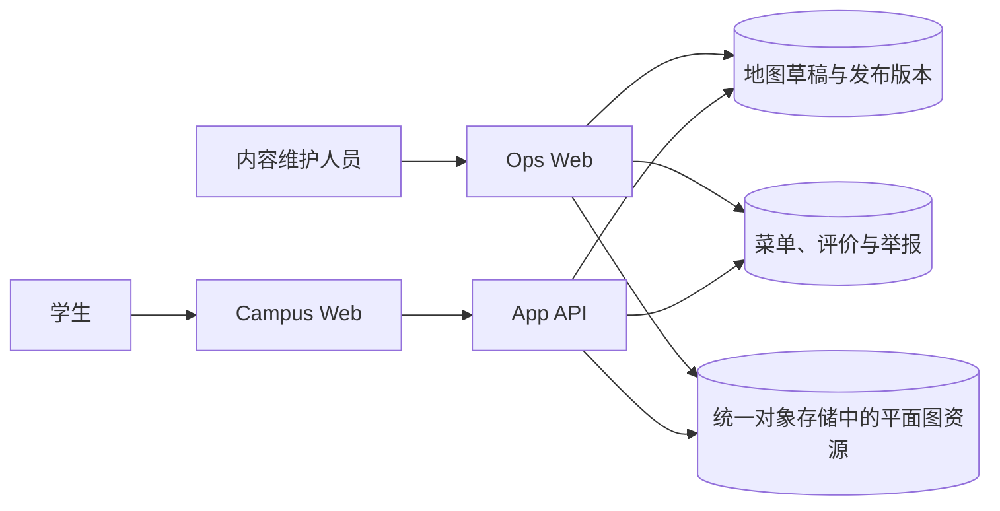
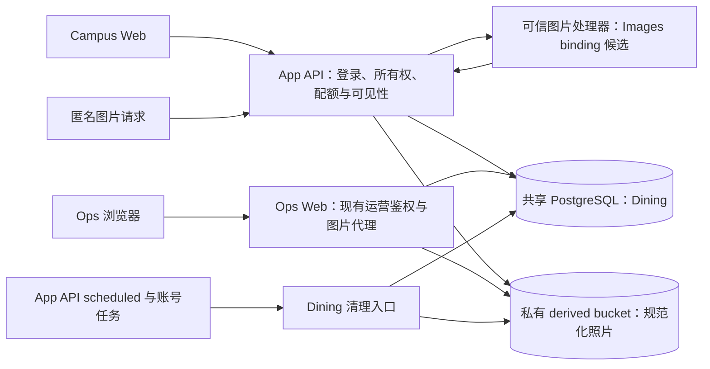

# 食堂

## 目标与边界

学生可以查看食堂平面图、窗口、菜品和价格，并围绕具体菜品查看、发表、删除或举报评价。
内容维护人员在 Ops Web 维护同一份地图和菜单，并处理评价与举报。

已接受的用户投稿需求允许学生补充实际供应但未录入正式菜单的菜品，并提供单张照片、文本评价和
内容治理。投稿始终独立于正式菜单，不代表官方录入或运营认可。

本能力不维护营业状态、评分、推荐、自动审核、采集、来源同步或导入导出。菜单、投稿和评价由
人员直接维护或提交，不从外部来源自动生成。

### 地图阅读与页面内导航

- 地图默认显示完整楼层，放大上限随画布尺寸计算，窗口标签放大后达到可阅读字号；详情保留完整名称。
- 普通滚轮滚动页面，Ctrl + 滚轮和双指捏合缩放地图；总览时单指滚动页面，放大后单指拖动地图。
  拖动、多指与取消手势不选择窗口，键盘 Enter／Space 仍可选择。
- 地图点击与搜索选择采用相同定位规则：手机端详情标题和楼层信息不可见时才滚动，减少动态效果时直接定位。
- 进入“我的投稿”再返回，保留本次页面会话的食堂、楼层、窗口、菜单项、搜索、地图视图和滚动位置。
  切换其他楼层重置总览；刷新按 URL 恢复选择，不持久化缩放和平移。
- 内部打开投稿详情后关闭回到来源；直接链接与新建投稿后的详情关闭替换 URL，不产生关闭后的历史回环。
  未保存编辑与保存中退出保护仍适用于这些导航。
- 搜索跨楼层保留关键词；本层无匹配时明确提示，复用清除搜索按钮恢复全部窗口。

决策见[食堂地图阅读、手势与往返导航](../../.agents/notes/implemented/bug-fix/2026-09-18-dining-map-navigation.md)。

## 文档与交付边界

本文集中维护 Dining 用户行为、数据消费边界和开发验收。用户投稿需求来源见
[Issue #351](https://github.com/MUC-WIKI/campus-agent/issues/351)。

当前源码包含地图、正式菜单、评价，以及投稿创建、本人编辑与软删除、公开和本人读取、图片处理及私有
对象适配器、双目标评价与举报、Ops 投稿治理和地图保护。定时清理、完整注销联动和两端投稿专属页面已接入；真实 Images 与云端
对象权限验收尚未完成。精确 wire shape 和数据库结构由领域 schema、路由、迁移与测试维护；源码
实现不等于已部署或已通过真实供应商验收。

## 当前学生页面

### 地图与窗口

- 页面一次读取当前发布版本的完整地图；
- 食堂、楼层、窗口和已打开菜品同步到 URL，刷新和分享后可以恢复；
- 地图与窗口列表使用同一份数据，窗口搜索在浏览器内完成；
- 页面只读取已发布地图，不能读取草稿或历史版本；
- 地图、资源和菜单失败分别显示错误状态，空地图、空菜单和空评价分别显示空状态；
- 窄屏下选择窗口后进入窗口详情，页面本身不产生横向滚动。

### 菜单与评价

- 选择窗口后读取该窗口当前启用的菜品，按维护顺序显示名称和可选价格文本；
- 选择菜品后从侧边面板查看公开评价；未登录用户也可以查看；
- 登录用户可以提交最多 500 字的文本评价，并选择公开署名或公开匿名；
- 公开匿名只隐藏学生页面上的作者名称，获准内容维护人员仍可查看提交账号；
- 学生不能编辑评价，可以删除自己的评价；删除后不再公开，但记录继续保留；
- 登录用户可以举报他人的评价，原因是垃圾信息、不当内容、隐私问题或其他；
- 同一学生对同一菜品按 `Asia/Shanghai` 自然日最多提交三次，已删除评价仍计入次数；
- 提交评价使用稳定幂等键。网络失败后原样重试不会重复创建，正文或匿名选择变化后使用新键。

### 投稿与本人管理

- 窗口详情分别展示正式菜单和用户投稿；公开列表、详情、投稿链接和评价面板持续标明“用户投稿”。
- 登录学生从窗口发布投稿，可选一张照片并预览；请求失败保留输入，原样重试保留创建幂等键。
- `/dining?submission=<id>` 打开公开投稿详情，可查看评价、发表评价及举报他人投稿；分享不携带本人读取范围。
- `/dining?mine=1` 查看本人投稿及状态，`submission` 参数可同时打开本人详情；未登录提供就近登录入口。
- 本人可编辑当前公开或隐藏稿，选择保持、移除或替换照片；隐藏稿保存后仍隐藏。
  修改冲突时先重新读取当前内容，再确认操作。
- 删除需要确认；已删除和到期稿仅显示状态及期限，不提供正文、照片、编辑或自行恢复入口。
- 投稿列表、详情和照片独立处理加载与失败，照片失败不阻断文字；普通刷新失败保留已读取内容，
  当前无权访问时撤下详情。本人查询与未保存表单按登录账号隔离。

## 当前内容维护

Ops Web 的食堂一级入口包含五个任务页：

- `/dining`：编辑完整地图草稿、发布不可变版本、查看历史并恢复版本；
- `/dining/menu`：新增和修改菜品、移动所属窗口、调整窗口内顺序、归档和恢复菜品；
- `/dining/submissions`：按窗口、状态与举报筛选投稿，打开详情查看当前内容、历史、身份和治理操作；
- `/dining/reviews`：筛选评价、录入普通评价、查看提交身份、修改正文、隐藏或重新公开评价；
- `/dining/reports`：按投稿或评价目标查看待处理与已处理举报，查看可回放内容，并决定保留或隐藏相应目标。

地图外轮廓可拖动节点、增删节点和缩放，支持手工锁定与解锁。每张地图仍须保留唯一外轮廓，不能
删除、剪切或复制出第二个轮廓；保存前继续校验闭合多边形、画布范围和自相交。

选中分隔线、结构或外轮廓后，可拖动画布节点，或在属性面板输入每个节点的 X/Y 坐标；Enter 或
移出输入框提交，Escape 取消本次输入。节点旁的加号在线段中间插入新节点，再调整坐标即可绘制
折线。顶部添加按钮在末段插点，闭合路径则在闭合边插点。分隔线最少保留两个节点，闭合路径
最少三个；坐标限制在地图画布内，手工锁定后须先解锁。

投稿详情位于 `/dining/submissions/:submissionId`，提供当前与未到期历史照片、相关评价和举报入口。
隐藏、软删除、恢复和举报处置使用当前操作版本；发生冲突时重新读取后再确认。
到期或清理后的正文与照片明确显示不可回放；注销、窗口不可用、清理中和到期状态给出不能恢复的原因。
列表在桌面使用表格、窄屏使用任务列表。

菜单保存后立即成为当前内容，不经过地图发布流程。菜品直接引用稳定的 `windowId`；地图发布或
恢复若会移除仍被启用菜品引用的窗口，操作必须失败并列出相关窗口。菜品只能归档和恢复，不能
物理删除。

内容维护人员修改评价正文时必须写入修改前后正文、操作者和时间。隐藏不修改正文；重新公开
恢复可见性。内容维护人员只能删除由内容维护人员录入的评价，不能删除学生评价。一次举报处理会
关闭同一评价的全部待处理举报；处理结果只有保留或隐藏。

## 当前 HTTP 接口

公开读取：

- `GET /api/dining`
- `GET /api/dining/floorplans/:digest.svg`
- `GET /api/dining/windows/:windowId/menu`
- `GET /api/dining/menu-items/:menuItemId/reviews`

学生登录后写入：

- `POST /api/dining/menu-items/:menuItemId/reviews`
- `DELETE /api/dining/reviews/:reviewId`
- `POST /api/dining/reviews/:reviewId/reports`

投稿创建、读取、本人编辑与删除接口见下文“投稿 HTTP 与消费合同”；这组接口已经接入 App API
和 Campus Web 同源代理，并由上述投稿页面消费。

Ops Web 的地图、菜单、评价和举报接口统一位于 `/api/ops/dining/*`。精确路径、正文和错误响应以
`apps/ops-web/src/server/app.ts` 及领域 Zod schema 为可执行合同，不在第二篇文档复制。

## 当前数据与权限



当前 `dining` schema 包含十一张表：

- `map_draft`：唯一完整地图草稿；
- `map_releases`：不可变地图发布版本；
- `map_publication`：当前地图版本指针；
- `menu_items`：菜品、窗口、顺序、价格和归档状态；
- `reviews`：评价正文、提交身份、匿名选择和可见状态；
- `review_reports`：举报原因和处理结果；
- `review_edits`：内容维护人员修改评价正文的历史；
- `submissions`：投稿正文、作者、版本、创建幂等身份、状态与清理期限；
- `submission_photos`：规范化照片的当前和历史引用、孤儿预留与清理状态；
- `submission_edits`：投稿文字和照片引用的修改历史及期限；
- `submission_reports`：投稿举报、关联内容版本与保留期限。

`ops_web` 维护 Dining 表；`app_api` 读取当前地图版本、菜单、评价和举报状态，写入学生评价、
举报、投稿与媒体引用。投稿历史采用写入及清理所需的列权限，不开放历史正文查询；精确授权由
[PostgreSQL 所有权](../data/postgres-ownership.md)及统一 schema Job 维护。App API 不读取地图草稿
和评价修改历史，也不能修改地图或正式菜单。两个运行时使用共享 PostgreSQL 中各自的现有角色，
不创建 Dining 专属数据库、角色或连接。双目标评价、举报和投稿治理路由已消费相应结构与列级授权。

学生删除、内容维护人员删除、隐藏和举报处理都保留原评价记录。这样可以执行每日次数限制、
处理争议并查看操作历史；公开接口不会返回已删除或已隐藏评价。具体用户告知由
[注册协议产品需求](./legal-consent.md) 和 Campus Web 法律页面维护。

## 当前更新与缓存

地图初始化文件只用于空数据库首次初始化，目前包含已经校准的丰台校区平面图，以及供本地维护流程使用的
海淀第一至第四食堂待维护占位楼层。海淀占位图不代表已经校准的公开内容，需由内容维护人员在 Ops Web
补充实际地图信息后再作为正式内容使用。部署 bootstrap 在安装 schema 和授权后创建基线草稿，并调用与 Ops Web 相同的发布实现：平面图资源写入成功后，
release 和当前 publication 在同一数据库事务内提交。这样首次部署完成后 App API 立即能读取正式
发布版本，而不是把未发布草稿当作初始化完成。

bootstrap 重跑时若当前 publication 有效则不修改草稿或版本；已有基线草稿但尚未发布时会补齐
首次发布。非基线草稿、孤立 release 或悬空 publication 会明确失败，不能被初始化任务覆盖或伪装
成成功。尚未校对的地图不应被视为已维护的公开内容；本次海淀占位地图只用于本地开发和后续手工维护。之后地图由内容维护人员保存和发布，菜单由内容维护人员
直接保存，评价由学生或内容维护人员提交。这些更新都不修改仓库文件，也不要求重新部署。

地图发布时，Ops Web 先生成平面图 SVG，以 SHA-256 摘要写入统一对象存储的
`campus-agent-derived/dining/floorplans/` 前缀，资源写入成功后才更新当前版本。浏览器只请求 App API
的摘要 URL；staging 和 production 的 App API 平面图路径通过 Workers VPC binding 读取集群内对象存储，
该读取路径不使用 S3 凭据，也不回退到公开对象存储 URL。菜单响应允许浏览器缓存 30 秒、共享边缘缓存 60 秒，内容
维护后的公开传播目标不超过 60 秒。评价响应因包含当前查看者可执行操作而不进入公开边缘缓存。

## 用户投稿需求

本节维护已接受的完整投稿合同。创建、本人编辑与软删除、列表、详情及当前图片读取已在源码实现，
包含配额、幂等、版本并发和上传失败补偿。双目标评价与举报、Ops 投稿治理和历史读取、
地图发布与恢复保护、定时清理、完整注销联动与投稿专属页面已实现；
图片处理器的真实能力与云端对象权限尚未验收。

### 投稿身份与学生旅途

- 登录用户只能向当前发布地图中的公开窗口投稿；名称和可选价格沿用现有菜单字段校验，照片可选。
- 投稿有独立稳定标识，不写入 `menu_items`，不借用正式菜品标识；同名不是重复请求。
- 校验和保存成功后立即公开，不增加待审核状态；公开投稿长期存在，不按上传年龄过期。
- 窗口列表、详情、分享链接和评价目标持续显示“用户投稿”；公开作者展示名，不公开邮箱、学号或
  内部 principal。投稿不提供匿名选择，现有评价的公开匿名选项不变。
- 学生可以查看自己的投稿及状态；公开或隐藏状态均可随时修改名称、价格、照片，产生评价或举报
  不锁定字段。编辑不改变所属窗口、不清除举报、不撤销运营隐藏。
- 本人可以软删除自己的投稿，但不能编辑软删除稿或自行恢复；恢复隐藏或软删除仅由 Ops 执行。
- 不提供草稿、后台上传队列、多图、远端 URL 抓图、投稿采纳、合并或关联正式菜品。

### 状态与读取矩阵

“公开”同时要求投稿未隐藏、未软删除、作者未进入注销且所属窗口仍在当前公开地图中。图片还必须是
该投稿当前有效照片，评价还必须满足评价自身的可见状态。以下是行为矩阵，不预先规定数据库状态列。

| 投稿情形 | 公共列表、详情、图片与关联评价 | 本人操作 | Ops 操作 |
| --- | --- | --- | --- |
| 公开且窗口有效 | 按各自权限公开 | 查看、编辑、软删除 | 查询、保留、隐藏、软删除 |
| 隐藏 | 不公开 | 查看状态、编辑、软删除；编辑不公开 | 查询、保留、恢复隐藏、软删除 |
| 软删除未满 30 天且未清理 | 不公开 | 查看删除状态；不可编辑或恢复 | 查询，满足窗口与账号条件时恢复 |
| 软删除到期或已清理 | 不公开 | 不可编辑或恢复 | 不可恢复已过期内容 |
| 作者进入注销 | 立即不公开 | 不可继续写入 | 不得通过普通恢复重新公开 |

软删除恢复只撤销删除原因，不抹除原有隐藏原因；恢复到公开前必须再次检查窗口和账号状态。
父稿仅门控关联评价的公开性，不批量改写评价自身隐藏或删除字段；恢复父稿不会恢复已被独立治理的评价。

本人公开或隐藏稿返回当前名称、价格、本人照片地址、状态、时间和可执行操作；照片使用独立的本人
鉴权路径。软删除及到期未清理稿仅返回状态元信息，不返回正文或照片，编辑和删除能力均为 false；
清理并解除作者关联后不再进入本人列表，详情返回 `404`。本人不读取历史正文、历史照片、举报内容、
举报人或内部处置备注。Ops 可经受保护后端查看当前和未到期历史照片；到期后明确显示不可回放。

### 投稿 HTTP 与消费合同

下表投稿、图片、评价和举报接口已实现。共享 Zod 定义位于
`packages/domains/dining/src/domain/submissions.ts`，App API 路由位于
`apps/app-api/src/app/routes/dining-submissions.ts` 和 `dining.ts`。

| 方法与 App API 路径 | 读者与输入 | 成功结果 |
| --- | --- | --- |
| `GET /api/dining/windows/:windowId/submissions` | 公开；`cursor`、`limit` | `DiningSubmissionPage` |
| `GET /api/dining/submissions/:submissionId` | 公开 | `DiningSubmissionResponse` |
| `GET /api/dining/submissions/:submissionId/photos/:photoId` | 公开；每次校验当前引用与父稿 | 静态 `image/webp` |
| `POST /api/dining/windows/:windowId/submissions` | 登录；创建正文及 `Idempotency-Key` | `201 DiningMySubmissionResponse` |
| `GET /api/dining/me/submissions` | 登录；仅本人，`cursor`、`limit` | `DiningMySubmissionPage` |
| `GET /api/dining/me/submissions/:submissionId` | 登录；仅本人 | `DiningMySubmissionResponse` |
| `GET /api/dining/me/submissions/:submissionId/photos/:photoId` | 登录；仅本人公开或隐藏稿的当前照片 | 静态 `image/webp` |
| `PATCH /api/dining/me/submissions/:submissionId` | 登录；编辑正文及 `If-Match` | `DiningMySubmissionResponse` |
| `DELETE /api/dining/me/submissions/:submissionId` | 登录；`If-Match` | `204` |
| `GET /api/dining/submissions/:submissionId/reviews` | 公开；`cursor`、`limit` | `DiningSubmissionReviewPage` |
| `POST /api/dining/submissions/:submissionId/reviews` | 登录；现有评价正文及 `Idempotency-Key` | `201`，`{ review: DiningSubmissionReview }` |
| `POST /api/dining/submissions/:submissionId/reports` | 登录；现有举报原因与说明 | `201`，`{ reportId }` |

投稿下评价的删除和举报继续使用现有 `/api/dining/reviews/:reviewId` 及其 `/reports` 路径。
旧菜单评价请求与响应保持原样；投稿评价只将返回目标字段换为 `submissionId`，不能同时暴露两个目标。
列表按 `createdAt`、稳定 ID 倒序分页，`limit` 默认 20、范围 1–50；游标绑定窗口或本人查询范围。
所有新增 JSON 和错误响应均为 `Cache-Control: no-store`。图片成功响应携带内容不变的强
`ETag`（`photoId` 唯一且对象仅写入一次）并使用 `Cache-Control: private, no-cache`：浏览器可
存储但每次使用前必须回源重验证，逐次鉴权和父稿状态校验不被 `304` 绕过——校验通过后匹配的
`If-None-Match` 仅省略响应体传输。图片返回 `X-Content-Type-Options: nosniff`，不使用重定向。

创建正文为 `{ name, priceText, photoAction }`，`photoAction` 只能是 `none` 或 `replace`；编辑正文
使用相同完整文字字段，`photoAction` 只能是 `keep`、`remove` 或 `replace`。名称和价格经领域 schema
裁剪空白后校验，未填价格显式传 `null`。拒绝省略图片动作、额外字段和正文内的窗口、作者、状态或版本。

- 不带新文件时使用 `application/json`；创建选择 `none`，编辑选择 `keep` 或 `remove`。
- `replace` 使用 `multipart/form-data`，恰好一个 `metadata` 文本字段和一个 `photo` 文件；
  `metadata` 是上述 JSON，拒绝重复字段、未知 part、空文件和远端 URL。
- JSON 或 metadata 最多 8 KiB；整条 multipart 请求实际读取最多 10 MiB + 64 KiB，其中照片
  独立限制 10 MiB。传输开销不是图片额度，不依赖 `Content-Length` 判定实际已读字节。
- Campus Web 同源代理保留上传流和版本头，由 App API 限制实际读取字节；修改先读取本人当前 DTO 的正整数 `revision`，通过 `If-Match: "<revision>"` 提交；仅接受单个
  带引号的版本，不接受通配符、弱验证器或多值。缺失返回 `428`，格式错误返回 `400`，版本过期
  返回 `412`；本人详情及修改结果返回对应强 `ETag`，均保持 `no-store`。
  编辑、隐藏、删除和恢复改变操作版本；真实文字或照片变化另递增 `contentRevision`，供举报关联。
  状态操作不改内容版本。锁内比较版本并写历史，照片处理后仍须在最终事务复核。
- 本人重复删除已软删除稿返回 `204`，不重置到期时间；同一资源已恢复后旧版本删除必须冲突。
  其他成功修改返回当前本人 DTO；相同内容的编辑不重复写历史，不能借无变化请求绕过版本或状态校验。

公共 DTO 只有公开展示字段、来源 `user_submission`、当前公共照片以及当前查看者的举报能力；
本人 DTO 使用独立照片地址，不含内部身份和治理材料。服务端投影必须校验照片 URL 中的两个 ID
与实际投稿、照片匹配；路径格式校验不能证明所属关系。

新增 App API 错误使用共享 [错误 envelope](../contracts/app-api/error.md)。具体分类如下；已有评价
错误码与状态不改写，其中评价每日上限继续为 `409 dining_review_daily_limit`。

| HTTP 与 code | 触发条件 | retryable |
| --- | --- | --- |
| `400 dining_submission_request_invalid` | 编码、字段、图片动作或版本头无效 | false |
| `400 idempotency_key_invalid` | 缺少或不符合既有 8–200 字符要求的幂等键 | false |
| `401` / `403` | 沿用现有登录、注销禁写与自举报拒绝分类 | false |
| `404 dining_submission_not_found` | 不存在、非本人或当前读者不可见 | false |
| `404 dining_submission_photo_not_found` | 当前读者无权读取该照片引用 | false |
| `412 dining_submission_revision_conflict` | `If-Match` 与当前版本不同 | false |
| `409 dining_submission_state_conflict` | 删除后编辑、过期恢复或窗口条件不成立 | false |
| `409 dining_submission_idempotency_conflict` | 同键创建请求不同 | false |
| `413 dining_submission_payload_too_large` | 图片、metadata 或整请求实际字节超限 | false |
| `415 dining_submission_media_unsupported` | 请求编码或真实图片格式不支持 | false |
| `422 dining_submission_photo_invalid` | 已明确识别的动画、损坏或尺寸超限 | false |
| `428 dining_submission_revision_required` | 修改或删除未提供 `If-Match` | false |
| `429 dining_submission_daily_limit` | 本用户当日第三条之后的新投稿 | false |
| `503 dining_submission_image_unavailable` | 处理器缺失、额度、超时或无法可靠分类的处理故障 | true |
| `503 dining_submission_storage_unavailable` | 私有对象读取、写入或删除能力暂不可用 | true |

未知供应商故障不能伪装成用户输入无效，也不返回原始异常或存储坐标。`retryable` 沿用共享合同，
不指令客户端自动重放；创建响应不明时仍保留原始幂等键和请求，先核实结果。

### 单图输入与可信处理

| 项目 | 约束 |
| --- | --- |
| 数量 | 每条投稿 0–1 张 |
| 输入格式 | JPEG、PNG、WebP，按真实字节与解码结果判断 |
| 输入大小 | 不超过 10 MiB，实际读取字节也必须受限 |
| 输入尺寸 | 宽、高分别不超过 4096 像素 |
| 动画 | 拒绝动画 PNG 和 WebP，不以截取第一帧代替拒绝 |
| 输出 | 静态 WebP，最长边不超过 1600 像素，保留透明通道 |
| 规范化 | 纠正显示方向，移除 EXIF、GPS 等非展示元数据 |
| 原图 | 不持久化原始上传，只保留规范化结果和必要引用、请求摘要 |

App API Worker 拥有上传入口、身份与所有权检查、校验和处理编排。第一候选为 Images binding，
但必须用真实字节验证格式识别、动画拒绝、完整解码、方向、透明、元数据移除和错误行为；仅证明
“可以输出 WebP”不能完成验收。前端预览或格式转换只改善体验，不是可信校验，也不能免除服务端限制。
编码质量及可能需要的输出字节上限须由实际样例和运行资源验证后落实，不借供应商默认值新增产品限制。

处理器不可用、额度不足或存储失败时拒绝相应带图操作，不保存原图兜底、不提交半成品、不修改旧稿和旧图。
转换故障不应阻断无图投稿、纯文字编辑或既有规范化图片读取；存储本身不可用时如实报告读取失败。
替换图片的传输合同区分“不变”“移除”“新文件替换”，不得把字段省略误解释为删除。

### 媒体边界与架构

以下链路已在源码实现，包括 App API 投稿与媒体处理、Ops 图片代理、定时清理及账号任务中的
Dining 清理入口；供应商图片处理与对象版本清理仍需部署后验收：



- 复用 `campus-agent-derived` 的 S3-compatible 合同，目标对象前缀为 `dining/submissions/`；
  不创建第二套 source/derived bucket，不因候选供应商预建 R2 双写或公共分发链路。
- App API 的目标能力限于该前缀的 Get、Put、Delete；Ops 的图片读取使用独立前缀受限的
  `GetObject` 身份，不复用地图的 broad derived 写身份。PostgreSQL 继续使用既有 `app_api`、
  `ops_web` 角色，媒体身份不等于新增产品角色。
- staging/production 继续遵守私有对象访问边界。当前 Dining SVG 路径经 `OBJECT_STORE_PRIVATE`
  无 S3 签名读取；当前通知图片路径经同一私有 binding 发送由 Worker 凭据签名的读取请求。
  两者不能混称“App API 一律没有凭据”，也不能证明投稿的写入和删除已经获准。
- 投稿写删所需的运行时接口、最小身份及 secret-consumption contract 由源码 owner 定义；binding、
  secret 投递、前缀策略、资源和真实能力由环境 owner 验证。不得静默扩大现有只读身份权限或回退到公开地址。
- 公开图片允许匿名访问，但每次经 App API 验证父稿、当前窗口及当前照片引用；不满足时返回 `404`。
  不返回对象地址、预签名直链或可绕过状态检查的缓存 URL。
- 公开与 Ops 图片成功响应不进入公共 CDN、整响应 Edge cache 或沿用 SVG 的长期缓存，而是携带
  `photoId` 强 `ETag` 并使用 `private, no-cache` 重验证（见上文缓存段）。
  条件请求也不能绕过可见性与回放状态检查；Ops 私有图片响应同样不进入共享缓存。
- 保留内部媒体读写接口和将来的缓存接入点，不增加无消费者的缓存实现、配置开关或供应商抽象平台。
  将来接入缓存时仍须逐请求检查状态，并重新验收撤下行为。

对象存储写入与数据库提交不是一个事务。先完成可信规范化及对象写入，再在数据库事务中复核窗口、
所有权、配额、幂等和当前状态并关联照片；网络操作不长占数据库事务。失败对象由清理入口回收，
提交结果不明时先核对引用，不能误删已提交或被幂等重放复用的图片。PUT 结果不明时保留
孤儿预留及到期清理状态，避免远端迟到写入丢失清理记录；已确认写入但最终未关联时执行补偿。
验收针对状态提交后新发起的请求，
不承诺收回用户已经下载的字节。

内部处理接口只消费受限上传流，全部检查及输出读取成功后返回规范化 WebP 字节、宽和高；调用者
不能用 `.info()` 成功替代完整解码。内部对象接口为 `put(key, normalized)`、`get(key)` 和
`deleteAllVersions(key)`：写入返回实际版本标识（无版本时为 null），读取区分不存在与依赖失败，
删除只有精确 key 的全部版本及删除标记消失后才成功。对象 key 由服务端生成，每次换图使用新 key，
不覆写当前 key；清理开始后不允许重新绑定该照片。

| 消费者 | 运行时输入与实现状态 | 最小能力 |
| --- | --- | --- |
| App API 图片处理 | 已接入 `DINING_IMAGES` Images binding，真实能力待验收 | 输入校验后的转换；实际能力通过样例验收后采用 |
| App API 投稿对象 | `OBJECT_STORE_DERIVED_ACCESS_KEY`、`OBJECT_STORE_DERIVED_SECRET_KEY` | 投稿前缀的 `GetObject`、`PutObject`、`DeleteObject`、`DeleteObjectVersion`；带该 prefix 条件的 `ListBucketVersions` |
| Ops 投稿图片代理 | `OBJECT_STORE_DERIVED_READ_ACCESS_KEY`、`OBJECT_STORE_DERIVED_READ_SECRET_KEY` | 投稿前缀的 `GetObject`；不授予写删和版本枚举 |

对象存储已部署在云端，本地开发环境不部署对象存储实例。投稿写删、私有读写和实际版本配置下
的完整删除能力在云端验收；本地没有实例不构成本功能的环境缺陷，也不要求为验收新建本地实例。
云端服务已部署不代表投稿所需权限和版本删除能力已经验收。

对象存储的 [bootstrap](../../infra/k8s/data-object-store/base/bootstrap.yaml) 把投稿写删与版本枚举
能力并入现有 derived 写策略，复用既有 bucket 与写读身份；已有环境不需要为投稿重建身份或生成密钥。
环境 owner 应用策略更新，并把既有凭据交付给新增消费者；交付位置与复用规则见
[对象存储配置](../environment/providers.md#对象存储)。只提交源码不能完成策略生效或密钥交付。App API 的
Images、对象 adapter 与候选版本密钥消费已接入；现有 derived 凭据通过 GitOps 共享凭据流程投递到
Source staging，再由候选发布注入 Worker。Ops 只读身份已接入治理图片代理与部署清单；凭据同步
不代表本分支的对象策略、迁移和 Worker 已部署，仍需验收实际能力。

App API 继续经 `OBJECT_STORE_PRIVATE` 向私有 derived bucket 发送 S3 签名请求；已有
`OBJECT_STORE_LOCAL_BASE_URL` 是本地运行时的访问地址配置，桶名从中解析，不表示本地部署了对象
存储。Ops 复用现有 endpoint 与 bucket 配置。投稿写删复用 derived 写身份，删除和版本枚举仍限于
投稿前缀。版本枚举必须分页、精确筛选 key，不能删除同前缀的
其他对象；清理身份与普通上传属于同一 App API owner。环境 owner 投递上述 binding 与 secret，
验证 prefix 拒绝边界、写删及版本字节消失；只有配置名字并不表示该能力已经部署。

Images binding 的信息接口没有动画帧数；当前 adapter 先按真实字节校验容器、尺寸和动画，再完整
消费 WebP 转换输出，并验证输出容器、尺寸及移除非展示元数据。方向、透明、解码和供应商错误行为
仍需真实 Images 样例验收；本地模拟转换不能作为生产能力结论。

### 新增限额与幂等

- 每用户按 `Asia/Shanghai` 自然日跨窗口最多成功新增三条投稿；隐藏、删除不退名额，编辑不计新增。
- 使用服务端时间和数据库原子约束，不能依靠浏览器计数或先查后写的无锁请求限制并发。
- 同一用户的稳定创建幂等键与同一创建请求重放得到同一投稿；同键异内容冲突，不新建或覆盖旧稿。
- 原创建请求身份独立于可编辑的当前字段，只保存所需字段与可信摘要，不为重放保留原图。
- 请求失败不计成功新增；响应丢失时客户端保留原键，不自动换键。原请求重放不能恢复隐藏或删除内容。
- 投稿清理前保留同键识别能力；清理后不承诺永久重放，不建立永久幂等账本。

创建身份由用户、稳定键、窗口、经 schema 规范化的初始名称/价格/图片动作及原上传字节的 SHA-256
组成。摘要只用于既有幂等承诺，不作为新投稿去重或永久内容标识；不使用转换后的字节、文件名、
MIME、multipart 边界或可编辑的当前字段比较请求。先识别已有同键结果，再处理新图片；成功创建
返回当前本人投影，重放仍返回同一投稿的当前状态，不回放旧正文或重置修改、隐藏和删除。

### 双目标评价与举报

投稿与正式菜品共用现有 Dining 文本评价，不建立第二套评价表。投稿作者可以评价自己的公开投稿；
评价依然最多 500 字，可署名或公开匿名，每用户、每目标、每 `Asia/Shanghai` 自然日最多三次，
删除仍计数，学生不能编辑评价。正式菜品的现有请求与响应兼容性必须保留。

已确认的迁移方向是在 `reviews` 中保留 `menu_item_id` 并增加 `submission_id`：两列均可空，
各自引用对应目标，CHECK 强制恰好一列非空。已有评价仍指向正式菜品，禁止双空、双填和悬空目标。
具体 FK、索引、查询及清理约束由领域 schema 和追加 migration 落实；不得用无外键的通用 ID
替代已确认的两目标关系，或通过级联删除悄悄移除仍须保留的他人评价与治理记录。

用户只能举报他人的公开投稿或公开评价，不能举报自己的内容；可以举报自己投稿下的他人评价。
沿用现有举报原因及重复举报语义，不因投稿编辑、举报已关闭而自动开放再次举报。Ops 必须能识别
被举报的是父稿还是评价。新举报在与目标编辑相同的行锁下保存精确目标 FK 和 `targetRevision`，
指向受理时的 `contentRevision`；重复举报返回原记录，不更新版本或重新打开。编辑历史将前后内容
版本与字段、操作者和时间关联。Ops 区分举报时内容和当前内容，正文或历史图到期后明确显示不可回放，
不能把当前正文当作举报时正文；不复制无期限保留的举报正文快照。旧评价迁移增加内容版本，但已有
举报没有可证明的历史版本时 `targetRevision` 为 null，标记历史不可回放，不能用迁移时正文伪造。

Ops 的“保留”或“隐藏”关闭相应目标全部待处理举报，父稿举报与评价举报不得混关。“保留”不恢复
内容、不采纳为正式菜品。既有 Ops 评价编辑、隐藏和删除权限不扩大：仍不能删除学生评价，投稿软删除
不能成为绕过此限制的逐条评价删除入口。

### Ops 与窗口完整性

Ops 在现有 Dining 入口内增加投稿列表和详情，按窗口、状态与举报筛选，查看提交身份、当前照片、
编辑历史和处理结果，执行保留、隐藏、恢复隐藏、软删除及期限内删除恢复。复用现有 Ops 登录及内容
运营授权，不引入新角色、学生可调用的管理接口或独立 App Tool。

地图发布与恢复必须同时保护启用的正式菜品和公开投稿所引用的窗口；操作失败应列出受影响窗口与
内容类别。创建投稿、恢复公开和地图切换的并发不能产生公开悬空稿。隐藏或删除稿不阻止移除窗口，
但窗口重新出现不能自动恢复稿件；不能借编辑字段把稿件隐式迁移到其他窗口。

地图发布与恢复在最终数据库事务中取得 `dining-publication` 排他事务 advisory lock；投稿创建与
恢复公开使用同名共享锁后复核窗口，菜单新增、迁移和恢复也参与该边界。图片处理及地图资源上传不持有
此锁。锁只覆盖当前发布指针与引用窗口的竞争，不增加协调服务或地图写入权限。失败结果的 `windows`
列出 `windowId` 和 `contentTypes`（`menu_item`、`submission`），保留原 `windowIds` 字段。

Ops 后端已实现以下投稿接口；评价和举报页面兼容两类内容，投稿专属列表和详情页面已接入。
Ops 新增合同复用现有 `/api/ops/dining` 路由 owner，所有读取通过现有运营准入，写入还需配置的
Origin 校验。投稿动作不提供运营代作者修改正文的权限。

| 方法与 Ops 路径 | 输入与结果 |
| --- | --- |
| `GET /api/ops/dining/submissions` | `window_id`、`status`、`report_status`、`cursor`、`limit`；返回投稿分页 |
| `GET /api/ops/dining/submissions/:submissionId` | `DiningOpsSubmissionDetail`；到期不返回正文，清理后只返回占位元信息 |
| `GET /api/ops/dining/submissions/:submissionId/photos/:photoId` | 当前或未到期历史引用；私有 WebP 代理，`ETag` + `private, no-cache` 重验证，匹配 `If-None-Match` 返回 `304` |
| `PUT /api/ops/dining/submissions/:submissionId/visibility` | `{ expectedRevision, visible }`；返回当前投稿 |
| `POST /api/ops/dining/submissions/:submissionId/delete` | `{ expectedRevision }`；返回当前投稿 |
| `POST /api/ops/dining/submissions/:submissionId/restore` | `{ expectedRevision }`；返回当前投稿 |
| `POST /api/ops/dining/submissions/:submissionId/reports/resolve` | `{ expectedRevision, resolution: "keep" \| "hide" }`；`204` |

动作正文的 `expectedRevision` 与本人 DTO 的操作版本使用同一计数器；状态变化和编辑在同一行锁下
比较版本，过期返回 `409`。删除或恢复的重复请求不重置期限；已经完成相同状态转换时允许返回当前
状态，发生过相反转换后仍拒绝旧版本。既有 Ops 错误 envelope 和大写分类沿用所属路由约定。

评价和举报沿用现有 Ops 列表、详情与动作入口，增加 `submission_id` 与明确的 `target_type` 筛选；
正式菜单与投稿筛选互斥。评价返回目标为可判别的两目标合同，举报返回被举报目标、原内容版本、
当前内容版本及可回放状态。表内的两 FK 关系不能退化为只靠 DTO 判别的无约束通用 ID。
投稿 `expired` 不返回正文字段，`purged` 仅返回 ID、清理时间、版本及不可执行动作；不保留作者与
原窗口。Ops 的 `accountDeletingAt` 独立标识注销撤下，不能把原 public 状态解释为仍然公开。
评价正文和已去身份字段允许为 null，历史使用 `replayable` 区分正文是否可用；图片另有自己的
available/expired 状态。编辑记录的 `previousRevision`、`nextRevision` 和举报的 `targetRevision`
均指内容版本，与 Ops 当前 `contentRevision` 比较。浏览器不能以当前正文代填不可回放内容，
也不持有对象 key、对象版本标识、内部清理错误或对象存储凭据。

投稿分页返回 `DiningOpsSubmissionPage`，动作返回 `DiningOpsSubmissionResponse`。投稿 `status`
筛选使用 `public`、`hidden`、`deleted`、`expired`、`purged`；省略不筛选。`report_status` 使用
`pending` 或 `resolved`，省略不筛选。Ops 分页沿用默认 50、范围 1–100，按创建时间与 ID 倒序。
评价使用 `DiningOpsContentReviewPage`，举报使用 `DiningOpsContentReportPage`；评价的
`target_type` 为 `menu_item` 或 `submission`，举报的 `target_type` 为 `review` 或 `submission`。

### 数据生命周期

30 天按本需求各项事件分别起算，不是项目所有数据的统一 TTL。隐藏、公开长期存在、
软删除恢复与账号注销须分别处理，不给整个投稿前缀配置按对象年龄删除的规则。

| 数据或事件 | 起算点与期限 | 读取、恢复及到期动作 |
| --- | --- | --- |
| 公开稿及当前规范化照片 | 长期存在 | 符合状态与窗口条件才公开，不按创建时间销毁 |
| 隐藏稿及当前照片 | 隐藏不触发自动销毁 | 停止公开，保留治理和获准本人操作 |
| 本人或 Ops 软删除稿 | 删除时起 30 天 | 立即撤下；未到期且未清理时仅 Ops 可恢复；到期清理，不再可恢复 |
| 被替换或移除的规范化照片 | 退出当前引用时起 30 天 | 只供获准历史读取；到期删除字节并标明不可回放，清理前复核现有引用 |
| 写入失败或未引用照片 | 确认为未引用后尽快处理 | 优先回收，失败由内部记录续接，不建立用户上传队列 |
| 进入注销的用户投稿及照片 | 注销受理后立即撤下，30 天内清理 | 禁止写入和普通恢复，清理正文、照片及不再需要的身份 |
| 投稿目标被替换的文字历史 | 从替换时起 30 天 | 到期清除旧正文及不再需要的历史身份字段；不删除仍有效的当前正文 |
| 投稿目标举报详情与举报发生时内容 | 从举报受理时起 30 天 | 待处理与已结案使用同一期限，结案不重新计时；到期不可回放，不自动结案 |
| 正式菜单评价的修改历史与举报详情 | 永久保留 | 不设置到期字段，不参与定期清理；仅身份清理（注销）仍会移除关联身份 |
| 父投稿清理后仍保留的他人评价 | 从父稿清理时起再保留 30 天 | 仅供 Ops 治理，不公开；到期清除正文及不再需要的身份 |
| 举报去重及最小处理记录 | 至目标内容最终清理 | 举报人注销时提前清除其身份关联；不因占位记录仍存在而无限保留 |
| 无内容投稿占位 | 至最后一个必要引用解除 | 仅保留引用所需元信息；没有依赖后删除 |
| 创建请求身份与清理记录 | 只覆盖幂等承诺与未完成清理 | 投稿清理后不保留永久重放账本；完成清理不成为永久身份日志 |

编辑记录前后字段、操作者和时间；历史图片到期不代表文字历史可无限保留。保留最小治理字段不等于
允许永久保留正文、邮箱、principal 或已注销作者展示名。清理投稿时，必须同时解决关联评价、举报、
历史与 FK 的保留关系，不能把这一责任留给默认数据库级联行为。

投稿到期清理与评价 FK 解耦：清空当前及历史正文、照片引用、作者身份和展示名、原创建请求依据；
仍有他人评价或治理引用时仅保留投稿 ID、清理状态及这些引用必须的元信息。`reviews.submission_id`
使用 `RESTRICT`，不级联删除他人评价；不再有引用时删除占位记录。已清理投稿不得为本人列表保留
身份，也不为无实际消费者的窗口筛选永久保留原窗口。占位记录永不公开、编辑或恢复。

期限按事件时间起算，以 UTC 时间戳计算到期时刻，不使用每日配额的自然日边界。投稿目标文字历史的
`expiresAt` 为替换时间加 30 天；投稿目标举报的 `contentExpiresAt` 为受理时间加 30 天；他人评价在父稿
`purgedAt` 加 30 天到期。这些到期值在原事件发生时确定，重复操作和结案不能延期。正式菜单评价的
编辑历史与举报不写入到期字段，永久可回放，不参与定期清理。

举报回放到期后即不可读，即使同一正文仍因当前内容或尚未到期的编辑历史而保留。已到期但未处理
的举报显示“内容已到期、不可回放”，不自动写入保留或隐藏结论，不用当前正文冒充原内容。
软删除、历史照片及注销的既定清理期限优先，不能因举报或其他治理窗口延期；账号注销完成也不等待
其他用户评价的保留窗口结束。举报人注销时清空可回连身份，不另建可回连账号的摘要。目标内容最终
清理时解除已无消费者的去重和治理引用，不能让去重记录与投稿占位相互依赖而永久保留。

App API 已通过 `modules/dining/lifecycle.ts` 复用 `scheduled()` 和既有账号任务入口；
调度器只派发所属 Dining 清理处理，不承担领域
编排，不新建独立 cleanup Job。增加最小内部媒体清理元数据：到期时间、状态、尝试次数和最近错误。
清理支持重复执行和失败续接，执行前复核引用、恢复及当前状态；单项失败不能阻断其他 sweep。

在短事务内锁定投稿及照片引用，确认到期、非当前有效引用且不再允许恢复后，将清理项置为执行中；
对象版本删除在事务外进行，结束后才写完成状态并清理所需元信息。失败和中断沿用同一项续接；
软删除恢复也锁定同一投稿，已经到期或开始清理便不可恢复。提交结果不明的上传对象先核对数据库
引用，确认未被成功提交复用后才进入清理。单个对象成功但其他对象失败不代表整稿或账号清理完成。

注销立即撤下与后台物理删除是不同完成条件。不得仅删除认证账号或数据库引用就宣称图片已删除，
也不得为了 30 天上限强制让现有注销任务空等 30 天。接入现有账号流程时遵守以下完成条件：

- `requestDeletion` 锁定用户、写入注销请求的同一事务内调用 Dining 窄入口，锁定作者投稿，
  标记注销撤下，并按 `accountDeletionRequestId` 登记清理责任。创建、本人编辑和删除先锁同一
  用户行复核注销状态；操作已有投稿时再锁投稿行。运营恢复锁定目标投稿后复核
  `accountDeletingAt`、期限与清理状态，检查和修改在同一事务内完成；不读取或修改认证用户表。
  注销受理提交后，普通恢复不得重新公开稿件；不能仅靠受理前已解析的会话阻止竞争写入。
- 注销清理立即可执行，30 天是完成上限。清理项持有必要对象键、期限、状态、尝试次数和最近错误，
  通过注销请求 ID 续接，不依赖随后可能清空的作者 ID；未绑定上传临时登记上传者，
  上传预留与注销受理共用用户行锁，受理时把预留转交注销请求，绑定或转交后清除上传者字段。
  正在上传且结果未知的对象先等原上传 lease 到期，确认可回收后清理；清理完成不留永久对象或身份日志。
- 账号任务在删除认证用户及调用 `completeDeletion` 前，确认 Dining 正文清理、身份处理和实际
  对象字节清除均已完成。未完成保持现有 pending，通过 defer 或 failure 续接；不新增“已移交即完成”
  状态，也不让账号完成后丢失清理依据。
- Dining scheduled 入口独立于 execution-control 配置；沿用所属数据库和对象依赖。为现有各 sweep
  的初始化及调用分别设错误边界，前项失败仍运行 Dining，Dining 失败仍运行后项，其他模块原有配置
  条件保持有效。账号任务和定时入口调用同一 Dining 清理 owner。

启用 versioning 的对象存储需要验证历史版本与删除标记的真实字节处理。只有 `DeleteObject` 名称或
一个成功响应不足以证明履行删除要求，实际权限、版本枚举与删除方式由运行时消费合同和环境能力共同验收。

### 开发所有权与合同收敛

| 所有者 | 本需求的开发边界 | 完成依据 |
| --- | --- | --- |
| Dining 领域包 | 投稿合同、状态与可见性、评价双目标、逻辑结构 | Zod、声明式 schema 和领域测试一致 |
| 统一 schema Job | 追加 migration 与现有角色的最小 ACL | 空库、历史升级及真实角色测试；不修改已应用 SQL |
| App API Dining | 本人接口、公开读、限额幂等、媒体编排和清理窄入口 | 路由暴露登记、授权、并发、失败一致性测试 |
| App API 账号与调度 | 注销撤下、清理移交和 sweep 续接 | 既有账号及调度合同不回归，不漏清理或伪报完成 |
| Ops Web | 投稿治理、双目标评价举报、私有照片代理、地图保护 | 后端鉴权、真实数据库和运营浏览器旅途 |
| Campus Web | 创建、编辑、本人状态、公开投稿与双目标交互 | 来源标记、错误体验、稳定链接及窄屏旅途 |
| 环境 owner | 处理器 binding、前缀身份、私网读写删和版本生命周期 | 所属环境证据，源码测试不能代替环境验收 |

新增接口仍在现有 Dining 路由和 store 内，不预建公共媒体 API 平台。公开 DTO 不带内部身份和存储坐标；
本人、公开和 Ops DTO 分别按实际消费者最小化；新增浏览器路由同步 App API exposure inventory。
精确字段以领域合同为准；当前投稿路径已注册并纳入路由测试和 exposure inventory。

生命周期的治理期限和到期行为已确定，数据库结构与清理实现须遵守上文合同。
处理器样例、实际账号额度、私有写删和对象版本清理须由对应 owner 完成能力
验证；运行时消费合同由源码 owner 维护，实际资源、权限和部署能力由环境 owner 验收。领域 DTO
和本地样例通过不表示路由、清理实现或环境能力已经验收。

### 新增机制的依据与重评

| 机制 | 产品约束、消费者与 owner | 现有机制不足或信任边界 | 删除或重评条件 |
| --- | --- | --- | --- |
| 独立投稿、状态与历史 | 来源区分、本人编辑与 Ops 治理；Dining、两端 UI | 菜单不是用户内容；可变正文不足以解释既存举报 | 取消投稿或改变编辑、恢复要求时重评，不扩为通用内容平台 |
| 可信单图与媒体最小身份 | 可信校验、私有对象读写删与受控读取；App API、Ops、环境 owner | 浏览器不可信；现有 SVG 和通知只读链路不提供位图写删 | 处理器或前缀能力不成立时重评，不降级原图或扩大凭据 |
| 生命周期与失败续接记录 | 30 天事件期限、注销及真实删除；Dining、账号、调度 owner | 数据库与对象非原子，版本对象与文本身份不会随认证删除自动消失 | 期限改变或既有入口可直接覆盖时收缩，完成后不留永久账本 |
| 双目标评价与父稿可见性 | 共用评价及父稿可见性约束；领域、App API、Ops | 当前评价只引用正式菜单，评价自身状态不能表达父稿撤下 | 出现真实第三目标才重评抽象；取消投稿时移除扩展 |
| 原子配额与创建身份摘要 | 每日三条新增上限及重复请求识别；App API、Campus Web | 并发请求和可编辑字段不能靠前端计数或当前正文识别 | 幂等承诺或期限变更时重评，不建立永久原图或请求库 |
| 窗口发布保护 | 当前地图合同与公开投稿的窗口完整性；Ops、App API | 当前 guard 只检查启用菜单，无法保护并发投稿 | 若产品允许孤立稿再重评，不增加独立协调服务 |

### 用户投稿验收

- 有图、无图投稿与本人编辑删除全链路成立；匿名访客能看公开稿和展示名，持续识别“用户投稿”。
- 所有输入边界由可信服务端验证；动画、损坏、伪 MIME、超限及元数据样例覆盖，不保留原图兜底。
- 三条新增上限在跨窗口、并发、日界、删除后成立；同键重放、异内容冲突、编辑后重放和响应丢失成立。
- 隐藏、删除、注销、换图后新公共图片请求不可绕过状态；匿名、本人和 Ops 的权限矩阵成立。
- 自评允许、自举报拒绝，自己稿下的他人评价可举报；两类评价均沿用三次限制，旧菜单接口不回归。
- Ops 处理目标明确，举报不混关；恢复父稿不恢复评价自身隐藏或删除，编辑不撤销隐藏。
- 地图发布、恢复和投稿创建并发无公开悬空稿，原正式菜单窗口保护不回归。
- 恢复与清理竞争不误删当前图；软删除、旧图和注销按各自期限处理，失败可续接，字节删除可验证。
- 两端旅途、用户告知、schema、ACL、HTTP 和路由暴露登记一致；320、390、1440 像素下操作可达。
- 源码测试和环境交接分别列证据；媒体真实能力未验收时不宣称已可上线。

## 当前能力回归验收

- 学生可以按食堂和楼层查找窗口，看到该窗口当前菜单并打开菜品评价；
- 地图 URL、菜单 URL 和菜品 URL 刷新后恢复同一选择；
- 菜单加载、空内容、接口失败和重试均有独立页面状态；
- 登录学生可以匿名或署名提交评价，原样重试不重复创建，第四次同日提交被拒绝；
- 学生只能删除自己的评价，只能举报他人的评价；
- 内容维护人员可以完成地图发布与恢复、菜单维护、评价处理和举报处理；
- 删除、隐藏、编辑和举报处理均保留规定的数据与操作历史；
- 地图发布或恢复不能产生仍被启用菜品引用的失效窗口；
- App API 和 Ops Web 的 PostgreSQL 权限与上述边界精确一致；
- 320、390 和 1440 像素宽度下没有页面级横向溢出或不可达操作；
- 页面和接口不出现营业状态、评分、推荐、采集、来源同步或导入导出能力；投稿照片不改变地图
  SVG 和正式菜单既有合同。

## 可执行来源

- 领域合同和数据库 schema：`packages/domains/dining/`
- Ops Web 页面、接口和存储：`apps/ops-web/src/app/dining-*.tsx`、
  `apps/ops-web/src/server/dining-*.ts`
- 数据库安装和授权：`apps/ops-web/ops/db/`
- 统一迁移所有者：`jobs/campus-agent-schema/`；新增结构与 ACL 追加迁移，不修改已应用 SQL
- App API：`apps/app-api/src/app/routes/dining.ts`、`apps/app-api/src/modules/dining/`
- App API 平面图读取：`apps/app-api/src/app/routes/campus-experience.ts`
- App API 浏览器暴露登记：`apps/app-api/src/app/route-exposure-browser-inventory.ts`
- App API 账号与调度：`apps/app-api/src/modules/account-lifecycle/`、`apps/app-api/src/index.ts`
- Campus Web：`apps/campus-web/src/components/dining/`、`apps/campus-web/src/features/dining/`

## 验证

```bash
pnpm --dir packages/domains/dining typecheck
pnpm test --filter=@campus-agent/dining
pnpm --dir jobs/campus-agent-schema typecheck
pnpm test --filter=campus-agent-schema
pnpm --dir apps/app-api typecheck
pnpm test --filter=app-api
pnpm --dir apps/app-api test:worker
pnpm --dir apps/campus-web typecheck
pnpm test --filter=campus-web
pnpm --dir apps/ops-web typecheck
pnpm test --filter=ops-web
pnpm --dir apps/ops-web test:database-integration
```

学生与内容维护人员的浏览器旅途按影响范围显式运行；本地夹具不能替代部署环境的数据库、对象
存储和访问控制验收。

### 投稿交互行为

- 未保存的投稿在取消、关闭、Escape、遮罩、路由离开和页面离开时会确认；保存中禁止关闭，背景刷新不会覆盖编辑内容。
- 登录后自动继续发起的投稿或举报；取消登录不触发继续操作。
- 投稿列表的文字和缩略图打开同一详情地址，照片重试按钮独立于链接。
- 分享使用“复制链接”，成功或失败均反馈；失败时提供可选中的绝对公开地址且不改变当前页面。

## 相关文档

- [Dining 领域包（合同与 schema）](../../packages/domains/dining/README.md)
- [食堂地图阅读、手势与往返导航](../../.agents/notes/implemented/bug-fix/2026-09-18-dining-map-navigation.md)
- [dining submission interactions](../../.agents/notes/implemented/bug-fix/2026-09-17-dining-submission-interactions.md)
- [Dining SVG 主题颜色](../../.agents/notes/implemented/bug-fix/2026-09-18-dining-floorplan-theme.md)
