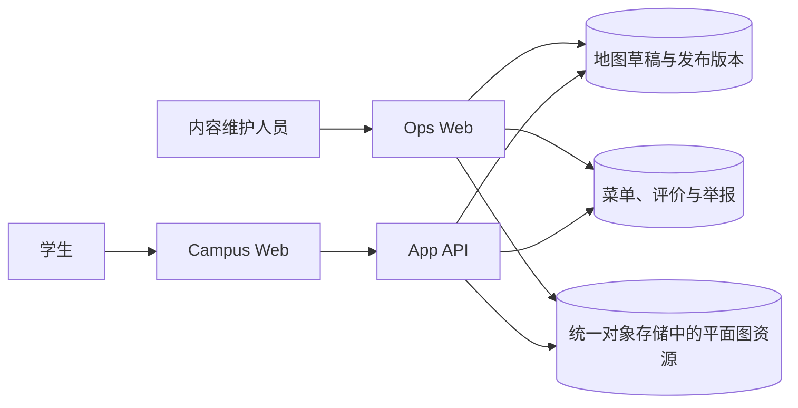

# 食堂

## 目标与边界

学生可以查看食堂平面图、窗口、菜品和价格，并围绕具体菜品查看、发表、删除或举报评价。
内容维护人员在 Ops Web 维护同一份地图和菜单，并处理评价与举报。

本能力不维护营业状态、评分、图片、推荐、自动审核、采集、来源同步或导入导出。菜单和评价由
人员直接维护或提交，不从外部来源自动生成。

## 学生页面

### 地图与窗口

- 页面一次读取当前发布版本的完整地图；
- 食堂、楼层、窗口和已打开菜品同步到 URL，刷新和分享后可以恢复；
- 地图与窗口列表使用同一份数据，窗口搜索在浏览器内完成；
- 页面只读取已发布地图，不能读取草稿或历史版本；
- 地图、资源和菜单失败分别显示错误状态，空地图、空菜单和空评价分别显示空状态；
- 窄屏下选择窗口后进入窗口详情，页面本身不产生横向滚动。

### 菜单与评价

- 选择窗口后读取该窗口当前启用的菜品，按维护顺序显示名称和可选价格文本；
- 选择菜品后从侧边面板查看公开评价；未登录用户也可以查看；
- 登录用户可以提交最多 500 字的文本评价，并选择公开署名或公开匿名；
- 公开匿名只隐藏学生页面上的作者名称，获准内容维护人员仍可查看提交账号；
- 学生不能编辑评价，可以删除自己的评价；删除后不再公开，但记录继续保留；
- 登录用户可以举报他人的评价，原因是垃圾信息、不当内容、隐私问题或其他；
- 同一学生对同一菜品按 `Asia/Shanghai` 自然日最多提交三次，已删除评价仍计入次数；
- 提交评价使用稳定幂等键。网络失败后原样重试不会重复创建，正文或匿名选择变化后使用新键。

## 内容维护

Ops Web 的食堂一级入口包含四个任务页：

- `/dining`：编辑完整地图草稿、发布不可变版本、查看历史并恢复版本；
- `/dining/menu`：新增和修改菜品、移动所属窗口、调整窗口内顺序、归档和恢复菜品；
- `/dining/reviews`：筛选评价、录入普通评价、查看提交身份、修改正文、隐藏或重新公开评价；
- `/dining/reports`：查看待处理与已处理举报，并决定保留或隐藏相关评价。

菜单保存后立即成为当前内容，不经过地图发布流程。菜品直接引用稳定的 `windowId`；地图发布或
恢复若会移除仍被启用菜品引用的窗口，操作必须失败并列出相关窗口。菜品只能归档和恢复，不能
物理删除。

内容维护人员修改评价正文时必须写入修改前后正文、操作者和时间。隐藏不修改正文；重新公开
恢复可见性。内容维护人员只能删除由内容维护人员录入的评价，不能删除学生评价。一次举报处理会
关闭同一评价的全部待处理举报；处理结果只有保留或隐藏。

## HTTP 接口

公开读取：

- `GET /api/dining`
- `GET /api/dining/floorplans/:digest.svg`
- `GET /api/dining/windows/:windowId/menu`
- `GET /api/dining/menu-items/:menuItemId/reviews`

学生登录后写入：

- `POST /api/dining/menu-items/:menuItemId/reviews`
- `DELETE /api/dining/reviews/:reviewId`
- `POST /api/dining/reviews/:reviewId/reports`

Ops Web 的地图、菜单、评价和举报接口统一位于 `/api/ops/dining/*`。精确路径、正文和错误响应以
`apps/ops-web/src/server/app.ts` 及领域 Zod schema 为可执行合同，不在第二篇文档复制。

## 数据与权限



`dining` schema 只保留七张表：

- `map_draft`：唯一完整地图草稿；
- `map_releases`：不可变地图发布版本；
- `map_publication`：当前地图版本指针；
- `menu_items`：菜品、窗口、顺序、价格和归档状态；
- `reviews`：评价正文、提交身份、匿名选择和可见状态；
- `review_reports`：举报原因和处理结果；
- `review_edits`：内容维护人员修改评价正文的历史。

`ops_web` 读写全部七张表。`app_api` 读取当前地图版本、菜单、评价和举报状态；只允许创建或
删除学生自己的评价、创建举报，不读取地图草稿和评价修改历史，也不能修改地图或菜单。两个
运行时使用共享 PostgreSQL 中各自的现有角色，不创建 Dining 专属数据库、角色或连接。

学生删除、内容维护人员删除、隐藏和举报处理都保留原评价记录。这样可以执行每日次数限制、
处理争议并查看操作历史；公开接口不会返回已删除或已隐藏评价。具体用户告知由
`legal-consent.md` 和 Campus Web 法律页面维护。

## 更新与缓存

地图初始化文件只用于空数据库首次初始化，目前只包含已经校准的丰台校区平面图。尚未校对的
食堂不进入初始化数据，由内容维护人员在 Ops Web 完成地图和窗口名称核对后再发布。之后地图由
内容维护人员保存和发布，菜单由内容维护人员直接保存，评价由学生或内容维护人员提交；这些更新
都不修改仓库文件，也不要求重新部署。

地图发布时，Ops Web 先生成平面图 SVG，以 SHA-256 摘要写入统一对象存储的
`dining/floorplans/` 前缀，资源写入成功后才更新当前版本。菜单响应允许浏览器缓存 30 秒、共享
边缘缓存 60 秒，内容维护后的公开传播目标不超过 60 秒。评价响应因包含当前查看者可执行操作而
不进入公开边缘缓存。

## 验收

- 学生可以按食堂和楼层查找窗口，看到该窗口当前菜单并打开菜品评价；
- 地图 URL、菜单 URL 和菜品 URL 刷新后恢复同一选择；
- 菜单加载、空内容、接口失败和重试均有独立页面状态；
- 登录学生可以匿名或署名提交评价，原样重试不重复创建，第四次同日提交被拒绝；
- 学生只能删除自己的评价，只能举报他人的评价；
- 内容维护人员可以完成地图发布与恢复、菜单维护、评价处理和举报处理；
- 删除、隐藏、编辑和举报处理均保留规定的数据与操作历史；
- 地图发布或恢复不能产生仍被启用菜品引用的失效窗口；
- App API 和 Ops Web 的 PostgreSQL 权限与上述边界精确一致；
- 320、390 和 1440 像素宽度下没有页面级横向溢出或不可达操作；
- 页面和接口不出现营业状态、评分、图片、推荐、采集、来源同步或导入导出能力。

## 可执行来源

- 领域合同和数据库 schema：`packages/domains/dining/`
- Ops Web 页面、接口和存储：`apps/ops-web/src/app/dining-*.tsx`、
  `apps/ops-web/src/server/dining-*.ts`
- 数据库安装和授权：`apps/ops-web/ops/db/`
- App API：`apps/app-api/src/app/routes/dining.ts`、`apps/app-api/src/modules/dining/`
- Campus Web：`apps/campus-web/src/components/dining/`、`apps/campus-web/src/features/dining/`

## 验证

```bash
pnpm --dir packages/domains/dining typecheck
pnpm --dir packages/domains/dining test
pnpm --dir apps/app-api typecheck
pnpm --dir apps/app-api test
pnpm --dir apps/campus-web typecheck
pnpm --dir apps/campus-web test
pnpm --dir apps/ops-web typecheck
pnpm --dir apps/ops-web test
pnpm ci:ops-web-postgres
```

学生与内容维护人员的浏览器旅途按影响范围显式运行；本地夹具不能替代部署环境的数据库、对象
存储和访问控制验收。
